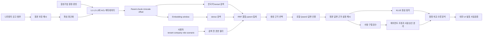

# ASTRA AI 에이전트 프로젝트 인계 문서

> **이 문서는 자동 생성된 인계 초안이며 최신 코드와 실행 기록을 우선한다.**

- GitHub: <https://github.com/YangNaang2/ko-lettucedetect>
- 기준 시각: 2026-09-17 KST
- 작성 브랜치: `presentation/final-deck-v1`
- 작성 직전 기준 커밋: `20a0e42`
- 원격 확인: `git fetch origin --prune` 실행 후 기록

이 문서는 저장소에 처음 접근하는 사람과 AI 에이전트가 ASTRA의 데이터, 권한형 RAG, 로컬 생성, 평가, 환각 탐지, 데모와 발표 자료를 서로 혼동하지 않고 후속 작업을 시작하도록 돕는다. 수치와 상태는 기준 시점의 스냅샷이다. 작업을 시작할 때 반드시 현재 브랜치의 최신 README, manifest, validation 결과와 실행 중인 프로세스를 다시 확인한다.

## 1. 문서의 목적

ASTRA에는 수집 원본, 파싱 결과, 합성 회사 자료, 검색 색인, 생성 답변, 사람 검수, 에이전트 라벨, 탐지기 예측과 발표용 산출물이 함께 존재한다. 이들은 같은 성격의 자료가 아니다. 후속 작업자는 다음 원칙을 먼저 적용한다.

1. 저장소에서 확인되는 코드·manifest·검증 결과를 설명 문서보다 우선한다.
2. 같은 이름의 결과가 여러 브랜치에 있으면 브랜치와 커밋을 함께 기록한다.
3. 구현 완료, 자동검사 완료, 탐색 결과, 사람 승인, 독립 성능 검증을 구분한다.
4. 모델 출력에 맞춰 정답을 바꾸지 않으며, 에이전트 수정과 사람 승인을 분리한다.
5. 기존 정본과 실행 기록을 덮어쓰지 않고 새 `run_id`와 별도 출력 경로를 사용한다.

## 2. 프로젝트 한 문장 정의

**ASTRA는 나라장터 공고와 회사별 증빙을 권한에 맞게 검색하고, 근거가 연결된 답변을 로컬 LLM으로 생성한 뒤 답변의 의심 구절을 근거와 대조하는 조달 검토 지원 시스템이다.**

| 구분 | 내용 |
|---|---|
| 주요 사용자 | 입찰 분석가, 원가 분석가, 승인 담당자, 공개 공고 조회자 |
| 주요 입력 | 나라장터 공고·첨부, 합성 회사 인력·실적·인증·원가 문서, 사용자 질문과 권한·회사·시나리오 |
| 처리 | 수집·파싱 → 문서 등급·ACL → 청킹·임베딩 → lexical+dense+RRF 검색 → 근거 선택 → 로컬 생성 → 인용·구절 검사 |
| 주요 출력 | 근거 인용 답변, 원문 위치, 접근 차단, 저장 답변, 환각 의심 구절과 검수 자료 |
| 차별점 | 공개 공고와 회사 자료를 한 질의 흐름에서 다루되, 검색 전에 권한을 제한하고 답변과 실제 사용 근거를 함께 보존 |

ASTRA는 자동 적격 판정기나 법률 판단 시스템이 아니다. 현재 구현은 별도 그래프 DB 기반 GraphRAG가 아니라 메타데이터가 연결된 하이브리드 검색과 parent 단위 근거 집계다.

## 3. GitHub와 기준 브랜치

기준 시점에 원격에서 직접 확인한 브랜치와 HEAD는 다음과 같다.

| 브랜치 | HEAD | 역할과 상태 |
|---|---:|---|
| `main` | `2c180cd` | 기본 브랜치. `feature/sample-expansion-demo` 병합 이력 포함 |
| `feature/sample-expansion-demo` | `ea4e7a3` | 51개 공고·가상기업·평가·데모 계열 기준. `cb45470` 이후 5개 합성 회사 UI 패키지 추가 |
| `rag/workstation-275` | `772bfd5` | RTX A5000 기반 275개 신규 생성과 기존 25개를 합친 300문항 RAG 실행·복구 기록 |
| `eval/detector-300-v1` | `5381e0a` | 295개 생성 답변의 근거 복원, 3개 탐지기 예측, 잠정 라벨 평가 |
| `feature/detector-quality-v2` | `99de4b7` | KLUE 품질 진단과 고정 분할 실험 |
| `feature/klue-evidence-training-v3` | `5a7d1a6` | KLUE 전체 근거 window 학습과 63건 역사 비교 |
| `feature/klue-review-priority-v4` | `1ae5a8d` | 검수 우선순위 실험과 근거 기반 에이전트 라벨 수정 2건 |
| `feature/klue-false-positive-v5` | `83a8964` | 정상 답변 오탐 억제 GPU 학습과 재현율 trade-off 기록 |
| `feature/klue-regeneration-v6` | `234f5e2` | 숫자 대조 학습, 별도 새 답변 생성, 고정 100건 및 사후 선별 시연 세트 |
| `presentation/final-deck-v1` | `20a0e42` | 밝은 배경의 편집 가능한 발표 초안, 사실검증표와 출처 목록 |

`main`에 자동 병합하지 않는다. 기능 브랜치의 결과를 사용할 때는 해당 브랜치를 checkout하거나 `git show <branch>:<path>`로 읽고, 현재 작업 트리로 무심코 복사하지 않는다. 기준 시점 이후 HEAD가 달라질 수 있으므로 `git fetch origin --prune` 후 `git for-each-ref refs/remotes/origin`으로 다시 확인한다.

## 4. 프로젝트 전체 구조



### 영역별 경계

1. **수집**: 공고 차수와 첨부를 내려받고 원본·실패 사유를 보존한다.
2. **파싱**: 포맷별 어댑터가 텍스트와 구조를 정규화한다. 파싱 실패를 성공으로 세지 않는다.
3. **가상기업**: 실제 기업 정보가 아닌 합성 회사·인력·프로젝트·증빙이다.
4. **문서 등급**: L1 공개, L2 회사 내부, L3 민감 자료를 분리한다.
5. **권한 검색**: 인증, 멤버십, tenant, 회사, 역할, 시나리오를 검색 전에 검사한다.
6. **청킹·임베딩**: 의미 단위 parent와 모델 입력 window를 분리하며 Unicode offset을 유지한다.
7. **검색**: lexical과 dense 결과를 RRF로 결합하고 parent 단위로 집계한다.
8. **생성**: 검색된 실제 근거만 로컬 모델에 전달하고 답변·인용·설정을 저장한다.
9. **평가 300문항**: 검색 코퍼스가 아니라 질문·기대답·근거 연결을 검증하는 평가 자산이다.
10. **사람 검수**: 25문항 제출 의견과 에이전트 조정안이 있으며 사람 최종 승인은 별도다.
11. **환각 탐지**: KLUE를 주력 후보로 실험했지만 운영 성능 확정 단계가 아니다.
12. **데모 UI**: 저장 결과 재생과 실제 로컬 질의 모드가 함께 있으므로 화면에서 구분한다.
13. **발표**: 구현 사실과 성능 결론을 분리하고 모든 수치에 범위와 상태를 붙인다.

## 5. 핵심 수치 원장

| 영역 | 수치 | 정의·분모 | 상태 | 기준 출처 |
|---|---:|---|---|---|
| 공고 수집 | 137,745행 | 2026년 4~6월, 정정·차수 포함 | 확정 | `project-docs/데이터현황/3개월_통합현황.md` |
| 최신 공고 | 124,522건 | 공고별 최신 차수 | 확정 | 같은 파일 |
| 전체 첨부 | 285,252개 | 다운로드·파일 실체 기준 | 확정 | 같은 파일 |
| 사용 가능 첨부 | 246,797개, 87% | 어댑터 판정상 사용 가능 | 확정 | 같은 파일 |
| 재파싱 후 실패 | 3,301개 | 4월 1,408·5월 144·6월 1,749 | 확정 | 같은 파일 |
| 완전 공고 | 용역 28,852·물품 14,145·공사 8,082 | 공고문+RFP/과업/규격서 기준 | 확정 | 같은 파일 |
| 구조 표본 | 51건 | 4·5·6월 각 17건; SW/시스템개발 32, 운영/유지관리 19 | 구조 검증 | `project-docs/데모개선/2026-09-14/existing51-distribution.json` |
| 합성 기업 | 5개 | C01~C05, 실제 회사가 아님 | 자동검사 완료 | `project-docs/가상기업/v1/validation_report.json` |
| 합성 인력 | 45명 | 회사 원장 내 인력 | 자동검사 완료 | 같은 파일 |
| 합성 프로젝트 | 16개 | 회사 원장 내 프로젝트 | 자동검사 완료 | 같은 파일 |
| 합성 증빙 | 111개 | 회사 원장 내 evidence records | 자동검사 완료 | 같은 파일 |
| 문서 템플릿 | 45개 | 합성 문서 생성 템플릿 | 자동검사 완료 | 같은 파일 |
| 검색 문서 | 223개 | L1 167·L2 34·L3 22 | 구조 검증 | `project-docs/RAG파일럿/workstation-275/index_manifest.json` |
| parent 청크 | 3,275개 | L1 3,002·L2 159·L3 114 | 구조 검증 | 같은 파일 |
| embedding window | 7,195개 | 512 token 한도, window 460, stride 420 | 구조 검증 | `project-docs/RAG파일럿/workstation-275/embedding_config.json` |
| 평가 문항 | 300개 | 5개 회사 × 60문항, 51개 공고 | 구조 검증 완료 | `project-docs/평가데이터/v2/validation/report.json` |
| 생성 답변 | 295건 | 정상 차단 5건을 제외한 정본 생성 답변 | 구조 검증 완료 | `project-docs/RAG파일럿/workstation-275/evaluation/final_summary.json` |
| 정상 접근 차단 | 5건 | 권한 정책상 LLM 호출 전 `access_denied` | 자동검사 완료 | 같은 파일 |
| 기존 사람 검수 | 25문항 | 제출된 팀원 의견; 독립 gold test가 아님 | 사람 승인 대기 | `project-docs/환각라벨링/pilot-25-human-review-v1/README.md` |
| 기존 검수 구절 | 68개 | 동의 65·수정 3 | 사람 승인 대기 | 같은 디렉터리 validation/intake 자료 |
| 조정안 구절 | 88개 | unsupported 41·uncertain 16·contradiction 15·citation 14·quality 2 | 사람 승인 대기 | 같은 자료 |
| 3모델 비교 슬롯 | 885개 | KLUE·XLM-R·BGE-M3 × 생성 답변 295건 | 구조 검증 | `eval/detector-300-v1`의 `results-v1` |
| 고정 100건 탐색 | 채점 가능 96건 | 학습 분할 제외 113건에서 예측·라벨 비의존 해시 추출; 기존 잠정 라벨 재사용 | 탐색 결과 | `feature/klue-regeneration-v6`의 `results-v6/sample100/` |

### 탐지 성능 수치를 읽는 법

- v3의 역사 비교 63건: 정상 28건 중 오탐 21건, 환각 35건 중 32건 포착, 답변 재현율 91.43%, 문자 F1 31.13%.
- v5 `.8`: 오탐 10건, 환각 24건 포착, 문자 F1 15.28%. 오탐 감소와 재현율 하락이 함께 발생했다.
- v6 `contrast3/min/.3`: 오탐 14건, 환각 27건 포착, 문자 F1 24.89%.
- v6 고정 100건 중 채점 가능한 96건: v6 답변 정확도 67.71%, 정밀도 77.78%, 재현율 68.85%. 과거에 노출된 개발·비교 자료의 탐색 결과이며 독립 테스트가 아니다.
- `results-v6/showcase*`와 `demo-variants/80`, `demo-variants/85`는 결과를 확인한 뒤 구성한 시연 자산이다. 전체 또는 독립 성능으로 발표하면 안 된다.
- 모든 수치는 사람 최종 승인 라벨 0건 상태의 잠정 결과다. 운영 성능은 **평가 진행 중**이다.

## 6. 주요 디렉터리 안내

| 경로 | 내용 | 수정 시 주의사항 |
|---|---|---|
| `project-docs/` | 프로젝트 설명, 실험 기록, 데이터 현황, 발표 근거 | 같은 주제의 문서가 여러 시점에 존재하므로 날짜와 최신 manifest 확인 |
| `project-docs/데이터현황/` | 4~6월 수집·변환·분야별 집계 | 행 수와 최신 공고 수, 첨부 수의 분모를 섞지 않음 |
| `project-docs/표본_정보시스템/` | 51건 표본, 팀 검수, 원문 재대조 | 전체 나라장터 대표 성능 표본으로 확대 해석 금지 |
| `project-docs/가상기업/v1/` | 회사 원장, 조건 연결, 합성 문서 inventory, ACL 검사 | 실제 기업 자료로 표현 금지; generated 대형 문서의 정본·revision 보존 |
| `project-docs/RAG파일럿/` | 색인 manifest, GPU 실행, 300문항 생성·복구·검증 | `v1`과 `workstation-275` 결과를 혼합하지 않음 |
| `project-docs/평가데이터/v2/` | 300 Q-A-R, schema, retrieval 연결, validation | 평가 정답·라벨을 생성 프롬프트에 유출하지 않음 |
| `project-docs/환각라벨링/` | 25문항 검수와 detector-300 입력·결과 | 브랜치마다 `results-v1`~`v6` 범위가 다름; 사람 승인 상태 확인 |
| `procurement-pipeline/` | 수집 후 가공, 합성 자료, RAG, 생성, 평가, 라벨·탐지 실행 코드 | private 경로와 대형 가중치를 하드코딩·커밋하지 않음 |
| `procurement-pipeline/collector/g2b_rag_pipeline/` | 나라장터 수집 실행기·설정 | API·원천 캐시·실패 재처리 상태 보존 |
| `demo-ui/` | 정적 ORBIT 데모와 spatial POC | 저장 결과 재생과 실시간 질의를 UI에서 명시 |
| `demo-ui/spatial-poc/` | 공개 공고, RAG observatory, L1 서버, 통합 서버·테스트 | 파일럿 세션 정책을 운영 인증·인가로 표현 금지 |
| `output/visuals/` | 발표용 파이프라인·스토리보드 SVG | 시각 자료는 사실 원장이 아니므로 원본 근거와 대조 |
| `presentations/final/` | PPTX/PDF 초안, 사실검증표, 출처 목록, 재생성 코드 | 미검증 성능 수치 추가 금지; 렌더링 후 잘림·겹침 검수 |
| `팀원배포/` | 팀원용 실행·대시보드·평가 패키지 | 패키지 README와 검증 JSON을 함께 전달 |

## 7. 주요 실행 파일

| 파일 | 역할 | 입력 | 출력 | 실행 주의사항 |
|---|---|---|---|---|
| `procurement-pipeline/collector/g2b_rag_pipeline/run.py` | 나라장터 공고·첨부 수집 | config, 기간, 저장소 | raw/manifest/실패 기록 | 기존 cache·API 설정과 rate limit 보존 |
| `procurement-pipeline/adapt_g2b.py` | 수집 자료를 공통 구조로 변환 | raw 수집물 | parsed JSONL·보고서 | 실패를 누락하지 말고 사유 보존 |
| `procurement-pipeline/generate_c01_documents.py` | C01 합성 문서 생성 | 회사 원장·schema | C01 문서·metadata | revision과 hash 확인 |
| `procurement-pipeline/generate_remaining_companies.py` | C02~C05 합성 문서 생성 | 회사 원장·schema | 합성 문서 | 실제 회사 자료와 혼합 금지 |
| `procurement-pipeline/validate_company_master.py` | 합성 원장·연결 검증 | company master, mappings | validation report | 자동검사를 현실 적합성으로 확대 해석 금지 |
| `procurement-pipeline/security_schema.py` | L1/L2/L3·ACL schema와 검사 | 문서·사용자 metadata | 허용/차단 판정 | 역할만 보지 말고 tenant/company/scenario 함께 확인 |
| `procurement-pipeline/rag_pilot.py` | 청킹·검색·RRF·생성 근거 처리의 중심 | 정본 문서·질문·권한 | 검색·근거·생성 요청 | parent와 embedding window를 구분 |
| `procurement-pipeline/rag_pilot_embedding.py` | 임베딩 window와 dense 검색 | parent 청크·E5 | 벡터·검색 결과 | 모델 revision, window/stride, hash 고정 |
| `procurement-pipeline/setup_workstation_rag.py` | 워크스테이션 색인 준비 | 문서·모델 cache | 로컬 index | 기존 index를 덮어쓰지 않음 |
| `procurement-pipeline/start_host_gpu_rag.py` | 기존 GPU RAG 서버 시작·유지 | GGUF·설정·token | llama-server | 다른 실행 중 서버 PID를 종료하지 않음 |
| `procurement-pipeline/run_workstation_shards.py` | 275개 신규 문항 분할 실행·재개 | 요청·shard plan | 문항별 답변 | 완료 건 skip과 config identity 확인 |
| `procurement-pipeline/finalize_workstation_rag.py` | 25+275 결과 정리 | 생성 기록 | final summary·handoff | 5개 정상 차단을 실패로 합치지 않음 |
| `procurement-pipeline/build_qa300.py` | 300문항 평가 자산 구성 | 공고·회사·시나리오 | Q-A-R | 기대답과 생성 입력 분리 |
| `procurement-pipeline/validate_qa300.py` | schema·중복·근거 연결 검증 | Q-A-R | validation report | 구조 검증은 의미 성능이 아님 |
| `procurement-pipeline/prepare_detector300_handoff.py` | detector 입력 무결성·인계 준비 | 정본 답변·근거 | frozen inputs | 먼저 `--check` 실행 |
| `procurement-pipeline/detector300*.py` | v1의 추론·라벨·패키지·채점·검증 | frozen 295·모델 | 예측·잠정 평가 | 실제 코드는 `eval/detector-300-v1` 이상에서 확인 |
| `procurement-pipeline/klue_quality_v3*.py` | 전체 근거 window KLUE 학습·추론 | 학습/개발 분할 | v3 checkpoint·예측 | `feature/klue-evidence-training-v3`에서 확인 |
| `procurement-pipeline/klue_fp_*.py` | 정상 오탐 억제 학습·선택·검증 | v4 수정 라벨·train | v5 실험 프로파일 | 운영 기본값이 아님 |
| `procurement-pipeline/detector_v6_*.py` | v6 학습·새 답변 생성·검증 | 기존 근거·별도 run | v6 결과 | `feature/klue-regeneration-v6`; 생성 실패 2건 보존 |
| `demo-ui/spatial-poc/integrated_server.py` | UI와 로컬 RAG·탐지 연결 | 세션·질문 | HTTP 응답 | 실제 모드와 저장 결과 모드 확인 |
| `presentations/final/source/build_final_deck_v2.mjs` | 33장 편집 가능 발표 초안 재생성 | 저장소 근거·이미지 | PPTX·메모·검증표 | 발표 성능 수치 임의 추가 금지 |

브랜치별 파일은 현재 checkout에 없을 수 있다. 파일명을 추정해 새로 만들지 말고 `git -c core.quotepath=false ls-tree -r --name-only origin/<branch>`로 존재를 확인한다.

## 8. 데이터 흐름과 추적 정보

1. **원천 수집**: 공고 ID, 차수, URL, 다운로드 시각과 파일 실체를 보존한다.
2. **정본 보존**: raw·parsed·JSONL을 분리하고 원본/파싱 hash를 기록한다.
3. **정규화**: 문서별 어댑터 결과와 실패 이유를 남긴다. 읽을 수 없는 16문서는 해당 색인에서 제외하되 inventory에 보존한다.
4. **권한 metadata**: `access_level`, `tenant_id`, `company_id`, `allowed_roles`, `scenario_id` 등을 문서에 연결한다.
5. **parent chunk**: 최대 1,800자, overlap 240자. 생성·인용에 읽을 수 있는 의미 단위로 사용한다.
6. **offset**: Unicode code point 기준 `[start, end)`와 LF 정규화를 사용한다. byte offset과 혼합하지 않는다.
7. **embedding window**: E5 모델 입력용 460 token window, stride 420. 최대 3개 window를 parent 점수에 사용한다.
8. **검색**: 한국어 2글자 lexical 및 영어·숫자 exact, multilingual E5 dense를 계산한다.
9. **결합**: RRF `k=60`으로 순위를 합치고 parent 최대 6개, 생성 근거 최대 4개를 선택한다.
10. **권한 필터**: 허용되지 않은 문서는 검색 결과와 모델 입력에 나타나지 않아야 한다.
11. **생성**: Qwen3-4B GGUF가 실제 선택 근거를 입력받아 답변한다. 평가 정답·라벨은 입력하지 않는다.
12. **정본 답변**: 질문 ID, 답변, 사용 근거 ID, 인용, prompt/config/code/hash와 실행 상태를 묶어 저장한다.
13. **검수**: 답변 구절의 문자 offset과 근거 문서·청크·원문 위치를 연결한다.
14. **탐지**: 동일 정본 답변과 근거를 KLUE 등에 입력하고 모델 예측을 정답 라벨과 분리해 저장한다.

## 9. 권한 모델

| 역할 | L1 공개 | 자기 회사 L2 | 자기 회사 L3 | 대표 용도 |
|---|---|---|---|---|
| `viewer` | 허용 | 차단 | 차단 | 공개 공고 확인 |
| `bid_analyst` | 허용 | 허용 | 차단 | 실적·인력·인증 검토 |
| `cost_analyst` | 허용 | 허용 | 허용 | 원가·견적 검토 |
| `bid_approver` | 허용 | 허용 | 허용 | 투찰 승인 검토 |

서버는 최소한 `authenticated`, `membership_active`, `tenant_id`, `company_id`, `role`, `scenario_id`를 함께 확인한다. 같은 역할이라도 다른 회사 문서, 비활성 사용자, 승인되지 않은 시나리오는 차단한다. 정상 차단 5건은 정책이 의도대로 작동한 결과이며 모델 실패·빈 답변·환각으로 집계하지 않는다.

## 10. 평가 구조

| 평가 층 | 질문 | 현재 해석 |
|---|---|---|
| 자동 구조 검사 | schema·ID·hash·offset·중복·연결이 맞는가 | 통과해도 검색·답변 정확성을 보장하지 않음 |
| 검색 평가 | 필요한 근거가 top 결과에 있는가 | 질문별 gold 근거와 Recall/순위 검증 필요 |
| 생성 평가 | 질문에 답했고 근거와 일치하는가 | 질문 충족도, 누락, 인용과 환각을 함께 봄 |
| 사람 구절 검수 | 어떤 구절이 unsupported/contradiction/citation 등인가 | 제출 의견과 최종 승인을 구분 |
| 에이전트 조정 | 근거 대조 후 라벨 수정안을 제안했는가 | 사람 gold로 승격하지 않음 |
| KLUE 평가 | 동일 근거·답변에서 의심 문자를 찾는가 | 정상 오탐과 환각 누락, span 성능을 같이 보고 |
| XLM-R·BGE-M3 | KLUE 오류를 보완하는가 | 기존 비교 보존; 구체적 가설이 있을 때만 재실행 |
| 운영 검증 | 새 사용자·문서·질문에서 안전하게 일반화하는가 | 아직 완료되지 않음 |

학습 182건, 개발 50건, 역사 비교 63건은 공고 그룹 분할로 관리됐지만 역사 비교 자료는 반복 노출됐다. 새 답변이라도 같은 질문과 근거를 사용하면 완전히 독립적인 평가가 아니다. 학습 암기, 개발 선택, 노출 비교, 독립 테스트를 한 표의 단일 성능으로 합치지 않는다.

## 11. 환각 탐지 현황

### KLUE를 주력으로 둔 이유

한국어 조달 문장과 문자 구간 평가를 직접 다루고, 한 번 로드한 단일 모델로 295건을 처리하며 GPU 학습·재개 경로를 확보했기 때문이다. XLM-R와 BGE-M3의 v1 결과는 비교 기준으로 보존하며 매 실험마다 재실행하지 않는다.

### 현재 확인된 문제

- 정상적인 바꿔 말하기, 조건·예외, 인용 주변을 환각으로 경고하는 오탐이 많다.
- 임계값을 엄격하게 하면 정상 오탐과 함께 실제 환각 재현율도 떨어진다.
- 답변 단위 포착이 높아도 정확한 오류 구절 경계인 exact-span F1은 0일 수 있다.
- 숫자 대조 학습은 통제 실험 대비 명확한 개선을 입증하지 못했다.
- 학습 정상 65건의 오탐 0은 암기 가능성을 포함하며 새 정상 답변에 일반화되지 않았다.
- 모델 단독 성능과 금액·날짜·자격·의무 조건 규칙을 결합한 성능은 별도로 보고해야 한다.

### 발표 가능한 결론

- 295개 정본 답변에 대한 탐지·검수 파이프라인과 재현 가능한 실험 프로파일을 구축했다.
- KLUE에서 오탐 억제와 환각 포착 사이의 trade-off를 실제 GPU 실험으로 확인했다.
- 역사 비교 63건과 고정 100건의 잠정 탐색 결과를 보존했다.
- 운영에서 검증된 80% 정확도나 F1은 확보하지 못했다.

### 발표하면 안 되는 결론

- 사후 선별 50·100건 또는 80/85 시연 파일을 전체 정확도라고 주장하는 것.
- 사람 최종 승인 0건인 잠정 라벨 수치를 독립 gold 성능으로 부르는 것.
- 답변 단위 재현율 91.43%를 정확한 구절을 91.43% 찾았다는 의미로 설명하는 것.
- 학습 자료의 정상 오탐 0건을 임의 질문의 정상 오탐 0으로 일반화하는 것.

## 12. 현재 구현된 것과 미완료 항목

| 기능 | 상태 | 근거 | 남은 작업 |
|---|---|---|---|
| 4~6월 공고·첨부 수집/집계 | 구현 완료 | `project-docs/데이터현황/3개월_통합현황.md` | 실패 문서·누락 공고 추적 지속 |
| 51건 구조 표본과 원문 재대조 | 구조 검증 완료 | `project-docs/표본_정보시스템/검수/` | 전체 대표성 주장 금지 |
| 5개 합성 회사 원장·증빙 | 자동검사 완료 | `project-docs/가상기업/v1/validation_report.json` | 현실성·운영 데이터 연결 별도 검토 |
| L1/L2/L3와 역할 정책 | 자동검사 완료 | `security_schema.py`, ACL 검사 | 운영 인증·인가·감사로그 연결 |
| 223문서/3,275청크 로컬 색인 | 구조 검증 완료 | workstation index manifest | 운영 index 연결 |
| 하이브리드 검색·근거 선택 | 구현 완료 | `rag_pilot.py` | 독립 검색 Recall 평가 |
| Qwen3-4B 로컬 GPU 생성 | 구현 완료 | workstation 환경·final summary | 질문 충족도·사람 승인 평가 |
| 300문항 평가 자산 | 구조 검증 완료 | 평가데이터 v2 validation | 독립 문항과 사람 gold 보강 |
| 295답변+정상 차단5 보존 | 구조 검증 완료 | workstation final summary | 생성 품질 최종 평가 |
| 25문항 사람 의견 접수 | 사람 승인 대기 | pilot-25 human review | 최종 승인·IAA 가능한 중복 검수 |
| KLUE v3~v6 실험 | 평가 진행 중 | 각 브랜치 `results-v*` | 새 독립 자료와 사람 승인 라벨 평가 |
| 새 답변 생성 v6 | 평가 진행 중 | v6 README | 293성공·2실패, 미검토 139건 해결 |
| L1 로컬 질문 UI | 구조 검증 완료 | 데모개선 local-integration | L2/L3 자유 질문 운영 DB 연결 |
| 운영 인증·인가 | 운영 연결 필요 | Live RAG 전환 설계 | 실제 IdP·tenant·감사로그 검증 |

## 13. AI 에이전트 작업 규칙

1. 작업 전 `git status --short`, 현재 branch, `git worktree list`, 관련 프로세스와 GPU 상태를 확인한다.
2. 미커밋 변경과 실행 중인 서버를 보존한다. 기준 시점에는 별도 worktree의 GPU RAG/llama 서버가 장시간 실행 중이었다.
3. fetch는 가능하지만 사용자 승인 없이 기존 작업 브랜치를 reset·rebase·merge하지 않는다.
4. 원본 데이터, 정본 답변, 실제 근거, 가중치와 기존 결과를 덮어쓰지 않는다.
5. 새 실험은 별도 branch/worktree, `run_id`, 출력 디렉터리와 manifest를 사용한다.
6. resume 시 input/config/code/model hash가 일치할 때만 완료 레코드를 재사용한다.
7. 서로 다른 설정의 결과를 같은 run에 이어붙이지 않는다.
8. 모델 예측을 보고 정답 라벨을 유리하게 바꾸지 않는다.
9. 에이전트 초안, 에이전트 승인 수정, 통합 조정안, 사람 최종 승인을 별도 필드로 보존한다.
10. 자동검사 통과를 검색 Recall, 답변 정확도, 탐지 F1 또는 운영 보안 완성으로 표현하지 않는다.
11. `access_denied`를 모델 실패·거절·정상 답변으로 재분류하지 않는다.
12. 유료 API, 새 대형 모델 다운로드, 외부 데이터 업로드는 별도 허가 없이 수행하지 않는다.
13. 원천 공고, 전체 원문 cache, private prompt, 모델 가중치, 대형 probability 배열, index DB, API key를 Git에 추가하지 않는다.
14. 명령, 입력·출력 경로, 모델·코드·설정 hash, 처리시간, GPU/VRAM과 실패를 기록한다.
15. 문서의 주요 주장과 수치는 상대 경로 출처를 연결한다.

## 14. 발표 자료 작성 규칙

- 137,745는 차수를 포함한 공고 행이며 124,522는 최신 차수 공고다.
- 51건은 월별·분야별 구조 표본이며 전체 나라장터 성능 대표 표본이 아니다.
- 직접생산 42, 공동수급 48, 하도급 51, 지역 46, 서비스 인증 5는 조건의 **언급 수**다. 허용·의무·금지 수가 아니다.
- 223문서·3,275청크와 300 Q-A-R은 각각 검색 자산과 평가 자산이다.
- 295는 생성 답변 수이며 5는 정상 접근 차단이다.
- `correct 73 / partial 133 / incorrect 69`는 신규 275건의 에이전트 탐색 분포로 사람 정확도가 아니다.
- 25문항 검수는 독립 gold test가 아니며 최종 사람 승인이 남아 있다.
- 사후 선별 시연 자료는 데모 동작 설명에만 사용하고 전체 성능 표에 넣지 않는다.
- 현재 환각 탐지 운영 성능은 `평가 진행 중`으로 표시한다.
- 파일럿 ACL을 운영 인증·인가 완성으로 표현하지 않는다.

## 15. 처음 읽어야 할 파일

| 순서 | 파일 | 이유·얻는 정보 | 최신성·주의사항 |
|---:|---|---|---|
| 1 | `ASTRA_AI_AGENT_PROJECT_CONTEXT.md` | 전체 지도와 주장 경계 | 이 문서보다 최신 실행 기록 우선 |
| 2 | `project-docs/프로젝트_현황_외부검토용.md` | 외부 설명용 문제·범위 | 최신 manifest와 대조 |
| 3 | `project-docs/데이터현황/3개월_통합현황.md` | 수집 수치와 분모 | 차수 포함/최신 구분 |
| 4 | `project-docs/표본_정보시스템/검수/재확인_원문대조_결과.md` | 51건 중 쟁점 원문 재대조 | 전수 법률 검증 아님 |
| 5 | `project-docs/가상기업/v1/README.md` | 합성 기업 구조 | 실제 기업 자료 아님 |
| 6 | `project-docs/가상기업/v1/validation_report.json` | 원장·연결·접근 검사 | 자동검사 범위만 의미 |
| 7 | `project-docs/RAG파일럿/workstation-275/README.md` | GPU RAG 실행 구조 | 해당 브랜치/시점 확인 |
| 8 | `project-docs/RAG파일럿/workstation-275/index_manifest.json` | 문서·청크·등급 | production index 아님 |
| 9 | `project-docs/RAG파일럿/workstation-275/evaluation/final_summary.json` | 295 생성·5 차단·오류 | 정본 집계 기준 |
| 10 | `project-docs/평가데이터/v2/README.md` | 300 Q-A-R 설계 | 검색 코퍼스와 구분 |
| 11 | `project-docs/평가데이터/v2/validation/report.json` | 평가 데이터 구조 검증 | 성능 검증 아님 |
| 12 | `procurement-pipeline/rag_pilot.py` | 검색·집계·근거 처리 구현 | 문서 설명보다 코드 우선 |
| 13 | `procurement-pipeline/security_schema.py` | 권한 schema·불변조건 | 운영 인증 체계와 구분 |
| 14 | `project-docs/환각라벨링/pilot-25-human-review-v1/README.md` | 기존 사람 검수 상태 | 최종 승인 pending |
| 15 | `project-docs/환각라벨링/detector-300-workstation-v1/WORKSTATION_PROMPT.md` | 탐지 평가 계약 | `eval/detector-300-v1` 이상에서 결과 확인 |
| 16 | 브랜치별 `results-v3`~`results-v6/README.md` | KLUE 실험, 실패·trade-off | 현재 checkout에 없을 수 있음 |
| 17 | `project-docs/데모개선/2026-09-15/local-integration/README.md` | UI와 로컬 모델 연결 | 저장/실시간 모드 구분 |
| 18 | `presentations/final/ASTRA_최종발표_내용확장_초안_v2_사실검증표.md` | 슬라이드 주장별 근거 | 기준 커밋 이후 변경 재확인 |

## 16. 작업별 시작점

| 작업 | 먼저 볼 파일·명령 |
|---|---|
| 데이터 수집 수정 | `procurement-pipeline/collector/g2b_rag_pipeline/README.md`, `run.py`, 월별 수집현황 |
| 파싱 문제 조사 | `adapt_g2b.py`, 월별 `adapt_report.json`, `tools/g2b_reset_failed_parse.py` |
| 합성 회사 수정 | `project-docs/가상기업/v1/company_master.json`, schema, `validate_company_master.py` |
| 권한 정책 수정 | `security_schema.py`, `rag_pilot.py`의 역할 mapping, `access_rule_checks.json` |
| 검색 품질 개선 | `rag_pilot.py`, `rag_pilot_embedding.py`, retrieval manifest, workstation validation |
| 새 답변 생성 | workstation README, `start_host_gpu_rag.py`, `run_workstation_shards.py`; 새 run 사용 |
| 평가 300 수정 | `build_qa300.py`, schema, `validate_qa300.py`; baseline hash 보존 |
| 사람 라벨 검수 | pilot-25 README/GUIDELINES, 제출 원본, adjudication proposals |
| detector-300 재현 | `python procurement-pipeline/prepare_detector300_handoff.py --check` 후 해당 브랜치 README |
| KLUE 학습·평가 | v3/v5/v6 브랜치의 README와 `klue_*`/`detector_v6_*` 코드 |
| 데모 UI 수정 | `demo-ui/spatial-poc/설계_및_실행가이드.md`, local integration README, tests |
| 발표 자료 수정 | PPT 인수인계 prompt, v2 사실검증표·출처목록, builder와 전체 렌더링 |

## 17. 알려진 한계와 미해결 문제

| 문제 | 영향 범위 | 관련 파일 | 현재 처리 | 다음 검증 |
|---|---|---|---|---|
| 파싱 후 사용할 수 없는 첨부 | 검색 코퍼스 누락 가능 | 데이터현황과 adapt report | 실패 이유 별도 보존 | 포맷별 재파싱·OCR 정책 |
| 51건 표본의 대표성 없음 | 전체 성능 일반화 불가 | 표본 문서 | 구조 설명에만 사용 | 독립 층화 표본 확대 |
| 운영 index 미연결 | 데모와 운영 간 차이 | workstation manifest | SQLite/NumPy 로컬 실험 | 운영 DB/index 계약 검증 |
| 검색 Recall 미확정 | 생성 전에 근거 누락 가능 | retrieval manifest | 구조·연결 검증 | 독립 질문별 gold 근거 평가 |
| 생성 답변 사람 gold 부족 | 생성 품질 확정 불가 | final summary·pilot 25 | 에이전트 탐색과 사람 의견 분리 | 중복 사람 검수·승인 |
| 탐지 정상 오탐·환각 누락 | 경고 신뢰도와 안전성 저하 | results-v3~v6 | 여러 운영점과 실패 기록 | 새 독립 자료·보정·오류유형별 평가 |
| exact-span F1 0 | 정확한 구절 강조 불안정 | v3/v5 README | 답변 단위와 문자 단위 분리 보고 | span 학습·경계 규칙 검증 |
| v6 생성 실패 2건 | 새 답변 295 전체 비교 불가 | v6 README | 실패 원문·사유 보존 | parser 계약 수정 후 별도 run |
| v6 새 답변 미검토 139건 | C/D 결론 불완전 | validation-progress | 미검토를 정상으로 세지 않음 | 예측 비노출 근거 검수 |
| L2/L3 자유 질문 운영 연결 미완료 | 실제 내부자료 데모 제한 | Live RAG 전환 설계 | L1 로컬 질문 중심 | 실제 인증·회사 DB와 통합 |
| 운영 인증·감사로그 미완료 | 보안 완성 주장 불가 | spatial POC 설계 | 파일럿 ACL 검사 | IdP·tenant·audit 종단 검증 |

## 18. AI 에이전트용 시작 프롬프트

아래 문장을 팀원의 AI 에이전트에 복사한다.

```text
다음 GitHub 저장소와 프로젝트 인계 문서를 먼저 읽고 ASTRA 프로젝트의 현재 상태를 파악해라.

GitHub:
https://github.com/YangNaang2/ko-lettucedetect

인계 문서:
ASTRA_AI_AGENT_PROJECT_CONTEXT.md

작업 전 원격을 fetch하고 현재 브랜치, 미커밋 변경, worktree, 실행 중인 프로세스를 확인해 보존해라. 기존 결과를 덮어쓰거나 main에 자동 병합하지 마라.

확인되지 않은 성능 수치를 만들지 말고 구현 사실, 자동검사, 탐색 결과, 에이전트 라벨, 사람 승인과 모델 성능을 구분해라. 51건 표본, 25문항 사람 검수, 역사 비교 63건, 고정 100건과 사후 선별 데모 세트의 범위를 서로 바꾸어 말하지 마라.

이후 내가 요청한 작업을 실제 파일과 실행 결과에 근거해 수행하고, 주요 주장마다 저장소 상대 경로와 기준 브랜치·커밋을 남겨라.
```

---

문서 내용과 저장소가 충돌하면 저장소의 최신 코드, manifest, validation 결과와 실제 실행 기록을 우선한다. 다만 최신이라는 이유만으로 실험 결과를 운영 승인으로 간주하지 않는다.
