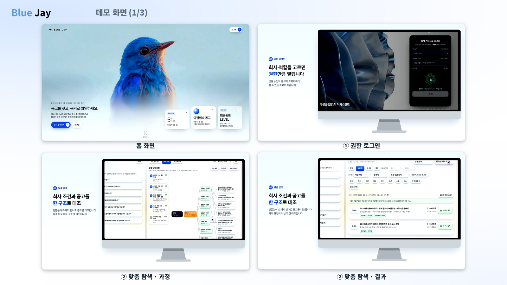
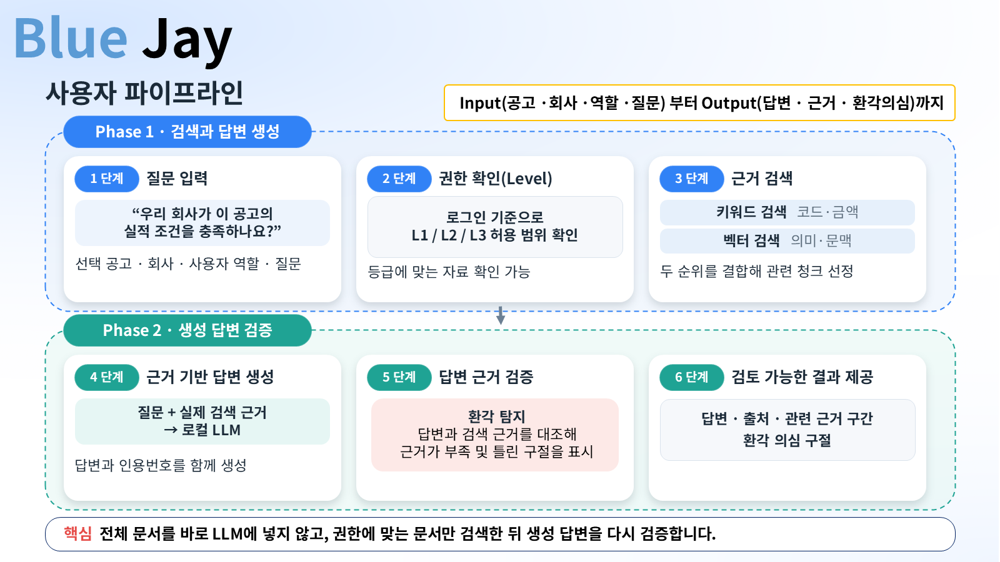
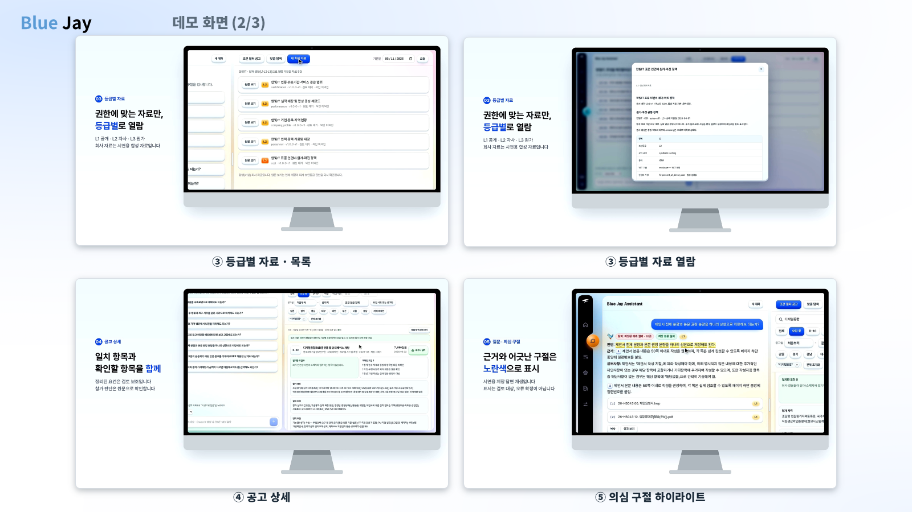

# Blue Jay

### 권한별 문서 검색과 환각 의심 구절 검증을 결합한 공공입찰 AI 어시스턴트

**복잡한 공고는 근거를 찾아 답하고, AI 답변은 다시 근거와 대조합니다.**

Blue Jay는 나라장터 공고와 기업 자료를 함께 검토하는 입찰 담당자를 위한 프로젝트입니다. 사용자에게 허용된 문서에서 관련 근거를 찾고, 로컬 LLM이 만든 답변에서 근거와 어긋나거나 뒷받침되지 않는 구절을 표시해 검토를 돕습니다.

포스코 청년 AI·Big Data 아카데미 34기 B1조 프로젝트입니다. 저장소명은 `ko-lettucedetect`, 초기 서비스명은 `ASTRA`이며, 최종 발표에서는 **Blue Jay**를 사용합니다.

[최종 발표 PPT](https://github.com/YangNaang2/ko-lettucedetect/blob/bb6b2ff2c158123eb5b997020f53bbc47801d4be/presentations/final/최종리허설_LastDanceV2!.pptx) · [종합 보고서](https://github.com/YangNaang2/ko-lettucedetect/blob/bb6b2ff2c158123eb5b997020f53bbc47801d4be/output/pdf/Blue_Jay_공공입찰_AI_종합보고서.pdf) · [300문항 데이터셋](project-docs/평가데이터/v2/README.md) · [데모 실행](#데모-실행)



*최종 PPT에 수록한 시연 화면입니다. 아래 실행 안내는 이 저장소의 개발용 대시보드 기준이며, 발표 화면과 UI 버전·모델 설정이 다를 수 있습니다.*

## 프로젝트가 해결하려는 문제

입찰 담당자는 공고문·제안요청서에 흩어진 참가자격, 실적, 인력, 인증, 금액과 일정을 회사 자료와 비교해야 합니다. 이 과정에는 세 가지 문제가 함께 존재합니다.

| 문제 | Blue Jay의 접근 |
|---|---|
| 긴 문서 여러 개에서 필요한 조건을 찾기 어려움 | 키워드와 의미를 함께 검색하고 답변에 출처 연결 |
| 회사 내부 자료와 원가·투찰 전략의 접근 범위가 다름 | 회사·역할·문서 등급에 따라 검색 후보 제한 |
| 문서를 제공해도 AI가 근거와 다른 답변을 생성할 수 있음 | 학습한 탐지기로 답변의 환각 의심 구절 표시 |

목표는 **담당자가 근거를 확인하며 판단할 수 있는 입찰 검토 지원**입니다. 개별 조건의 충족을 전체 입찰 적격 판정으로 확대하지 않습니다.

## 사용자는 이렇게 이용합니다



1. **공고 선택·질문** — 검토할 공고와 질문을 정합니다.
2. **권한 확인** — 회사와 사용자 역할에 맞는 문서만 검색 후보로 둡니다.
3. **근거 검색** — 키워드·벡터 검색 순위를 결합해 관련 구간을 찾습니다.
4. **답변 생성** — 로컬 LLM에 질문과 검색 근거를 전달하고 인용을 포함한 답변을 받습니다.
5. **환각 탐지** — 생성 답변을 실제 전달된 근거와 대조해 의심 구절을 찾습니다.
6. **결과 검토** — 답변, 출처, 의심 구절을 함께 확인합니다.

현재 개발용 통합 서버의 탐지는 **답변 생성 완료 후** 수행합니다. 탐지하지 못한 구절도 있을 수 있으며, 미검출은 답변의 정확성을 보증하지 않습니다.

## 데이터 구축: 공고 51건 · 가상 기업 5곳 · 평가 질문 300건

### 나라장터 공고 수집과 정제

2026년 4·5·6월 나라장터 API 수집 자료를 원본, 파싱 텍스트, 구조화 레코드로 관리하고 문서 확보 상태와 분야를 비교했습니다.

| 산출물 | 담긴 내용 |
|---|---|
| `raw/` | 다운로드한 원본 첨부문서 |
| `parsed/` | 원본에서 추출한 텍스트 |
| `jsonl` | 공고·첨부·처리 결과 등을 레코드 단위로 기록한 데이터 |

[`adapt_g2b.py`](procurement-pipeline/adapt_g2b.py)는 수집기 출력을 공통 파이프라인 입력으로 변환하고, [`prepare.py`](procurement-pipeline/prepare.py)는 문서 확보 상태를 검사·집계해 표본 선정을 지원합니다.

| 업무 구분 | 공고 | 사용 가능한 문서 | 완전 공고 |
|---|---:|---:|---:|
| 용역 | 50,717 | 102,702 | 28,852 |
| 물품 | 32,673 | 66,298 | 14,145 |
| 공사 | 38,839 | 73,038 | 8,082 |

위 표는 [3개월 통합 현황](project-docs/데이터현황/3개월_통합현황.md)의 업무별 집계입니다. ‘완전 공고’는 **공고문 + 제안요청서 또는 과업·규격서**를 확보한 기준입니다. 발표의 ‘약 13만 건’은 수집 규모를 나타내는 표현이며, 차수·중복 처리 전후 집계를 구분해야 합니다.

이 중 **정보시스템 구축·운영** 분야를 선정하고, 세 달에서 17건씩 총 **51건**을 추출했습니다. 팀원들이 공고문과 첨부문서를 대조해 요건 시트를 작성했으며, 원문 충돌과 자료부족도 기록했습니다.

### 가상 기업과 L1·L2·L3

실제 공고의 조건을 비교·검증할 수 있도록 서로 다른 강점과 제약을 가진 **합성 가상 기업**을 설계했습니다. 공고에서 실제 기업 정보를 추출한 것은 아닙니다.

| 기업 | 지역·전문 분야 | 대표 강점과 제약 — 회사 마스터 v1 기준 |
|---|---|---|
| 가상 한빛IT | 서울 · 공공 웹·포털 | 개발 인력 풍부 / 정보통신공사업 면허 미보유 |
| 가상 해온시스템 | 부산 · 관제망·네트워크 유지관리 | 관련 면허 보유 / 일부 인증 만료 |
| 가상 인우블록 | 인천 · 블록체인·모바일 | 전문 개발 역량 / 작은 인력 풀·실적 증빙 제약 |
| 가상 누리클라우드 | 대전 · 클라우드·보안 운영 | 관련 면허·ISO 인증 / 서비스 CSAP 증빙 미확보 |
| 가상 새온에너지SW | 전남 · EMS·PMS | 에너지 제어·제조 역량 / 정보통신공사업 면허 미보유 |

| 등급 | 자료 | 접근 원칙 |
|---|---|---|
| **L1 공개** | 나라장터 공고문·제안요청서·과업·규격 문서 | 요청 범위에 맞는 공개 문서 |
| **L2 회사 내부** | 실적·인력·경력·등록·인증 대장 | 해당 회사의 허용된 역할 |
| **L3 민감** | 인건비·원가·견적 가정·투찰 검토 | 해당 회사의 추가 권한을 가진 역할 |

L2·L3는 회사 마스터의 공통 사실을 기준으로 생성하고, 공고별 배치·비용 계획은 별도 시나리오로 관리합니다. 합성 증빙은 실제 기관 발급 증명서가 아니며, 인증 만료·증빙 미확보 상태도 유지합니다. 보안 등급만 높다고 다른 회사의 문서를 볼 수 있는 구조는 아닙니다.

→ [회사 마스터·문서 설계](project-docs/가상기업/v1/README.md) · [권한 스키마](procurement-pipeline/security_schema.py)

### 질문·기대답·근거 300건

가상 기업별 60건씩 구성해 **51건 공고를 모두 포함**했습니다. 참가자격, 실적, 인력, 인증, 공동수급, 원가 계산, 경계값, 자료부족·충돌, 권한 차단을 다룹니다.

| Q · 질문 | A · 기대답 | R · 근거 |
|---|---|---|
| 회사와 공고 조건을 비교하는 예상 질문 | 조건별 판단과 추가 확인 사항 | 실제 공고 인용 + 합성 회사 문서 + 필요 시 계산·합성 시나리오 |

- 구성: 답변 218건 · 조건부 답변 59건 · 자료부족 안내 18건 · 접근 거절 5건.
- 질문·기대답·판정 자료는 **평가 폴더에 분리**하며 검색 코퍼스에 넣지 않습니다.
- 기대답 작성, 실제 LLM 답변 생성, 환각 구절 라벨링은 서로 다른 단계입니다.

→ [300건 JSONL](project-docs/평가데이터/v2/evaluation/questions_300.jsonl) · [검토용 CSV](project-docs/평가데이터/v2/evaluation/questions_300.csv) · [실제 구성 분포](project-docs/평가데이터/v2/evaluation/distribution.json)

## 검색과 답변 생성

### Parent와 Embedding Window를 분리한 청킹

긴 조항의 의미는 보존하면서 질문과의 관련성을 세밀하게 계산하기 위해 두 단위를 사용합니다.

| 단위 | 최종 PPT·후속 Window 384 실험 설정 | 역할 |
|---|---|---|
| **Parent** | 최대 약 1,800자 · 겹침 240자 | 답변 생성과 사람이 읽을 근거 문맥 |
| **Embedding Window** | 최대 384토큰 · 겹침 40토큰 | Parent 내부의 의미 검색 입력 |

문자 수와 토큰 수는 서로 다른 단위입니다. 여러 Window로 Parent를 덮어 임베딩하고, 검색된 구간을 Parent 근거에 연결합니다. 이전 파일럿의 460토큰 설정과 후속 384토큰 설정은 버전으로 구분합니다.

### 하이브리드 검색 → 로컬 생성

```text
질문 + 공고·회사·역할·시나리오
             ↓
     권한에 맞는 문서 후보
             ↓
  키워드 검색 + E5 벡터 검색
             ↓
   RRF 순위 결합 · 중복 억제
             ↓
    최대 6개 검색 근거 후보
             ↓
  생성에 사용할 최대 4개 Parent
             ↓
  로컬 LLM → 답변과 인용번호
```

RRF는 검색 점수의 크기를 직접 섞지 않고 **각 검색의 순위**를 결합합니다. 동일 문서의 크게 겹치는 구간은 중복을 억제하며, 입력 길이 제한에 따라 최종 근거 수는 줄어들 수 있습니다. 탐지에는 검색 후보 전체가 아니라 **실제 생성에 사용한 근거**를 연결합니다.

| 역할 | 모델·구현 | 용도 |
|---|---|---|
| 검색 임베딩 | `intfloat/multilingual-e5-small` | 질문·문서의 의미 유사도 계산 |
| 답변 생성 | **Qwen3-8B** — 최종 PPT의 선정 모델 | 검색 근거를 바탕으로 답변 작성 |
| 환각 탐지 | **BGE-M3 기반 토큰 분류기** — KLUE·XLM-R도 비교 | 답변 속 의심 구절 예측 |
| 학습 데이터 번역 | Gemma-3-12B | RAGTruth의 한국어 학습 자료 구축 |

생성 모델은 정답률·환각률·형식 준수·응답 속도와 메모리 사용을 함께 고려해 선정했습니다. 번역·검색·생성·탐지 모델은 각각 다른 역할을 맡습니다.

→ [배치 RAG 코드](procurement-pipeline/rag_pilot.py) · [청킹 비교 실험](https://github.com/YangNaang2/ko-lettucedetect/blob/590aadf/project-docs/RAG파일럿/chunk-ablation-v1/README.md)

## 한국어 환각 탐지 모델

RAGTruth의 환각 구절에 태그를 붙여 한국어로 번역하고, 번역된 답변의 문자 위치를 다시 계산해 학습 데이터를 만들었습니다. 자동 구조 검사를 통과한 자료는 **17,537건**, 기존 학습·평가 분할은 **14,863 / 2,674건**입니다. 구조 검사 통과가 번역의 의미 정확성을 보장하는 것은 아닙니다.

탐지기는 **질문·근거·답변**을 함께 입력받는 이진 토큰 분류 모델입니다. 학습 시 답변 영역의 토큰을 `SUPPORTED / HALLUCINATED`로 분류하도록 학습합니다.

```text
질문 + 생성에 사용한 근거 + AI 답변
                   ↓
            학습된 토큰 분류기
                   ↓
      토큰 점수 → 답변 문자 구간으로 변환
                   ↓
       환각 의심 구절 형광펜 + 출처 확인
```

표시는 정본 답변의 문자 위치에 연결합니다. 긴 입력은 윈도우로 처리하고, 미검사 구간·탐지 실패와 정상적인 미검출을 구분합니다. ‘지지·모순·정보부족’의 3분류나 오류 문장의 자동 수정을 수행하는 모델은 아닙니다.



→ [학습 데이터 구성 코드](src/dataset.py) · [탐지 추론 코드](demo/detector.py) · [대시보드 탐지 연결부](demo-ui/spatial-poc/detector_bridge.py)

## 평가 결과와 해석 범위

### 한국어 번역 데이터의 탐지 실험

| 모델 | 기록된 토큰 Macro F1 | 실험 조건 요약 |
|---|---:|---|
| XLM-RoBERTa | 0.6527 | 기본 다국어 모델 실험 |
| KLUE-RoBERTa | 0.6980 | 슬라이딩 윈도우·임계값 조정 포함 |
| BGE-M3 | 0.7385 | 2,048토큰·임계값 조정 기록 |

Macro F1은 정상·환각 클래스의 F1을 동일한 비중으로 평균합니다. 위 값은 [기존 학습 기록](project-docs/Claude_인수인계_2026-09-11.md)에 정리된 결과이며, **문맥 길이와 추론·임계값 조건이 달라 동일 조건의 독립 모델 비교가 아닙니다.** 조달 서비스의 답변 정확도와도 구분합니다.

### 조달 데이터 검색·실행 검증

| 검증 | 확인된 결과 | 의미 |
|---|---|---|
| 청킹 설정 8종 비교 | 평가 가능한 292문항에서 비교 | 동일 자료에서 청크 설정의 영향 확인 |
| Parent 1,800 / Window 384 | Hit@6 **79.79%**, MRR@6 **0.6096** | 검색 근거 도달률·순위 품질 |
| Window 384 후속 실행 | 300건 중 **답변 생성 295건 · 접근 차단 5건** | 실행·출처 연결 결과, 정답 수 아님 |

[청킹 실험 원본](https://github.com/YangNaang2/ko-lettucedetect/blob/590aadf/project-docs/RAG파일럿/chunk-ablation-v1/README.md)에서 384토큰의 Hit@6 개선은 기존 460토큰 대비 292건 중 순증 4건이었습니다. 개발 중 확인한 자료이므로 독립 평가로 표현하지 않습니다. [후속 실행 요약](https://github.com/YangNaang2/ko-lettucedetect/blob/590aadf/project-docs/RAG파일럿/window384-run-v1/evaluation/final_summary.json)에는 잘못된 인용이 있는 답변 2건과 사람 승인 `pending` 상태도 남아 있습니다.

<details>
<summary>시연 수치와 사람 검수의 범위</summary>

- 최종 PPT의 **100건·80%**는 선별된 시연 자료를 사용한 수치입니다. 전체 데이터의 독립 성능 추정치로 제시하지 않습니다.
- **11% → 2.2%**는 환각률 11%와 탐지 재현율 80%를 가정한 계산 예시입니다. 실제 서비스에서 측정한 환각 감소율이 아닙니다.
- 팀원 4명이 검수한 **25문항**은 제출 의견과 통합 조정안이 보존돼 있으며, [해당 버전](project-docs/환각라벨링/pilot-25-human-review-v1/README.md)의 최종 사람 승인은 `pending`입니다. 이를 300문항 전체의 승인 완료로 확대하지 않습니다.

</details>

## 데모 실행

Python 3.10 이상과 Git이 필요합니다. **저장 결과 모드**는 모델 다운로드 없이 실행할 수 있습니다.

```bash
git clone https://github.com/YangNaang2/ko-lettucedetect.git
cd ko-lettucedetect
python demo-ui/spatial-poc/integrated_server.py --generator disconnected --port 8769
```

브라우저에서 **http://127.0.0.1:8769/rag-observatory.html**을 엽니다. 공고 지도는 **http://127.0.0.1:8769/public-notices.html**에서 확인합니다. 종료는 실행 터미널에서 `Ctrl+C`입니다.

| 실행 범위 | 현재 저장소에서의 동작 |
|---|---|
| 저장 결과 모드 | 공고·예시 질문·저장 답변·출처 확인. 자유 질문의 새 답변은 생성하지 않음 |
| 로컬 공개 L1 서버 | 선택 공고의 공개 문서 검색. 현재 이 서버는 키워드 검색이며, 위 배치 하이브리드 검색과 구분 |
| 실제 생성·탐지 | 로컬 생성 서버·기존 색인·탐지 체크포인트를 별도 준비하고 연결 |
| 내부 검수 | 별도 개발용 접근 키로 검수 자료 조회. 운영용 회사 인증을 대신하지 않음 |
| L2·L3 자유 질문 | 배치 평가의 권한 검증과 별개로, 공개 개발 서버에는 미연결 |

모델·색인·전체 원천 캐시·비밀키는 저장소에 포함하지 않습니다. 설정 파일의 모델명이 바뀌었다고 실제 설치·연결 모델이 바뀐 것으로 간주하지 않습니다. 기존 연결 검증에는 Qwen2.5-1.5B 등 다른 모델도 사용됐으므로, **실행 시 서버 상태와 모델 식별자를 확인**해야 합니다.

실제 모델 연결, Windows·Linux 실행 절차, 테스트 명령은 [개발 패키지 안내](팀원배포/dashboard-integration-v1/README.md)와 [설정 예시](팀원배포/dashboard-integration-v1/.env.example)에 정리돼 있습니다.

## 저장소 안내

| 경로 | 내용 |
|---|---|
| [`procurement-pipeline/`](procurement-pipeline/) | 수집·정제, 회사 문서·평가 자료 생성, 권한·RAG 실행·검증 |
| [`src/`](src/) · [`scripts/`](scripts/) | 번역 데이터 처리·탐지 모델 학습·평가 |
| [`demo/`](demo/) | 학습한 환각 탐지기의 추론 |
| [`demo-ui/spatial-poc/`](demo-ui/spatial-poc/) | 지도·질문 대시보드·공개 L1 서버·내부 검수 |
| [`project-docs/`](project-docs/) | 데이터 현황·합성 기업·평가셋·실행 결과·검수 기록 |
| [`팀원배포/`](팀원배포/) | 개발 환경·배포·협업 안내 |
| [`docs/assets/`](docs/assets/) | 최종 발표에서 추출한 README 이미지 |

README는 최종 발표의 흐름을 기준으로 구성했습니다. 수치·화면·구현 상태의 출처와 버전은 [README 근거 기록](docs/README_SOURCES.md)에서 확인할 수 있습니다. 초기 번역 파일럿 안내는 [이전 README](https://github.com/YangNaang2/ko-lettucedetect/blob/bb6b2ff2c158123eb5b997020f53bbc47801d4be/README.md)에 보존돼 있습니다.

## 팀

**포스코 청년 AI·Big Data 아카데미 34기 B1조**
강인수 · 박승형 · 박지훈 · 양진우 · 이선희 · 임성민
