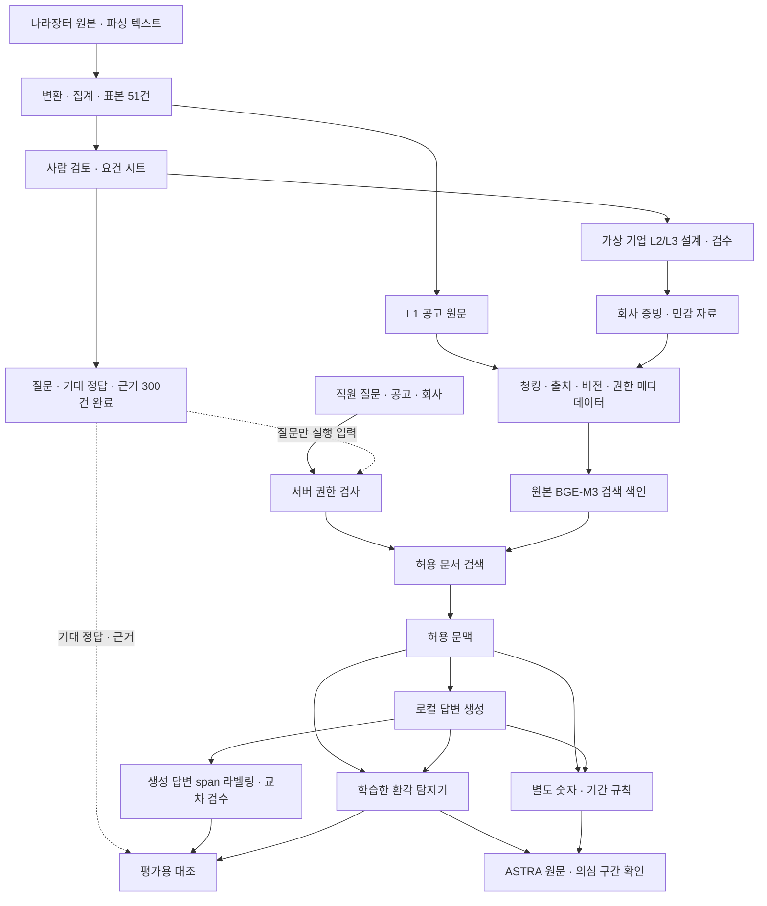

# B1조 3주차 발표 기획안 — 질문·정답·근거 300건 구축

작성 기준: 2026-09-13. 최종 결과 발표가 아닌 중간 마일스톤 발표용이다. 이 파일은 PPT 제작용 기획안·상세 원고이며, 기존 v5 PPT에 자동 반영된 수정본은 아니다.

## 발표 방향

**추천 프로젝트명: 나라장터 입찰 검토를 위한 권한 기반 RAG와 한국어 환각 탐지**

부제: **B1조 3주차 진행 보고 — 질문·기대 정답·근거 300건 구축과 통합 설계**

발표 흐름은 “문서 기반 답변의 오류를 탐지하는 연구”에서 “공개 공고와 비공개 회사 자료를 함께 다루는 입찰 검토 시스템”으로 확장한 이유를 중심으로 잡는다. 환각 탐지는 시스템의 핵심 검증 엔진으로 설명하고, 데이터 준비·문서 접근·평가 자산·실연결 계획에 충분한 비중을 둔다. 권장 발표 시간은 약 9~10분이다. 시간은 편집 제안이며 확정된 발표 제한 시간이 아니다.

### 이번 기획에서 확정한 사실의 범위

- 사용자가 2026-09-13에 확인한 최신 상태: **질문·기대 정답·근거 300건 완료**.
- 이는 생성 답변의 환각 구간(span) 라벨링 완료를 뜻하지 않는다.
- 완성된 300건 파일 자체는 이번 작업에 제공되지 않았다. 유형별 건수·권한별 비율·근거 완비율·중복률·기업별 분포는 실측하지 않았으므로 쓰지 않는다.
- 9/11 팀공유 문서와 9/12 업무분담표의 과거 진행 상태보다 사용자의 위 완료 확인을 우선한다. 그 밖의 기업 합성·API 통합·실제 인가·폐쇄망 운영 완료까지 확대해서 해석하지 않는다.
- 검증되지 않은 수치를 발표하지 않는 팀공유 문서 7절을 계속 적용한다.

### Gemini 제안에서 수정한 내용

| 원래 제안 | 이번 발표의 처리 |
|---|---|
| 외교부 가이드라인 대응을 프로젝트명에 명시 | 특정 지침의 요구사항과 구현 대응 근거가 없어 제목에서 제외 |
| 비취인가를 사내 RBAC와 동일하게 소개 | 비밀취급인가 용어와 프로젝트의 사내 문서 접근 모델을 구분 |
| MSDS를 현재 주력 도메인으로 설명 | 초기 문제 검토 단계로 짧게 소개, 현재 주력은 정보시스템 구축·운영 입찰 |
| 13~38%를 RAG 전체 성능 또는 모델 크기와 무관한 법칙으로 설명 | PDF의 문서 직접 주입 실험이라는 범위를 지키고, 이번 본문에서는 원실험 재검증 전 수치 제외 |
| 단국대 논문 수치 0.99/0.50을 실패·성능 순위로 단정 | 원논문 지표·조건 확인 전 수치 제외, 일관성과 문서 지지 여부의 차이에 집중 |
| 2주차 200건 검증에서 이번 300건 평가셋으로 확대 | PDF의 200건 파일럿은 번역·태그 보존 맥락. 서로 다른 자산이므로 연속된 표본 증가로 표현하지 않음 |
| 300건 구절 정답 라벨링 완료 | 질문·기대 정답·근거 완료로 수정. 실제 생성 답변의 구절 라벨링은 다음 단계 |
| KLUE 최종 채택·CPU 실시간 성능 보장 | 학습한 인코더 기반 탐지기로 표기. 실제 연결 모델·조건 확정과 지연 측정은 후속 |
| 에어갭·외부 API 통신 차단 완료 | 사내 처리 및 폐쇄망 배포 목표로 표기. 운영 검증 완료 주장 제외 |
| 같은 300건으로 파인튜닝과 최종 평가 | 개발용·최종 평가용 분리를 먼저 정하고 평가 자료 유출 방지 |
| 4~6주차 확정 로드맵 | 기존 10/2 발표 일정과 어긋날 수 있어 후속 단계와 완료 조건으로 제시 |

## 공통 시각화 규칙

- 16:9 기준. 이전 PDF의 밝은 배경·짙은 남색 제목·분홍 강조를 유지한다. 3D 공간 화면과 성능표는 다시 넣지 않는다.
- 제목 30~36pt, 본문 20~24pt를 시작점으로 한다. 한 페이지에서 말할 주장 하나를 제목과 한 줄 메시지에 담는다.
- 초록은 확인된 완료, 파랑은 자료 흐름, 분홍은 의심 구간·핵심 성과, 회색 점선은 설계·후속 단계에 사용한다.
- 발표 본문의 “완료” 배지는 300건 질문·정답·근거에 붙인다. 구성 설명용 예시에는 “설명용 예시”를 표시한다.
- 첨부 구조도는 작은 글자가 많고 미검증 F1 및 과거 상태를 포함한다. 제작 시 원본을 그대로 축소해서 붙이지 않고, 원본의 다섯 가로 구역과 연결 관계를 보존한 보정본을 사용한다. 7페이지는 전체 구조, 8페이지는 서비스 구역 확대 설명이다.
- 아래 각 슬라이드의 다섯 필드가 제작용 입력이다. `---`는 슬라이드 경계로 활용할 수 있다. 발표자 스크립트와 출처·편집 메모는 화면이 아니라 발표자 노트에 넣는다.

---

## Slide 1

### [슬라이드 제목]

나라장터 입찰 검토를 위한 권한 기반 RAG와 한국어 환각 탐지

### [핵심 메시지 (1줄)]

허용된 문서에 근거해 답하고, 의심되는 구절을 원문과 함께 확인한다.

### [상세 본문 불릿포인트]

- B1조 3주차 진행 보고
- 질문·기대 정답·근거 300건 구축과 통합 파이프라인 설계
- Finding Hallucination / ko-LettuceDetect / ASTRA
- 강인수 · 박승형 · 박지훈 · 양진우 · 이선희 · 임성민

### [시각화/레이아웃 가이드]

왼쪽 70%에 프로젝트명을 두 줄로 크게 배치하고, 아래에 부제와 팀원을 둔다. 오른쪽에는 “공개 공고 / 회사 증빙 / 근거 검토”의 세 텍스트를 단순 연결한다. 화면 하단에 “3주차 중간 보고” 배지를 둔다. 기관 로고나 인증 마크는 사용하지 않는다.

### [발표자 스크립트]

저희는 한국어 AI 답변의 환각 구간을 찾는 모델에서 출발했습니다. 지금은 그 모델을 나라장터 입찰 검토 업무에 적용하면서, 회사별 문서 접근 권한까지 함께 다루는 시스템으로 확장하고 있습니다. 이번 주의 핵심 성과는 질문과 기대 정답, 근거를 연결한 300건의 검수 자산을 완성한 것입니다. 오늘은 왜 이 업무로 확장했는지, 300건이 어떤 역할을 하는지, 그리고 실제 서비스로 어떻게 연결할지를 말씀드리겠습니다.

출처·편집 메모: 팀원 이름은 첨부 PDF 1페이지 표기를 따른다. 프로젝트명은 미확인 기관 지침 준수 표현을 제외한 추천안이다.

---

## Slide 2

### [슬라이드 제목]

문서를 제공해도 답변이 그 문서를 지킨다는 보장은 없다

### [핵심 메시지 (1줄)]

초기 MSDS 검토에서 확인한 문제는 질문 대상과 문서 근거가 어긋나는 답변이었다.

### [상세 본문 불릿포인트]

- 초기 적용: MSDS의 문서 기반 답변 검토
- 선정 이유: 물질·조건을 잘못 연결한 답변이 안전 판단을 혼동시킬 수 있음
- 이전 발표 사례: 톨루엔 자료를 주고 다른 물질을 질문했을 때, 제공 자료의 내용을 다른 물질에 적용
- 문서 확보에 더해 질문 대상·조건·답변의 근거 일치를 확인할 필요
- 현재 적용 도메인: 나라장터 정보시스템 구축·운영 입찰

### [시각화/레이아웃 가이드]

왼쪽에 “제공 문서: 톨루엔”과 “질문 대상: 에탄올”을 나란히 두고 대상 이름만 서로 다른 색으로 표시한다. 오른쪽에는 “질문 대상에 대한 근거가 부족한데 다른 물질의 내용을 적용”이라고 적는다. 이전 PDF의 화학물질 수치와 막대그래프는 재사용하지 않는다. 하단에 “초기 실험은 검색 없이 문서를 직접 주입”을 작게 명시한다.

### [발표자 스크립트]

처음에는 문서 기반 답변의 오류를 확인하기 위해 MSDS를 살펴봤습니다. 이전 발표에서는 톨루엔 자료를 제공하고 다른 물질을 질문했는데, 제공된 자료의 내용을 다른 물질의 답처럼 사용하는 사례를 소개했습니다. 이 실험은 검색기를 포함한 전체 RAG 평가가 아니라, 문서를 직접 제공한 조건의 검토였습니다. 여기서 얻은 문제의식은 문서가 입력에 있다는 사실만으로 답변이 그 문서를 적절하게 사용했다고 볼 수 없다는 것입니다. 저희는 이 문제를 실제 입찰 조건과 회사 자료를 대조하는 업무로 확장했습니다.

출처·편집 메모: 첨부 PDF 3~4페이지. 화학물질 취급 지침이나 노출 기준을 제시하는 슬라이드가 아니다. 13~38%와 “모델 크기와 무관” 주장은 이번 화면에서 제외한다.

---

## Slide 3

### [슬라이드 제목]

나라장터에서는 답변의 근거와 자료 접근 권한을 함께 확인해야 한다

### [핵심 메시지 (1줄)]

입찰 검토는 공개 공고와 비공개 회사 증빙을 조건별로 대조하는 업무다.

### [상세 본문 불릿포인트]

- 사용자: 정보시스템 구축·운영 입찰을 준비하는 기업의 제안팀
- 공고 측 조건: 참가자격·실적·인력·인증·금액·일정
- 회사 측 근거: 실적 증빙·보유 인력·인증·원가 자료
- 질문: “우리 회사가 이 공고의 조건을 충족하는가?”
- 필요 기능: 관련 근거 검색, 회사·프로젝트별 접근 제한, 답변의 의심 구간 확인

### [시각화/레이아웃 가이드]

왼쪽에 공개 공고, 오른쪽에 회사 증빙을 배치하고 가운데에 “조건 대조”를 둔다. 회사 증빙 아래에 L2 내부·L3 민감 표식을 붙인다. 하단에는 “같은 질문이라도 허용된 자료에 따라 답변 범위가 달라진다”를 강조한다. 실제 기업명이나 가상 실적 수치를 성과처럼 제시하지 않는다.

### [발표자 스크립트]

나라장터로 확장한 이유는 문서의 조건을 회사 자료와 대조하는 업무가 명확하기 때문입니다. 공고에는 어떤 실적과 인력이 필요한지 적혀 있고, 회사에는 그 조건을 확인할 증빙이 있습니다. 사용자는 이 둘을 연결해서 참가 가능 여부를 검토해야 합니다. 그런데 모든 직원이 모든 회사 자료를 볼 수는 없습니다. 따라서 정확한 답변을 만드는 문제와 어떤 자료를 검색에 사용할 수 있는지를 함께 해결해야 합니다. 저희의 현재 목표는 이 검토 과정을 지원하는 것입니다.

출처·편집 메모: 팀공유 문서의 정보시스템 구축·운영 분야 결정, 요건 추출 작성 요령, Live RAG 설계. 공개 공고와 회사 증빙의 결합은 프로젝트의 대상 업무 설명이며 시장 성과를 뜻하지 않는다.

---

## Slide 4

### [슬라이드 제목]

답변 일관성에서 문서 근거와 구절 검토로

### [핵심 메시지 (1줄)]

같은 답을 반복하는지와 근거 문서가 그 답을 지지하는지는 다른 질문이다.

### [상세 본문 불릿포인트]

| 접근 | 확인하는 것 | 우리 설계에 주는 의미 |
|---|---|---|
| 답변 일관성 기반 판정 | 여러 번 생성한 답변이 비슷한가 | 반복된 답의 문서 근거는 별도로 확인해야 함 |
| 문서 근거 기반 판정 | 입력 문서가 생성 답변을 지지하는가 | 실제 검색 문맥과 답변을 함께 검토 |
| 구절 단위 탐지 | 답변의 어느 부분이 의심스러운가 | 원문과 나란히 확인할 위치를 표시 |

- RAGTruth의 구간 라벨과 LettuceDetect 계열 접근을 한국어 탐지에 활용
- 숫자·기간 조건 비교는 학습된 환각 탐지와 별도 규칙으로 처리

### [시각화/레이아웃 가이드]

화면 위쪽에 간결한 비교표, 아래쪽에 “답변 전체” 속 일부 단어만 분홍 밑줄로 표시한 설명용 문장을 둔다. O/X 점수판이나 선행연구 성능 순위 차트는 넣지 않는다. 원문 근거 표시와 탐지기의 의심 구간 표시를 서로 다른 색으로 구분한다.

### [발표자 스크립트]

2주차에서는 답변을 여러 번 생성했을 때의 일관성을 활용하는 선행 접근을 검토했습니다. 다만 같은 답이 반복된다는 사실만으로 그 답이 문서에 근거한다고 판단할 수는 없습니다. 저희는 검색에 사용한 문서와 생성 답변을 함께 보고, 답변 전체를 하나의 결과로 처리하기보다 의심되는 구절의 위치를 표시하는 방향을 택했습니다. 이 탐지기는 입력 문서에 대한 지지 여부를 판단하는 모델입니다. 숫자와 기간을 정확하게 비교하는 일은 별도 규칙 검증으로 보완합니다.

출처·편집 메모: 첨부 PDF 5페이지의 선행연구 소개, 팀공유 7절. PDF에 기재된 단국대 2025 석사논문의 원문 지표·조건을 이번에 재확인하지 못했으므로 0.99/0.50 및 “찍기 수준”은 재인용하지 않는다. 본 표는 개념 비교이며 실험 성능 비교가 아니다.

---

## Slide 5

### [슬라이드 제목]

최종 목표: 허용된 문서로 답하고 원문에서 확인하는 입찰 검토

### [핵심 메시지 (1줄)]

문서 접근 통제와 답변 근거 검증을 하나의 검토 흐름으로 연결한다.

### [상세 본문 불릿포인트]

| 프로젝트 문서 등급 | 자료 예시 | 접근 설계 |
|---|---|---|
| L1 공개 | 나라장터 공고·RFP·과업 문서 | 공개 범위에서 검색 |
| L2 내부·대외비 | 회사 실적·인력·인증 | 회사·프로젝트·문서 권한 확인 |
| L3 민감·기밀 | 원가·투찰 전략·협력사 견적 | 해당 자료 승인과 유효기간 추가 확인 |

- 서버가 권한을 확인한 자료만 검색·생성·원문 열람에 사용
- 사내 모델 실행을 지향하고 폐쇄망 배포 가능성 검토
- 의심 구간과 근거를 제시하며 최종 판단은 담당자가 수행
- 비취인가: 비밀취급인가를 가리키는 용어. 위 L1~L3는 프로젝트의 사내 분류 예시

### [시각화/레이아웃 가이드]

중앙에 자료 등급 표를 배치한다. 하단 왼쪽에는 “등급은 문서에 / 허용은 요청 조건으로”를 적고, 오른쪽에는 “목표 구조 · 실제 인가 통합 예정” 배지를 둔다. L3를 높은 직급의 사용자에게 자동 허용하는 피라미드 그림은 쓰지 않는다. 법정 비밀 등급·실제 인가 취득과 동일시하지 않는다는 주석을 단다.

### [발표자 스크립트]

최종 목표는 허용된 자료를 바탕으로 입찰 조건을 검토하고, 답변의 의심 부분을 원문에서 확인하는 흐름입니다. 문서는 공개 공고, 회사 내부 자료, 민감 자료로 나누되 사람의 직급만으로 접근 범위를 정하지 않습니다. 회사와 담당 프로젝트, 자료별 승인 조건을 서버가 확인해야 합니다. 첨부 자료에서 사용한 비취인가는 비밀취급인가를 뜻하지만, 저희의 사내 분류 예시를 국가 비밀 등급이나 인가 취득 실적으로 소개하지는 않습니다. 로컬 처리와 폐쇄망 배포도 운영 목표이며 지금 검증이 끝났다는 의미는 아닙니다.

출처·편집 메모: Live 설계의 tenant·access_grants·기본 거부 정책 및 이전 사용자 첨부 추진배경 문서의 조건부 접근 방향. 법적 의무나 특정 정부 지침 준수를 설명하는 페이지가 아니다.

---

## Slide 6

### [슬라이드 제목]

3주차 성과: 질문·기대 정답·근거 300건 구축 완료

### [핵심 메시지 (1줄)]

이제 시스템의 답변을 사전에 정리한 기준과 대조할 수 있다.

### [상세 본문 불릿포인트]

- **완료: 검수 질문·기대 정답·근거 300건**
- 기반 작업: 선정 공고 51건의 요건 추출과 원문 근거 정리
- 쓰임: RAG 답변의 근거·조건 대조, 실패 사례 검토, 후속 라벨링 기준
- 구분: 질문의 기대 정답과 실제 생성 답변의 환각 span 라벨은 별도 자산
- 다음 단계: 고정된 질문으로 답변 생성 후 의심 구간 라벨링·교차 검수

설명용 질문 축 — 실제 유형별 건수나 비율을 나타내지 않음:

| 질문 축 | 질문 예시 | 필요한 근거 |
|---|---|---|
| 공고 사실 확인 | 제출 마감과 사업 기간은 언제인가? | 공고·정정 문서 |
| 조건 충족 검토 | 회사 실적으로 해당 조건을 충족하는가? | 공고 요건 + 회사 증빙 |
| 자료 부족·불일치 | 서로 다른 날짜 중 무엇을 확인해야 하는가? | 각 문서의 버전·위치 |

### [시각화/레이아웃 가이드]

왼쪽 35%에 큰 숫자 “300”과 “질문·기대 정답·근거 완료”를 둔다. 오른쪽은 작은 질문 예시 표로 무엇을 만든 것인지 설명한다. 하단에 “생성 답변의 span 라벨링은 다음 단계”를 표시한다. “300건 정답률”, “300건 환각 라벨 완료” 같은 배지는 쓰지 않는다. 확정되지 않은 분포를 도넛·막대그래프로 만들지 않는다.

### [발표자 스크립트]

이번 주 핵심 성과는 검수 질문과 기대 정답, 근거를 연결한 300건을 구축한 것입니다. 앞서 정리한 공고 요건과 근거 위치를 활용해 시스템에 무엇을 물어보고 어떤 답을 기대하는지 기준을 마련했습니다. 이 자산이 있으면 실제 답변이 나왔을 때 공고 조건을 놓쳤는지, 근거가 부족한데도 결론을 내렸는지 확인할 수 있습니다. 다만 이것은 생성된 답변의 모든 환각 구간을 라벨링했다는 뜻은 아닙니다. 다음에는 고정된 질문으로 답변을 생성하고, 그 답변을 문맥과 대조해 구절 라벨을 만드는 작업이 이어집니다.

출처·편집 메모: 완료 수량과 범위는 사용자의 최신 확인에 따른다. 실물 300건 파일의 배분과 열 구성은 미확인이다. 위 질문 축은 기존 업무 설계에 근거한 설명 예시이며 완성 파일의 실측 분포가 아니다. 기업별 확정 증빙과 정답 연결의 검수 여부는 파일 인수 시 별도로 확인한다.

---

## Slide 7

### [슬라이드 제목]

전체 구조: 원문·요건 시트·검수셋을 각각 연결한다

### [핵심 메시지 (1줄)]

검색할 자료와 정답 기준을 분리하고, 그 사이를 문서·공고·회사 ID로 연결한다.

### [상세 본문 불릿포인트]

1. 수집: 나라장터 원본과 파싱 텍스트, 문서 버전 보관
2. 변환·선정: 어댑터·집계와 정보시스템 공고 51건 표본
3. 사람 검토: 요건 시트와 질문·기대 정답·근거 300건
4. 자료 구성: 실제 L1 공고 + 별도로 설계·검수할 합성 기업 L2/L3
5. 서비스·검증: 권한 검색·답변 생성·환각 탐지·원문 확인

- 원문 청크: RAG가 검색할 자료
- 요건 CSV: 질문·기업 자료·조건 검토의 기준
- 질문·정답: 검색 DB에 섞지 않고 평가용으로 별도 관리

### [시각화/레이아웃 가이드]

첨부 `프로젝트_구조.png`의 다섯 가로 구역을 그대로 사용하되 각 구역의 대표 상자와 화살표만 남긴 보정 구조도를 화면의 약 80%에 배치한다. 긴 설명·파일별 부가 수치·F1 표기는 제거한다. ③ 사람 작업 구역과 “질문·정답·근거 300건 완료”에 분홍 테두리를 주고, 합성 기업과 서비스 통합에는 회색 점선으로 예정 상태를 표시한다. 정답표에서 검색 DB로 들어가는 화살표는 만들지 않는다. 검수 질문은 실행 입력으로, 기대 정답·근거는 평가 대조선으로 분리한다.

### [발표자 스크립트]

이 구조도는 위에서 아래로 읽으면 됩니다. 먼저 나라장터 문서를 모아 원본과 파싱 텍스트를 보관하고, 어댑터와 집계를 통해 대상 공고를 선정합니다. 사람이 읽어 정리한 요건 시트는 질문과 정답 기준을 만들고 가상 기업을 설계하는 데 사용합니다. 원문은 별도로 청킹해서 검색 자료로 들어갑니다. 즉 CSV 컬럼이 그대로 RAG의 청크가 되는 것은 아닙니다. 이번에 완료한 300건은 실제 시스템의 답변을 확인하는 기준이며, 정답을 검색 DB에 넣어 답을 찾게 하지 않습니다. 회사 자료까지 같은 ID와 버전으로 연결한 뒤 아래 서비스 흐름을 완성할 계획입니다.

출처·편집 메모: 사용자 첨부 구조도, 요건 작성 요령, Live 설계. 원본의 `F1 0.74`, 재파싱 복구율, 원문 크기 등은 이 페이지에서 생략한다. `prepare.py`의 기업 합성용 요약 패킷과 최종 RAG 전체 검색 색인은 같은 산출물로 간주하지 않는다.

---

## Slide 8

### [슬라이드 제목]

한 질문의 처리: 권한 검색에서 원문 검토까지

### [핵심 메시지 (1줄)]

생성 모델과 탐지기에 같은 허용 문맥을 전달하고, 원문 위치까지 연결한다.

### [상세 본문 불릿포인트]

1. **검색 준비:** 원문 청킹·문서 버전·회사·권한 정보를 연결하고 원본 BGE-M3로 색인
2. **권한 검색:** 서버가 회사·프로젝트·승인 조건을 확인한 뒤 허용된 근거를 검색
3. **답변 생성:** 로컬 Gemma에 질문과 허용 문맥을 전달하고 답변 스트리밍
4. **검증·표시:** 학습한 토큰 탐지기로 의심 span을 찾고, 숫자 규칙과 원문 대조를 별도로 제공

- 검색용 원본 BGE-M3와 학습한 환각 탐지기는 역할·모델 경로를 분리
- API 설계: FastAPI REST + POST NDJSON / PostgreSQL·pgvector
- GraphRAG: 요건·증빙 관계를 활용한 후속 검색 확장, 실제 연결은 별도 구현

### [시각화/레이아웃 가이드]

첨부 구조도 ⑤ 서비스 구역을 확대·재구성한다. 질문에서 권한 검색·생성·검토로 이어지는 네 단계는 위쪽 가로 흐름으로, BGE-M3 색인은 검색 아래 보조 상자로 둔다. “허용 문맥”에서 생성 모델과 탐지기로 각각 선을 연결한다. 숫자 규칙은 탐지 결과가 있어야만 실행되는 직렬 단계로 그리지 않고, 문서와 답변을 받는 별도 검증 가지로 둔다. 실제 3D 화면은 공개하지 않는다.

### [발표자 스크립트]

아래 서비스 구역을 확대하면 한 질문이 처리되는 흐름입니다. 서버가 권한을 확인하고 원본 BGE-M3로 색인한 자료에서 관련 근거를 찾습니다. 로컬 생성 모델은 그 근거로 답변을 만들고, 탐지기는 같은 문맥과 최종 답변을 받아 의심 구간을 표시합니다. 검색 임베딩과 환각 탐지 모델은 서로 다른 역할입니다. 숫자와 기간의 조건 비교 역시 별도 규칙으로 처리합니다. 사용자는 그 결과와 원문을 함께 확인하게 됩니다. 이 전체 연결은 목표 구조이며, 실제 인가와 API 통합은 다음 단계입니다.

출처·편집 메모: Live 설계의 8~9절. 모델을 KLUE로 최종 확정하거나 CPU 지연을 보장하지 않는다. Qwen은 필수 병행 구성으로 추가하지 않는다. 새 질문·공고 선택으로 바뀐 응답이 이전 답변과 섞이지 않도록 공고 snapshot·회사 자료 버전·답변 해시를 연결하는 설계다. 인용 위치 연결 자체가 주장의 참을 보장하지는 않는다.

---

## Slide 9

### [슬라이드 제목]

다음 마일스톤: 300건으로 실행하고, 라벨링하고, 통합한다

### [핵심 메시지 (1줄)]

완성한 기준표를 재현 가능한 답변 검수와 서비스 시연으로 연결한다.

### [상세 본문 불릿포인트]

| 단계 | 주요 작업 | 완료 조건 |
|---|---|---|
| 검수 자산 고정 | 300건 ID·기대 정답·근거 버전 점검, 기업 증빙 연결 확인, 개발·평가 분리 | 같은 질문과 근거를 다시 실행할 수 있음 |
| 실제 답변 검수 | 고정 모델로 답변 생성, 환각 span 라벨링, 불일치 교차 검토 | 답변·문맥·정답 span이 연결됨 |
| 서비스 통합 | 권한 검색·생성·탐지 API와 ASTRA 원문 표시 연결 | 질문에서 근거·의심 구간까지 동일 버전으로 동작 |
| 최종 시연 준비 | 승인 전후·타 회사·타 프로젝트 차단, 오류 사례와 한계 정리 | 시나리오를 반복 실행하고 결과를 설명할 수 있음 |

- 모델 추가 학습·임계값 조정은 개발용 자료에서 수행
- 최종 평가용 자료는 조정에 사용하지 않고 보존
- 기존 계획의 10/2 발표를 기준으로 세부 일정 재조정

### [시각화/레이아웃 가이드]

가로 타임라인을 사용하되 날짜를 새로 만들지 않고 단계·제출물·완료 조건을 배치한다. “현재: 질문·정답·근거 300건 완료”를 시작점에 둔다. 성능 목표 숫자와 달성률 그래프는 넣지 않는다. 마지막에는 “권한 있는 근거로 답변하고 원문에서 확인”이라는 목표로 돌아온다.

### [발표자 스크립트]

다음 작업은 완성한 300건을 실행 가능한 검수 자산으로 고정하는 것입니다. 문서와 회사 자료의 버전을 맞추고, 개발에 쓸 자료와 최종 평가 자료를 먼저 구분하겠습니다. 이후 실제 답변을 생성해 환각 구간을 라벨링하고, 판단이 다른 사례를 교차 검토합니다. 동시에 검색·생성·탐지 API를 ASTRA에 연결하고, 승인 전후와 다른 회사·프로젝트에 대한 접근 차단을 확인하겠습니다. 최종 발표에서는 이 흐름을 반복해서 보여주고, 구현 범위와 남은 한계를 함께 설명하겠습니다.

출처·편집 메모: 기존 업무분담은 10/2 발표, 답변 생성 후 라벨링·교차 검수·통합 순서다. 300건 완료를 반영해 후속 단계 중심으로 조정한 제안이며 새로운 확정 주차 일정이 아니다. 공고·회사·유사 질문이 개발·평가 양쪽에 중복되어 결과를 쉽게 만들지 않도록 분할 단위를 점검한다. Span F1 등의 수치는 라벨링과 조건 고정 후 산출할 수 있으며 이번 발표에는 지표 표를 추가하지 않는다.

---

## 구조도 보정용 제작 명세

원본 이미지: `C:/Users/aidan/Desktop/프로젝트_구조.png`. 원본 파일은 변경하지 않았다. 아래는 이미지의 연결 관계를 바탕으로 제작할 보정 도식이다. 실선은 데이터 관계, 예정 배지는 구현 상태를 뜻하도록 분리한다. 원본의 실선을 구현 완료 표시로 해석하지 않는다.

제작 시 추가로 고칠 사항:

- 질문 묶음 실행에는 공고·회사·사용자 권한 조건을 함께 연결한다. 위 도식의 점선 입력은 이를 포함하는 검수 실행을 뜻한다.
- 원본의 “가상 기업 5곳”은 계획 수량으로 남기거나 수량을 생략한다. 사용자가 별도로 완료를 확인하지 않았다.
- “회사+등급” 필터를 회사·프로젝트·자료별 승인으로 확장해 표기한다.
- `F1 0.74`, `92~95%`, `원본 151개·텍스트 430만 자`는 전체 구조 설명에 불필요하므로 보정본에서 제거한다.
- 성능을 나타내는 장식 차트, 비공개 공간 시연, 검증되지 않은 실시간 지연 배지는 삽입하지 않는다.
- 보정 이미지를 제작할 때에는 이 파일과 같은 커밋 원칙에 따라 저장소에 저장하고 검토 후 커밋한다.

## 근거 목록

1. 사용자 첨부 `B1 AI 프로젝트 2주차 발표 자료_파이프라인추가.pdf`, 7페이지 전체를 렌더링하여 확인. 1페이지 표지·팀원·파일럿, 3~4페이지 MSDS, 5페이지 선행연구, 6페이지 번역 파이프라인, 7페이지 과거 보안 RAG 설계.
2. 사용자 첨부 `프로젝트_구조.png`, 수집·집계·사람 작업·문서 등급·서비스의 다섯 구역.
3. 사용자 2026-09-13 확인: 질문·기대 정답·근거까지 300건 완료. 생성 답변 span 라벨링 완료와 구분.
4. [팀공유 문서와 7절](../../project-docs/프로젝트_진행현황_팀공유_2026-09-11.md).
5. [3개월 통합 현황](../../project-docs/데이터현황/3개월_통합현황.md).
6. [팀원별 업무분담](../../project-docs/팀원별_업무분담_2026-09-12.md).
7. [요건 추출 작성 요령](../../project-docs/표본_정보시스템/요건추출_작성요령.md).
8. [Live RAG 전환 설계](../../demo-ui/spatial-poc/live-design/Live_RAG_전환설계.md).

첨부 자료는 발표의 참고 근거로 사용했다. 그 안의 과거 계획·미확인 수치·기관 준수 주장은 이번 사용자의 사실 확인 및 팀공유 7절보다 우선하지 않는다. 원천 공고·기업 자료·모델 가중치·키와 완성된 평가 정답 데이터는 이 기획안에 포함하지 않는다.
