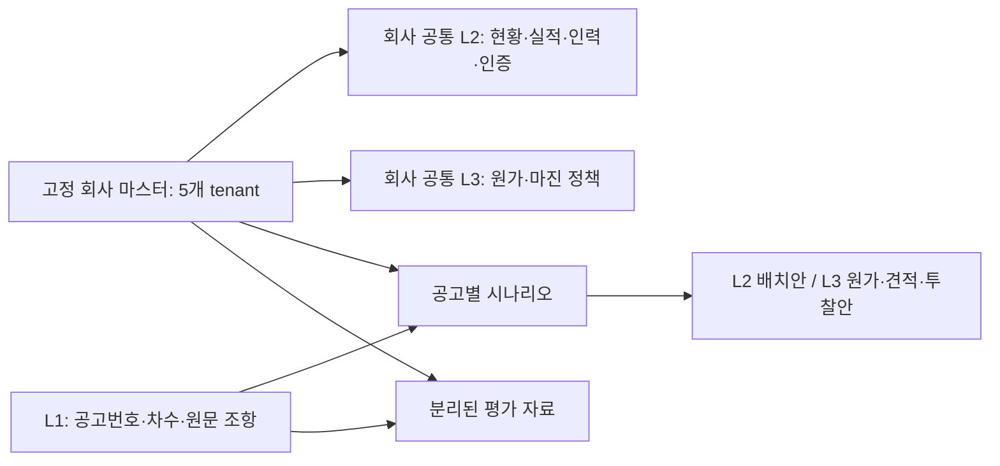

# ASTRA 가상 입찰 기업 5곳 — 공통 마스터 v1

작성일 **2026-09-13**, 합성 회사 상태 기준일 **2026-04-01**, 데이터 버전 **1.0.0**.

이 원장은 51건의 공개 공고와 비교할 **가상 회사의 공통 사실**이다. 공고마다 회사의 주소·면허·실적을 바꾸지 않는다. 모든 회사·인력·실적·고객·인증 보유·원가는 합성 설정이며, 실제 등록·수주·인증 발급 사실이 아니다. 원문의 업종코드와 조건은 원문 추출값이지만 **그 코드를 가상 회사가 보유한다는 설정은 합성값**이다.

현재 완료한 것은 회사 마스터, 문서 생성 목록, 조건 연결표, 질문·기대답·근거 예제다. **전체 L2/L3 문서·질문 300건·생성 답변의 환각 구간 레이블은 아직 만들지 않았다.**

## 1. 회사 비교

다음 인원·지역·등록·강점·제약은 모두 합성 설계다. 인원 수는 원장에 수록한 전체 인력 명부의 계산값이며 실제 회사 조사 결과가 아니다.

| ID / 회사 | 본점·규모·인원 | 주력 분야 | 주요 보유 설정 | 제약과 검증 포인트 |
|---|---|---|---|---|
| C01 / **가상 한빛IT** | 서울 / 소기업 / 12명 | 공공 웹·포털, 자료 아카이브, 데이터 연계 | SW 1468, 개발·유지관리 직접생산 | 정보통신공사업 0036 미보유. 실적 7천만원 경계, 1원 미달, 증빙 없는 실적을 구분 |
| C02 / **가상 해온시스템** | 부산 / 소기업 / 8명 | 도시 관제망, 네트워크·GPU 운영 | 1468·0036, 유지관리 직접생산, 중급 정보통신기술자 | 개발 직접생산은 2026-03-31 만료. 중급 인력은 기존 과업에 0.5 FTE 투입 중 |
| C03 / **가상 인우블록** | 인천 / 소기업 / 6명 | 블록체인 시민서비스·모바일 지갑 | 1468, 개발·유지관리 직접생산 | 2022년 설립, 작은 인력 풀과 일부 미확보 실적 증빙. 공동수급 수·지분과 실제 구성원 자격을 분리 |
| C04 / **가상 누리클라우드** | 대전 / 소기업 / 10명 | 클라우드 운영·보안 구성·데이터 연계 | 1468·0036, 유지관리 직접생산, 회사 ISO27001 | 공급 예정 **서비스의 CSAP 증빙 미확보**. 회사 인증으로 서비스 인증을 대체할 수 없음 |
| C05 / **가상 새온에너지SW** | 전남 / 중기업 / 9명 | EMS·PMS, ESS·PV 연계, 산업 모니터링 | 1468·제조업 28123, 모니터링장치 직접생산 | 에너지 분야에 특화. 총 9명 중 정규직 8명이며 기술인력 인정 여부는 별도. 일반 포털·타 지역 조건까지 통과하는 회사가 아님 |

5곳 모두 중소기업 범주의 합성 설정이다. `소기업/중기업`은 가상 확인 레코드로 정했으며 인원만으로 법적 기업 규모를 산정한 것이 아니다. 설립일·인력 규모·원가율을 특정 공고의 정답에 맞춰 역산하지 않았다. **7천만원/69,999,999원 실적 쌍만 명시적인 경계값 테스트 설정**이다.

## 2. 51건에서 무엇을 읽고 반영했는가

정본은 `표본_정보시스템/검수/요건추출시트_51건_통합.csv`이다. 입력 CSV와 표본 목록의 SHA-256은 `requirements_analysis.json`에 고정했다. 저장소와 상위 디렉터리에서 적용할 `AGENTS.md`는 발견되지 않았다. 팀공유 문서 7절, 3개월 통합현황, 팀원별 업무분담, 원문 재확인 결과, 기존 보안 스키마 및 UI 데이터 계약을 확인했다. 기존의 공고별 생성기 외에 공통 회사 마스터 JSON은 발견되지 않았다.

- **계산값:** 51개 공고번호·차수, 4·5·6월 각각 17건. 분야는 SW·시스템 개발 32건, 운영·유지관리 19건이다. 회사 5곳은 이 비율을 그대로 복제한 표본이 아니라 공통 개발·운영과 특수 조건의 검증 범위를 함께 확보한 설계다.
- **메타데이터 계산값:** 예산 범위는 26,587,000~450,000,000원이다. 원문 불일치가 있는 예산도 포함된 목록 집계이므로 확정 사업비 또는 회사 규모의 산식으로 쓰지 않았다.
- **검색 보조 계산값:** 참가자격 열에 `1468`은 33행, `0036`은 6행, `28123`은 1행에서 등장한다. ‘직접생산’은 40행이다. 부정문·설명도 포함되므로 **해당 자격을 필수로 요구하는 공고 수가 아니다.** 인증 열의 ‘ISO 없음’ 같은 문구도 단순 빈도에 포함된다.

| 분석 축 | 설계 반영 | 오판 방지 |
|---|---|---|
| 참가자격·면허 | 범용 SW 회사와 통신공사업·전기제어 제조업 회사를 분리 | SW 신고 하나로 통신공사업·제조업 조건을 대체하지 않음 |
| 실적 | 웹툰아카이브는 실적 **평가항목**, EMS는 7년 내 1건 이상 **참가요건** | 점수가 낮다는 이유로 참가 불가를 단정하지 않음 |
| 인력 | 경력 시작일·재직일·자격·기존 투입·가용 기간을 분리 | 내부 직무명·경력 연수를 법정 기술자 등급으로 자동 환산하지 않음 |
| 인증 | 회사 보유와 서비스 보유를 분리, 만료·미확보 상태 유지 | ISO·ISMS 준수·CSAP를 같은 인증으로 취급하지 않음 |
| 지역 | 본점은 광역 지역까지만 고정 | 공고에 맞춰 본점을 이동시키거나 미검증 실주소·좌표 생성 금지 |
| 예산·VAT | 공고 금액은 L1, 회사 실적·원가 가정은 별도 | 추정가격·총사업비·실적 계약금액을 혼용하지 않음 |
| 기간 | 계약·착수·완료·예정종료와 기준일을 별도 필드로 관리 | 진행 중 실적을 완료 실적으로 산입하거나 미래 종료를 확정 사실로 쓰지 않음 |
| 공동수급·하도급 | 과거 실적의 지분·하도급 여부와 신규 공고의 구성안을 분리 | 과거 지분을 모든 공고의 인정금액 계산에 일괄 적용하지 않음 |

`requirements_analysis.json`의 행별 기록은 시트 스크리닝 이력이다. **51건 모든 조항을 다시 원문 검증했다는 뜻은 아니다.** 대표 연결에 사용한 선택 구절은 원본 HWP/HWPX/PDF 추출문과 필요한 PDF 표의 시각 검토로 다시 확인했고, `source_references.json`에 파일명·차수·해시·절·연속 인용·문자 위치를 기록했다. HWP 쪽수는 추측하지 않고 null로 둔다.

## 3. 회사 사실과 공고별 계획의 경계



- **기준일:** 2026-04-01 회사 스냅샷을 사용한다. 작성일 2026-09-13은 입찰 당시 판단일이 아니다. 4~6월 공고는 과거 상황을 재현하는 테스트이며, 이후 날짜의 인증·재직·주소 유지 조건은 날짜별로 다시 확인한다.
- **미래 일정:** 이미 계약한 과업의 예정 종료일과 가용 계획은 미래 계획값이다. `completed_on=null`인 과업은 완료 실적으로 인정하지 않는다.
- **증빙:** `SYN-EV-*`는 마스터 내부의 합성 증빙 레코드 ID다. `synthetic_record`도 실제 기관 발급·증빙 파일 완성을 뜻하지 않는다. 현재 모든 증빙의 `physical_document_generated=false`. `missing`은 고의로 남긴 자료부족이며 후속 생성기가 임의로 보완해선 안 된다.
- **인력:** 직원은 한 회사에만 속한다. 기존 확정 배치와 신규 초안 배치를 합쳐 FTE를 검사한다. `SC-WB-C01`, `SC-IC-C03`은 독립 검토 초안이며 수주·협정 체결이 아니다. 특히 SC-IC-C03은 타 지역 구성원 때문에 차단된 부정 테스트 전용으로 제출안으로 쓰지 않는다. 대안 간 동시 수주를 가정할 때는 별도의 통합 자원 검증이 필요하다.
- **금액:** 계약 총액은 합성 설정값, 공급가액·VAT는 명시된 반올림 규칙의 계산값이다. `amount_scope=joint_total`이면 공동사업 전체 계약액, `company_contract`이면 해당 회사의 계약액이다. 하도급 실적은 가상 민간 원사업자와의 계약액으로 기록한다. 지분을 이중 차감하거나 하도급 계약액을 발주사업 전체 금액으로 해석하지 않는다. 원가율은 법정 요율이나 시장 평균이 아닌 가정이다. 마진은 매출액 대비 기준으로 `원가 / (1 - 마진율)`을 사용한다. 미확보 외부 견적은 null이며 0원 대입·공고 예산 역산을 금지한다.
- **버전:** `schema_version`은 구조, `data_version`/회사 `version`은 사실 원장의 버전이다. 변경 시 새 데이터 버전과 변경 이유를 기록하고, 문서·질문은 사용한 마스터 버전과 공고 차수를 고정한다. ID는 재사용하지 않는다. JSON Pointer는 이 버전에서만 유효하며 회사·증빙 ID와 함께 검사한다.

회사 공통 사실이 변경되면 원장을 먼저 수정하고 영향받는 연결표·문서를 다시 검증한다. 특정 공고에 참여하려고 회사 사실을 바꾸는 것은 허용하지 않는다.

## 4. 대표 조건 연결과 작은 예제

상세 표는 [공고–회사 조건 연결표](공고_회사_조건연결표.md), 원문 위치는 [선택 구절 근거](source_references.json)에 있다. **16개 연결은 개별 조건 또는 명시한 하위조건의 판단**이며 전체 적격 여부는 모두 null이다.

| 회사 | 대표 공고번호·차수 | 대표 검증 |
|---|---|---|
| C01 | R26BK01487327 / 000 | 실적 금액 7천만원 동일 경계 / 1원 미달 / 증빙 부족 / 단독 0036 미보유 / 공고 연도 확인 보류 |
| C02 | R26BK01474723 / 000 | 부산 본점 속성, 통신공사업·유지관리 직접생산, 중급 인력의 실제 가용량 |
| C03 | R26BK01518315 / 000 | 인천 본점 대조 및 공동이행 3개사·80/10/10 지분; 타 지역 구성원 때문에 막히는 부정 사례 |
| C04 | R26BK01574547 / 000 | 공급 서비스 CSAP 증빙 부족, ISMS 기준 준수와 인증 보유의 구분 |
| C05 | R26BK01505744 / 000 | EMS 실적 참가요건과 실적 점수의 구분, 제조업·직접생산 코드 대조 |

작은 예제는 **웹툰아카이브 1건 × 한빛IT 1곳 × 질문 5개**다. 원문 연도 표기 불일치를 발견해 ‘최근 3년 실적을 바로 집계하는 예제’ 대신 ‘기준일 확인 전 판단 보류’로 수정했다. 명확한 금액 하한 비교는 유지했다.

[질문·기대답·근거 5개](evaluation/질문_예제_5개.md)는 생성 답변의 환각 구간 정답지가 아니다. 실제 모델 답변 생성 후 사람이 원문·허용된 회사 자료와 대조하여 span을 붙이는 단계가 남아 있다. 정답·판정표를 회사 자료 본문이나 검색 인덱스에 넣지 않는다.

## 5. L2/L3 문서와 접근권한

`document_inventory.json`에는 **회사당 9종, 총 45개의 생성 템플릿 항목**이 있다. 45개 문서가 작성됐다는 뜻이 아니다.

| 범위 | L2 | L3 |
|---|---|---|
| 회사 공통 | 기업·등록·지역 현황, 실적 대장, 인력 대장, 인증·서비스 목록 | 표준 인건비·원가·마진 정책 |
| 공고별 | 배치 계획 | 원가 산출표, 공급사 견적 대장, 투찰 검토안 |

| 역할 | L1 공개 공고 | 자기 회사 L2 | 자기 회사 L3 원가·견적 | 자기 회사 L3 투찰전략 | 타 회사 L2/L3 |
|---|---|---|---|---|---|
| 미로그인 / viewer | 허용 | 차단 | 차단 | 차단 | 차단 |
| bid_analyst | 허용 | 허용 | 차단 | 차단 | 차단 |
| cost_analyst | 허용 | 허용 | 허용 | 차단 | 차단 |
| bid_approver | 허용 | 허용 | 허용 | 허용 | 차단 |

L2/L3 접근은 **로그인·활성 소속·tenant 일치·문서별 역할 허용을 모두** 만족해야 한다. L3 사용자가 타 회사 L2를 읽을 수 없고, 공동수급 구성도 상대 회사 문서 접근권한을 자동 부여하지 않는다. ‘비취인가’는 이 프로젝트의 문서 접근 통제 시나리오이며 실제 국가 보안 인가를 구현했다는 뜻이 아니다.

`company_master.json`에는 여러 회사와 L3가 함께 있으므로 **원장 자체를 RAG나 공개 UI에 넣지 않는다.** 서버 생성 단계에서 문서별 허용 필드만 분리한다. `generated_document.schema.json`은 후속 문서와 청크의 tenant·등급·역할·버전·원장 참조·문자 위치 계약이다. `validate_generated_document()`는 형식·참조 경계를 검사하지만 자유서술 본문 전체의 의미상 누출을 보장하지 않는다. 본문 검수와 실제 서버 접근 통제는 별도다.

기존 `procurement-pipeline/security_schema.py`의 공고별 회사 생성 방식은 그대로 남겨 두었다. **새 원장과 자동 통합된 상태가 아니므로 기존 생성기를 그대로 실행해 회사별 자료를 만들지 않는다.** 후속 작업에서 이 원장의 안정적인 tenant ID와 생성 템플릿을 입력으로 연결해야 한다.

## 6. 검증과 남은 쟁점

- [검증 결과](검증_결과.md): 날짜·증빙 참조·금액·VAT·인력 배치·권한 규칙·원문 인용을 확인했다. 성능 평가나 실제 입찰 판정은 아니다.
- **웹툰아카이브:** 제출 일정 2026-05-15와 공고문 말미 2025-04-24가 함께 존재한다. 임의로 2026-04-24로 고치지 않았다. 최근 3년 산정 기준일은 공식 게시일·정정 이력 확인 전 보류한다.
- **인천e지갑(해소):** PDF 뷰어 3쪽의 누락 표를 렌더링하여 중소기업·1468·개발 직접생산·인천 지역 조건을 직접 확인했다. 지역 문구는 S-IC-REGION에 시각 전사로 별도 기록했다. C03의 지역 속성은 일치하고 C01·C02는 불일치하므로 SC-IC-C03은 수치 조건만 맞는 부정 사례다.
- **클라우드:** 공급 서비스 CSAP 기간·증빙·공급권한이 미확보다. 회사 ISO 보유 설정으로 보완하지 않는다.
- **문서 생성:** 합성 증빙 파일과 공고별 계획은 후속 작업이다. 누락 증빙을 만들 경우 단순 형식 생성인지 시나리오 사실 변경인지 구분하고 후자는 데이터 버전을 올린다.
- **300문항:** 이 5개 파일럿의 근거 연결 방식을 확대하되, 애매한 원문을 억지로 확정하지 않는다. 학습·평가에 같은 질문·답변을 중복 사용하지 않고 공고·회사 시나리오 단위 분리와 사람의 span 검수가 필요하다.

## 7. 파일 및 재검증

| 파일 | 용도 |
|---|---|
| `company_master.json` / `company_master.schema.json` | 유일한 공통 사실 원장 / 엄격한 구조 스키마 |
| `requirements_analysis.json` | 입력 해시·51건 스크리닝·분야/월/키워드 집계 |
| `document_inventory.json` / `generated_document.schema.json` | 회사별 문서 생성 목록·역할 / 후속 문서·청크 계약 |
| `scenario_plans.json` | 회사 사실과 분리한 공고별 초안 계획 |
| `condition_mappings.json` / `공고_회사_조건연결표.md` | 기계용 조건 연결 / 사람이 읽는 연결표 |
| `source_references.json` | 선택 원문 구절·파일 해시·차수·위치 |
| `evaluation/qa_pilot_5.json` / `evaluation/질문_예제_5개.md` | 검색에서 제외하는 질문·기대답·근거 |
| `validation_report.json` / `검증_결과.md` | 구조·일관성·원문 확인 결과 |
| `access_rule_checks.json` | 오프라인 권한 규칙 20개 입력·기대 결과 |

저장소 루트에서 Python 3.10 이상으로 실행한다. 외부 패키지는 필요 없다.

```powershell
python procurement-pipeline/validate_company_master.py
cd procurement-pipeline
python -m unittest -v test_company_master.py
```

로컬 원본을 가진 환경에서는 검증기에 `--source-cache <source-texts.json>`와 `--source-root <export의 상위 폴더>`를 전달하면 추출 문자열·원본 SHA-256까지 다시 검사한다. 해당 인자를 생략한 실행은 원문 검사를 `not_run`으로 보고한다. 원본 파일과 전체 추출 캐시는 저장소에 넣지 않는다. 두 JSON Schema는 표준 도구로도 검사할 수 있으며, 동봉한 무의존성 검증기는 이 스키마에서 사용하는 키워드만 지원한다.
