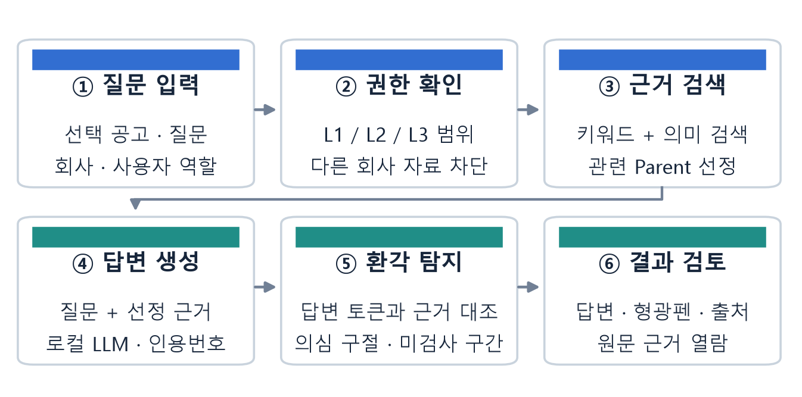
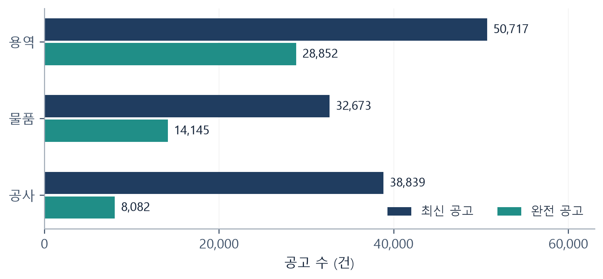
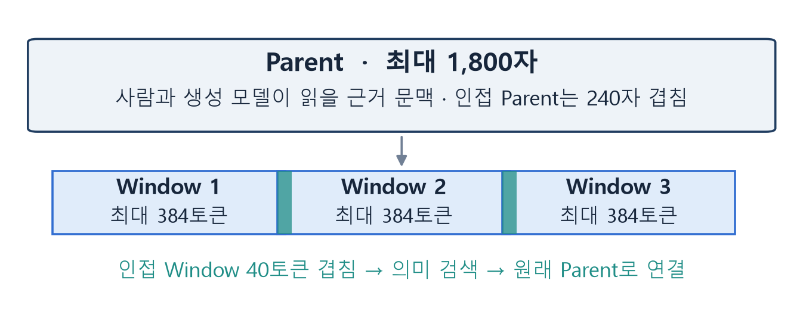
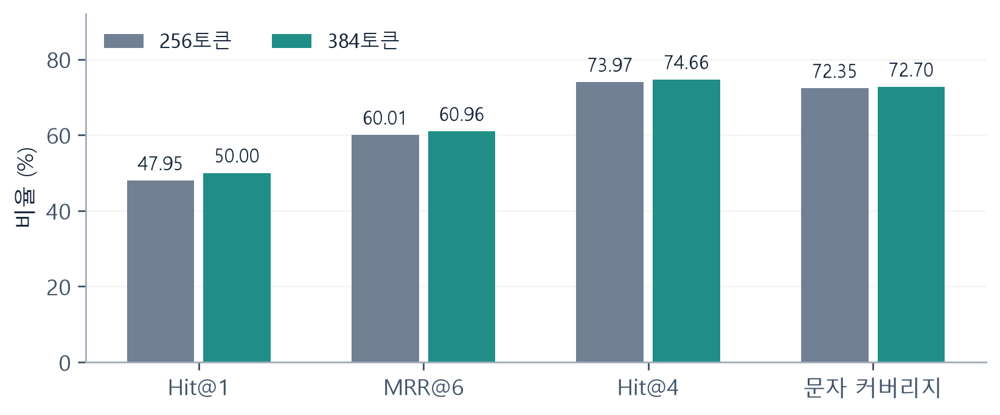
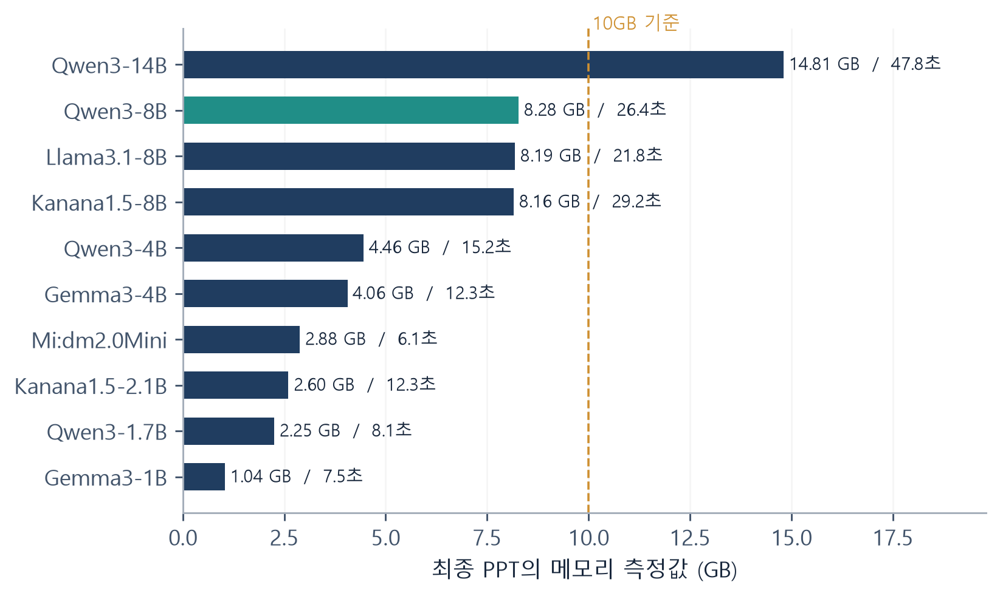
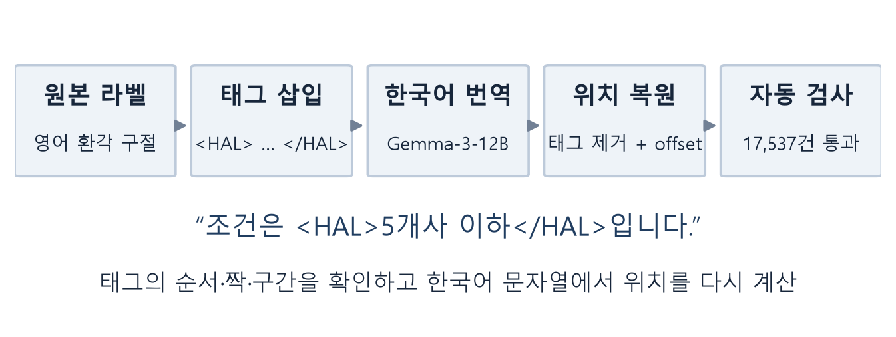
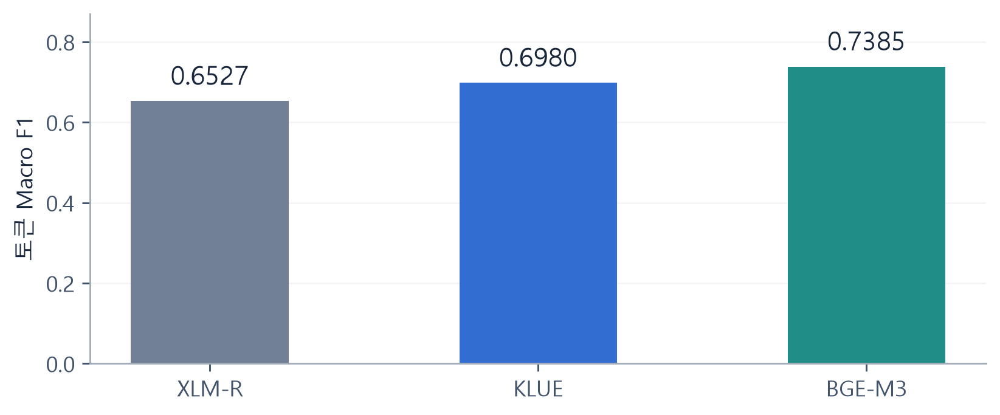
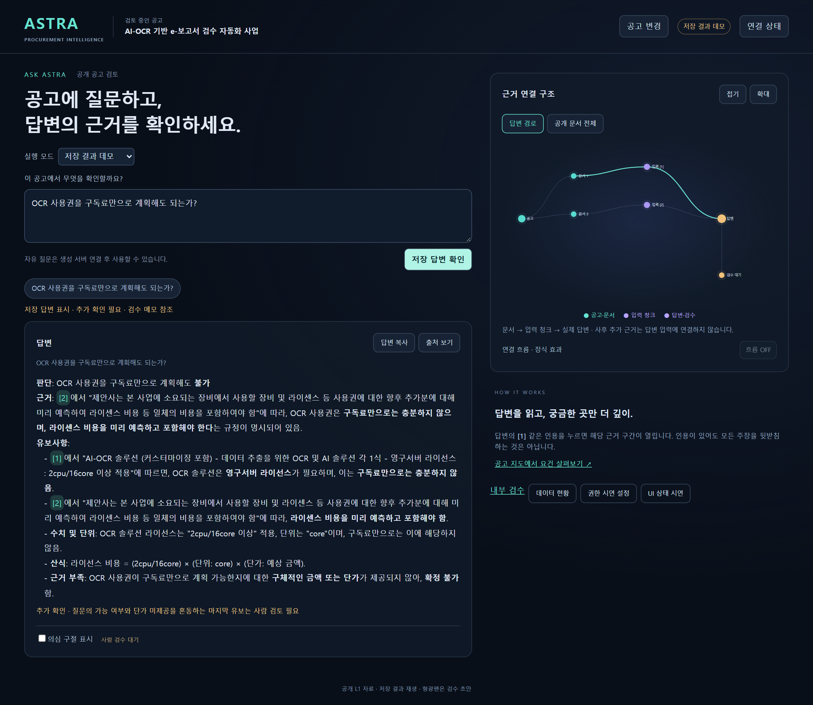
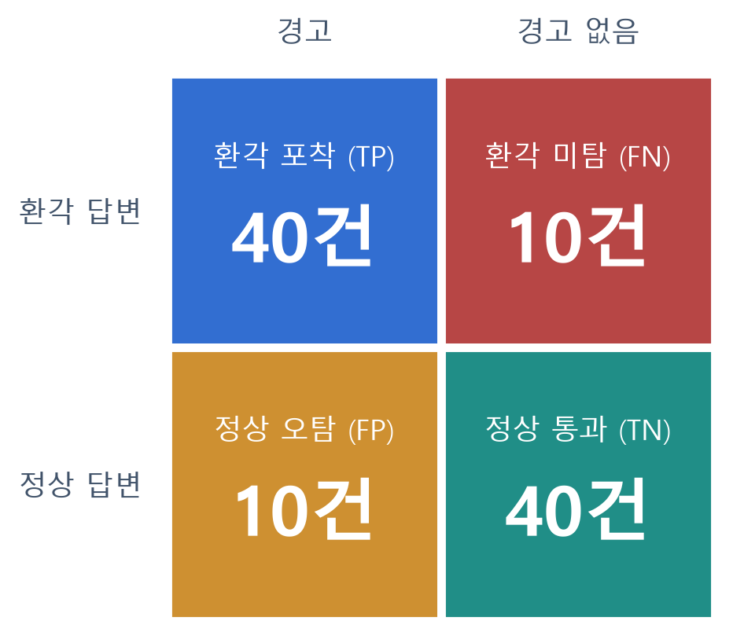
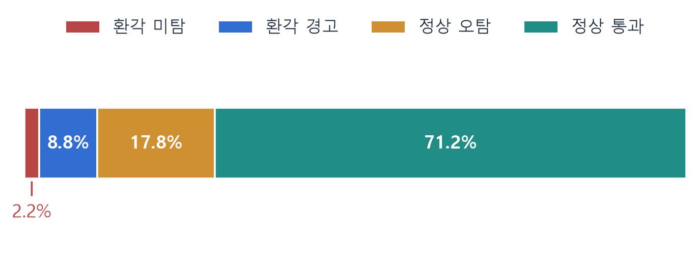

# 실시간 환각 검증 기반의 공공입찰 AI 어시스턴트

권한 기반 RAG와 한국어 토큰 분류 모델을 활용한 답변 근거 검증

강인수 · 박승형 · 박지훈 · 양진우 · 이선희 · 임성민

2026. 09. 29

## 국문 초록

공공입찰 참여 기업은 입찰공고, 제안요청서, 과업지시서에 분산된 자격·실적·인력·인증 조건을 자사 자료와 비교해야 한다. 생성형 AI를 활용하면 긴 문서의 탐색을 지원할 수 있지만, 검색 근거가 제공된 상황에서도 존재하지 않는 조건을 추가하거나 금액·기간·예외 조항을 잘못 해석할 수 있다. 동시에 회사의 실적, 인력 및 원가 자료를 외부로 전송하거나 다른 회사에 노출해서는 안 된다.

본 프로젝트는 이러한 문제에 대응하여 Blue Jay 공공입찰 AI 어시스턴트를 설계하였다. 공개 공고와 합성 기업 자료를 L1·L2·L3 보안등급으로 구분하고, 회사·역할·시나리오에 맞는 문서만 검색하도록 구성하였다. 키워드 검색과 의미 검색을 결합하여 관련 근거를 찾고, 로컬 생성 모델의 답변을 별도 토큰 분류 모델로 검사하여 환각 의심 구절과 출처를 함께 제시한다.

데이터 측면에서는 2026년 4~6월 나라장터 공고 137,745행을 수집한 기록을 바탕으로 정보시스템 구축·운영 분야의 대표 공고 51건을 선정하였다. 팀원 요건 추출과 원문 재확인을 거쳐 가상 기업 5곳, 회사별 내부·민감 문서, 질문·기대답·근거 300건을 구성하였다. 공개 문서의 사실과 합성 회사 설정을 구분하고, 평가 답안은 RAG 검색 자료에서 제외하였다.

모델 측면에서는 RAGTruth 환각 구절에 태그를 삽입하고 Gemma-3-12B로 번역한 뒤 한국어 문자 위치를 다시 계산하였다. 자동 검사 통과 데이터는 17,537건이며, 기존 실험 기록의 토큰 Macro F1은 XLM-R 0.6527, KLUE 0.6980, BGE-M3 0.7385이다. 이 값은 문맥 길이·윈도우·임계값 조건이 다른 실험 기록이며, 동일 설정의 독립 성능 비교로 해석하지 않는다. 최종 발표자료는 검색 Parent 1,800자·Window 384토큰과 서비스용 Qwen3-8B를 채택한 것으로 기술한다.

본 보고서는 데이터 구축, 권한 설계, 검색과 생성, 환각 탐지, UI 연동, 평가 절차와 구현 구조를 종합한다. 저장된 300문항 실행 결과는 답변 생성 295건과 접근 거절 5건으로 구분한다. 100건·80% 사례는 사후 선별한 시연 자료로, 11%에서 2.2%로의 변화는 가정 계산으로 설명한다. 연구의 성과는 근거를 추적할 수 있는 검토 지원 구조이며, 자동 입찰 적격 확정이나 모든 환각의 차단을 의미하지 않는다.

> 주제어: 공공입찰, RAG, 하이브리드 검색, RBAC, 한국어 환각 탐지, 토큰 분류, RAGTruth, 로컬 LLM, 근거 추적

*출처: [I1-I8] 프로젝트 산출물 및 최종 발표자료. 작성 기준일: 2026-09-29.*

# 제1부 서론

## 1. 연구 배경과 문제 정의

### 1.1 입찰 검토 업무의 복잡성

나라장터 공고를 확인하는 입찰 담당자는 사업 내용뿐 아니라 참가자격, 업종 등록, 실적 인정 기간, 인증 유효기간, 제출 방식과 마감일을 함께 검토한다. 같은 공고에서도 공고문과 첨부 문서가 서로 다른 역할을 맡으며, 정정 차수에 따라 조건이 달라질 수 있다. 짧은 요약만으로 결론을 내리면 예외 조항이나 증빙 요건을 놓치기 쉽다.

이 프로젝트의 주 사용자는 발주기관의 심사자가 아니라 입찰에 참여하려는 기업의 직원이다. 예를 들어 “우리 회사의 7천만 원 실적이 이 공고의 금액 기준을 충족하는가?”라는 질문에는 공고의 기준과 회사 실적의 VAT 포함 여부를 모두 확인해야 한다. 금액이 맞더라도 완료 여부, 유사 사업 범위, 증빙 상태가 불명확하면 전체 입찰 적격으로 확대해서 답할 수 없다.

### 1.2 해결해야 할 세 가지 문제

표 1. 업무 문제와 시스템 요구

| 문제 | 발생 상황 | 설계 요구 |
| --- | --- | --- |
| 정보 분산 | 공고문·RFP·과업 문서에 조건이 분산 | 문서·차수·근거 위치를 보존한 검색 |
| 답변의 비근거성 | 없는 조항 추가, 숫자·기간·조건 혼동 | 생성 답변과 입력 근거의 재대조 |
| 회사 자료 노출 | 다른 회사 실적·원가의 조회 또는 전송 | tenant·역할·등급을 이용한 접근 제한 |

RAG는 모델이 참조할 문서를 공급하지만 그 문서를 올바르게 해석하도록 보장하지는 않는다. 따라서 문서 검색 성공과 답변 신뢰성을 별도의 문제로 다루어야 한다. 본 프로젝트는 검색 결과를 보여주는 것에 더해 생성 답변의 어느 구절을 다시 확인해야 하는지 제공하는 데 초점을 둔다.

> 발표자료의 산업·사고 사례는 문제의 배경이다. 본 프로젝트가 특정 분쟁을 해결했거나 실제 입찰 손실을 줄였다는 실증 결과는 아니다.

*출처: [I1] 최종 발표 4-11쪽. [I2] 팀공유 문서. [E1] RAGTruth.*

## 1.3 연구 목표와 기여

Blue Jay의 목표는 사용자가 접근 가능한 문서를 바탕으로 입찰 관련 질문에 답하고, 근거와 환각 의심 구절을 함께 검토할 수 있는 환경을 만드는 것이다. 이전 개발 명칭인 ASTRA와 저장소명 ko-LettuceDetect는 코드와 파일 경로에 남아 있으며, 본 보고서의 서비스 명칭은 최종 발표자료에 맞춰 Blue Jay로 통일한다.

표 2. 연구 목표와 주요 산출물

| 목표 | 산출물 | 검토 범위 |
| --- | --- | --- |
| 입찰 도메인 데이터 구축 | 대표 공고 51건·요건 시트 | 공고 전체 적격의 일괄 확정은 제외 |
| 기업 비교 시나리오 설계 | 가상 기업 5곳·L2/L3 문서 | 실제 기업·인증·견적 자료와 구분 |
| 재현 가능한 질의 평가 | 질문·기대답·근거 300건 | 실제 생성 답변과 별도 관리 |
| 근거 기반 검색·생성 | 하이브리드 검색·로컬 모델 연결 | 선택 문서와 실제 입력 근거 추적 |
| 환각 구절 탐지 | 토큰 분류·문자 위치·형광펜 | 의심 표시이며 정답 보증은 아님 |

### 1.4 환각 탐지에서 공공입찰로의 확장

초기 연구는 한국어 문서에 대한 환각 구절 탐지 모델을 만드는 데 집중하였다. 이후 모델이 실제 업무에서 활용될 수 있는 도메인으로 나라장터 입찰 검토를 선택하였다. 정보시스템 구축·운영 분야는 자격, 실적, 기술 인력, 인증, 예산과 유지관리 조건이 함께 등장하므로 단일 사실 확인과 복합 조건 비교를 모두 구성하기에 적합했다.

이 과정에서 환각 탐지 모델뿐 아니라 문서의 수집·버전 관리, 합성 회사 원장, 권한 필터, 평가 데이터와 UI를 함께 설계하였다. 차별점은 모든 판단을 모델 한 번의 출력에 맡기는 대신, 어떤 회사의 어떤 문서가 검색되고 어떤 근거로 답변이 만들어졌는지 추적하는 구조에 있다.

### 1.5 보고서의 구성

참고 보고서의 종합보고서 형식을 따라 서론, 이론과 선행연구, 시스템 설계, 데이터 수집, 기업·권한 설계, 평가 데이터, 검색, 생성 모델, 탐지 모델, 통합·검증, 결론의 11부로 구성하였다. 부록에는 주요 설정, 코드 역할, 데이터 계약, 용어 및 수치의 출처를 정리한다.

*출처: [I1] 최종 발표 10-15쪽. [I3-I5] 데이터·기업·평가셋 산출물.*

# 제2부 이론적 배경 및 선행연구

## 2. RAG와 근거 기반 답변 검증

### 2.1 RAG의 구성

RAG(Retrieval-Augmented Generation)는 질문과 관련된 외부 문서를 검색하고, 해당 문맥을 생성 모델에 제공하여 답변을 작성하는 방식이다. 본 프로젝트에서 검색 자료는 공고 원문을 정제한 L1과 허용된 합성 회사 문서이다. 질문·기대답·근거 300건은 시스템을 시험하기 위한 평가 자산이며, 정답을 검색하여 반환하는 답안 DB로 사용하지 않는다.

표 3. 구성 요소의 역할

| 구성 요소 | 입력 | 출력 |
| --- | --- | --- |
| 검색용 인코더 E5 | 질문·문서의 검색 구간 | 의미 비교를 위한 벡터 |
| 하이브리드 검색 | 키워드 순위·벡터 순위 | 관련 Parent 후보와 메타데이터 |
| 생성 모델 Qwen | 질문·선정 근거 문맥 | 답변 정본과 인용번호 |
| 학습한 탐지 인코더 | 질문·답변·동일 근거 | 답변 토큰별 환각 의심 점수 |
| 사용자 인터페이스 | 답변·근거·탐지 구절 | 형광펜 및 근거 열람 화면 |

### 2.2 사실성과 근거 일치성

환각 탐지는 일반 세계의 모든 사실을 검증하는 작업과 다르다. 본 연구에서 기준은 “해당 답변이 모델에게 제공된 문서로 뒷받침되는가”이다. 실제로 참인 내용이라도 입력 근거가 없으면 비근거 주장으로 표시될 수 있다. 반대로 오래되거나 잘못된 문서를 충실히 따라 쓴 답변은 근거와 일치해도 현실적으로 틀릴 수 있다.

따라서 검색 누락, 문서 원문 충돌, 생성 오류와 탐지 오류를 구분한다. 근거가 부족한 경우에는 결론을 유보하고 추가 확인을 안내하는 동작이 적절하다. 탐지 결과에는 근거 범위와 미검사 영역을 함께 표시해야 사용자가 점수를 사실성의 보증으로 오해하지 않는다.

### 2.3 평가 단위의 차이

답변 단위 판정은 전체 답변에 환각이 하나라도 있는지 평가한다. 토큰·문자·구절 단위 평가는 어느 부분을 잘 표시했는지 평가한다. 답변 전체를 맞게 경고했더라도 형광펜 위치가 잘못될 수 있으므로 두 평가를 분리하여 보고한다.

*출처: [E1-E4] RAGTruth, LettuceDetect, E5, RRF. [I11] 검색·탐지 코드.*

## 3. 선행연구와 본 프로젝트의 접근

표 4. 참고 연구와 적용 방식

| 연구 | 핵심 접근 | 프로젝트 적용 |
| --- | --- | --- |
| RAGTruth | RAG 생성 답변의 비근거·상충 구절을 사람이 주석 | 한국어 번역 및 토큰 라벨 학습의 출발점 |
| LettuceDetect | 문맥·질문·답변을 읽는 토큰 분류 | 생성과 탐지를 분리하는 구조 |
| Turk-LettuceDetect | 번역 코퍼스와 여러 인코더의 비교 | 태그 기반 번역·비영어권 검증 절차 참고 |
| RRF | 서로 다른 검색 순위를 합산 | Lexical과 Dense 순위 결합 |

### 3.1 한국어 학습 자산의 확보

영어 RAGTruth에는 생성 답변에서 환각이 발생한 문자 구간이 포함되어 있다. 이를 단순 번역하면 단어 순서와 길이가 달라져 기존 위치를 사용할 수 없다. 프로젝트는 환각 구절의 양 끝에 태그를 넣어 번역하고, 태그를 제거하면서 한국어 위치를 다시 계산하는 방식을 채택하였다. 태그 보존 검사는 구조적 무결성 검사이며 번역 의미가 완벽하다는 증거는 아니다.

### 3.2 별도 검증 인코더의 선택

LettuceDetect는 긴 문맥을 처리하는 인코더를 이용한 토큰 분류 접근을 제안한다. 본 프로젝트도 생성문을 다시 장문으로 설명하는 방식보다 답변 토큰에 직접 점수를 부여하는 구조를 채택하였다. 한국어 전용 KLUE, 다국어 XLM-R, 긴 문맥 처리가 가능한 BGE-M3 계열을 비교하고 데이터·추론 조건의 영향을 살펴보았다.

### 3.3 도메인 적용의 차별점

공공입찰에 적용할 때는 “근거에 없는 구절 찾기”에 더해 회사별 문서 접근, 공고 차수, 인증 보유 주체, VAT 기준 및 증빙 상태가 중요하다. 이에 공고 원문과 회사 자료를 분리하고, 동일 질문에서도 회사와 역할에 따라 허용 근거가 달라지도록 설계하였다. UI는 환각 의심 구절에서 관련 근거로 이동할 수 있도록 구성하였다.

> 선행연구의 수치와 우리 결과는 언어·데이터·평가 단위·임계값이 다르면 직접 비교할 수 없다. 보고서는 연구 접근을 참고하되 특정 논문의 성능을 재현했다고 단정하지 않는다.

*출처: [E1] Niu et al., 2024. [E2] Kovács & Recski, 2025. [E6] Taş et al., 2025.*

# 제3부 전체 시스템 설계

## 4. 사용자 질의 파이프라인

서비스는 선택 공고, 사용자 질문, 회사와 권한 문맥을 받아 검색·생성·탐지 결과를 반환한다. 데이터 준비 단계와 서비스 질의 단계는 분리된다. 수집한 전체 자료를 매번 생성 모델에 넣지 않고, 요청 시점에 허용된 근거만 선정한다.

그림 1. 최종 발표자료의 사용자 질의 파이프라인. 화면은 설계 흐름을 나타내며 운영 인증 완료 여부와는 별개다.

### 4.1 단계별 처리

첫째, 서버가 공고번호와 차수 및 입력 질문을 검증한다. 둘째, 회사와 역할에 따른 문서 범위를 제한한다. 셋째, 키워드·벡터 검색 결과를 결합해 근거 후보를 만든다. 넷째, 모델 입력 예산 안에서 근거를 구성하여 로컬 LLM의 답변을 받는다. 다섯째, 생성에 사용한 동일 근거와 답변을 탐지기로 보내 의심 구절을 계산한다. 마지막으로 정본 답변, 인용 근거와 검사 상태를 사용자에게 제공한다.

### 4.2 출력의 의미

출력은 답변 하나로 끝나지 않는다. 인용번호는 실제 입력 근거를 찾는 연결점이고, 형광펜은 검토가 필요한 후보 구절이다. 인용이 존재한다는 이유만으로 해당 주장이 입증되는 것은 아니다. 자료 부족, 접근 거절, 잘림, 탐지 미실시와 정상 완료를 별도 상태로 표현한다.

> 최종 발표의 “실시간”은 사용 중 검증 결과를 제공한다는 서비스 목표를 뜻한다. 확인한 통합 코드의 탐지는 답변 생성 완료 후 수행되며, 생성 중 토큰마다 동시에 검사하는 구현과 구분한다.

*출처: [I1] 최종 발표 13쪽. [I9-I11] 공개 L1 서버·통합 서버·검색 코드.*

## 5. 단계별 Input·Process·Output

표 5. 데이터가 변환되는 서비스 계약

| 단계 | Input | Process | Output |
| --- | --- | --- | --- |
| 입력 확인 | 공고·차수·질문 | 형식·길이·요청 문맥 확인 | 검증된 요청 ID |
| 권한 제한 | 세션·문서 메타데이터 | 회사·역할·등급 확인 | 검색 허용 문서 집합 |
| 근거 검색 | 질문·허용 청크 | Lexical·Dense·RRF | 상위 후보 및 출처 |
| 문맥 구성 | Top 6 후보 | 중복·예산 확인, 최대 4개 | 생성 입력 근거 묶음 |
| 답변 생성 | 질문·선정 근거 | 로컬 모델 호출·스트림 | 부분 응답·최종 정본 |
| 환각 검사 | 정본·동일 근거 | 토큰 분류·문자 위치 변환 | 의심 구절·점수·상태 |
| 결과 제공 | 답변·출처·구절 | 안전한 렌더링·상태 표시 | 검토 가능한 UI |

### 5.1 공통 식별자와 정본

request_id는 요청을 식별하고, 공고번호·차수와 snapshot은 선택 자료를 고정한다. 문서 ID·버전·청크 ID·해시·문자 위치는 근거를 재확인하는 기준이다. 답변은 최초 생성 문자열을 정본으로 유지하고, 표시를 위해 Markdown을 가공하더라도 형광펜 좌표는 정본 문자열을 기준으로 계산한다.

### 5.2 처리 실패의 명시

서버 미연결, 모델 시간 초과, 취소, 빈 응답과 자료 부족은 서로 다른 원인이다. 생성 실패를 저장 답변으로 조용히 대체하면 실제 실행 상태를 오해하게 되므로 허용하지 않는다. 탐지 실패도 “환각 없음”으로 표현하지 않고 미검사 구간을 반환한다.

### 5.3 정적 데모와 서비스의 경계

저장 답변 재생, 테스트 어댑터, 실제 모델 생성은 화면과 응답 메타데이터에서 구분한다. 문서 연결 그래프의 장식 광점은 데이터 흐름을 시각적으로 설명하지만 실제 처리량이나 모델 진행률은 아니다. 공개 정적 폴더에 회사 원장과 평가 정답을 넣지 않는 배포 원칙을 유지한다.

*출처: [I9-I11] l1_server.py, integrated_server.py, detector_bridge.py, rag_pilot.py.*

# 제4부 공고 데이터 수집 및 정제

## 6. 수집 데이터와 변환 구조

### 6.1 원본·파싱 텍스트·레코드의 분리

나라장터 API에서 공고 목록과 첨부를 확보하고, 원본 파일과 파싱 결과를 구분하여 저장하였다. raw는 HWP·PDF 등 다운로드 원본이며, parsed는 원본에서 추출한 텍스트이다. JSONL은 JSON 레코드 하나를 한 줄씩 저장한 형식으로, 공고·첨부의 속성과 처리 결과를 프로그램이 순차적으로 읽을 수 있게 한다. JSONL이라는 확장자 자체가 임베딩이나 벡터 DB를 뜻하지는 않는다.

표 6. 데이터 계층과 사용 목적

| 계층 | 보존하는 내용 | 사용 목적 |
| --- | --- | --- |
| raw | 공고 첨부의 원본 바이트 | 표·쪽수·정정 내용의 최종 대조 |
| parsed | 문서별 추출 텍스트 | 요건 추출·검색용 정제의 입력 |
| JSONL | 공고·첨부·파싱 상태 등의 레코드 | 일괄 변환·검사·집계 |
| manifest | 문서 ID·버전·경로·무결성 정보 | 입력 계약·추적·색인 허용 목록 |
| 청크 | 정본 텍스트 구간과 메타데이터 | 검색·인용·답변 문맥 구성 |

### 6.2 주요 코드의 역할

adapt_g2b.py는 수집기의 출력을 파이프라인에서 사용하는 manifest와 구간 텍스트 형식으로 변환한다. prepare.py는 파일·파싱·무결성 조건을 검사하고, 분야별 문서 확보 현황을 집계하며, 표본 선정과 근거 분할을 수행한다. 세 달의 결과는 g2b_merge_sector_reports.py로 합쳐 비교하였다. 원본 HWP/PDF를 실제로 파싱하는 단계는 수집기·파서 영역이며 어댑터의 역할과 구분한다.

### 6.3 실패와 중복 처리

공고번호만으로 모든 파일을 합치면 정정 전후 문서가 섞일 수 있으므로 차수와 파일 해시를 함께 관리한다. 파싱 실패 캐시는 재파싱 대상과 성공 대상을 분리한다. 텍스트 추출 성공은 표의 셀 관계와 인쇄 쪽수가 정확히 복원됐다는 뜻이 아니므로, 중요한 충돌은 원본을 다시 확인한다.

*출처: [I3] 3개월 통합 현황. [I11] adapt_g2b.py, prepare.py, g2b_merge_sector_reports.py.*

## 6.4 4~6월 데이터 확보 현황

전체 수집 규모는 차수를 포함한 공고 행 137,745건이며, 최신 차수 집계는 124,522건이다. 발표에서는 이를 약 13만 건으로 표현하였다. 서로 다른 집계 단위를 합치거나 최신 차수 수를 다운로드 행 수로 바꾸어 사용하지 않는다.

표 7. 월별 공고 행과 최신 차수

| 구분 | 4월 | 5월 | 6월 | 합계 |
| --- | --- | --- | --- | --- |
| 차수 포함 공고 행 | 53,153 | 40,241 | 44,351 | 137,745 |
| 최신 차수 | 48,033 | 36,419 | 40,070 | 124,522 |

그림 2. 분야별 공고 수와 완전 공고 수. 워크스테이션 확정 집계의 주요 3개 업무구분.

표 8. 주요 업무구분의 문서 확보 결과

| 업무구분 | 공고 | 사용 가능 문서 | 완전 공고 | 비율 |
| --- | --- | --- | --- | --- |
| 용역 | 50,717 | 102,702 | 28,852 | 57% |
| 물품 | 32,673 | 66,298 | 14,145 | 43% |
| 공사 | 38,839 | 73,038 | 8,082 | 21% |

완전 공고는 공고문과 제안요청서 또는 과업·규격 문서를 함께 갖춘 경우를 의미한다. 모든 12종 문서가 다 있다는 뜻은 아니다. 용역은 비교에 필요한 문서 확보율과 요건의 다양성을 함께 고려했을 때 주요 분석 분야로 적합하였다.

> 위 3개 업무구분은 전체 집계의 부분집합이다. 기타·외자 등이 제외되어 표의 공고 수 합계는 전체 최신 차수 수와 다르다.

*출처: [I3] project-docs/데이터현황/3개월_통합현황.md, 2026-09-11 집계.*

## 6.5 대표 공고 51건과 요건 추출

용역 가운데 정보시스템 구축·운영을 상세 검토 대상으로 선정하였다. SW 및 시스템 개발과 운영·유지관리는 공고의 실적·인력·인증·단가 조건이 비교적 명시적이고, 팀이 문서의 기술적 의미를 이해하기에도 적합하였다. 확보율이 가장 높은 분야라는 이유로 선택한 것은 아니다.

표 9. 상세 검토 분야

| 세부 분야 | 공고 수 | 완전 공고 | 확보율 |
| --- | --- | --- | --- |
| SW 및 시스템 개발 | 2,163 | 984 | 46% |
| 운영 및 유지관리 | 1,313 | 681 | 52% |

### 6.6 표본과 검토 항목

4·5·6월에서 각 17건씩 총 51건을 선정하고, 원본 151개와 약 430만 자의 파싱 텍스트를 확보한 기록을 남겼다. 이 표본은 월·기관·금액과 업무 유형의 다양성을 고려한 개발용 표본이며, 전체 공공조달 모집단의 무작위 대표 표본은 아니다.

표 10. 요건추출시트가 구분하는 내용

| 구분 | 대표 항목 | 주의점 |
| --- | --- | --- |
| 참가자격 | 업종·면허·지역·직접생산 | 입찰 참여 가능 조건 |
| 평가기준 | 실적 점수·인력·인증 배점 | 점수 항목을 필수 자격으로 확대 금지 |
| 이행 의무 | 보안교육·착수·납품·운영 조건 | 계약 후 의무와 사전 자격 구분 |
| 금액·일정 | 예산·VAT·기한·사업기간 | 원문·메타데이터 충돌 기록 |

팀원 5명이 공고문과 첨부를 읽어 요건을 추출하고, 통합 과정에서 출처·용어·충돌을 정리하였다. 이 작업은 공고 원문을 CSV로 대체하는 과정이 아니라 평가 질문과 합성 회사 설계의 기준을 만드는 과정이다. 이후 답변에 대한 환각 라벨링과도 구분된다.

> 51건에서 모든 법적 쟁점과 외부 증빙을 해결한 것은 아니다. 우선순위를 확인하지 못한 원문 충돌은 보류 상태로 유지한다.

*출처: [I3-I5] 통합 현황, 표본 목록, 요건추출시트, 원문대조 결과.*

# 제5부 가상 기업과 권한 설계

## 7. 가상 기업 5곳의 설계

실제 기업의 기밀을 사용하지 않고도 회사별 실적·인력·인증과 공고 조건을 비교할 수 있도록 가상 기업 5곳을 설계하였다. 공고마다 새 회사를 만드는 대신 고정된 회사 원장을 여러 공고에 연결한다. 조건에 맞추어 면허나 실적을 바꾸지 않으며, 각 회사에 서로 다른 강점과 제약을 부여하였다.

표 11. 가상 기업 비교

| ID·회사 | 소재지·전문 분야 | 강점 | 제약 |
| --- | --- | --- | --- |
| C01 한빛IT | 서울 / 공공 웹·포털 | 개발 인력 | 통신공사업 면허 미보유 |
| C02 해온시스템 | 부산 / 관제망·네트워크 | 통신공사업 면허 | 일부 인증 만료·기존 투입 |
| C03 인우블록 | 인천 / 블록체인·모바일 | 분야 전문성 | 작은 인력 풀·실적 증빙 부족 |
| C04 누리클라우드 | 대전 / 클라우드·보안 | 면허·ISO | 서비스 CSAP 증빙 미확보 |
| C05 새온에너지SW | 전남 / EMS·PMS | 에너지 제어·제조 | 통신공사업 면허 미보유 |

### 7.1 마스터의 관리 단위

원장에는 회사 ID, tenant ID, 데이터 버전, 설립일, 본점 지역, 업종·등록, 실적, 인력, 인증, 합성 증빙 ID와 원가 정책을 저장한다. 기준 v1 검증 기록에는 회사 5곳, 인력 45명, 프로젝트 실적 16건, 증빙 레코드 111건이 존재한다. 증빙 레코드는 합성 설정을 연결하는 식별자이며 실제 기관이 발급한 증명서를 뜻하지 않는다.

### 7.2 회사 사실과 공고별 계획

회사 공통 사실과 공고별 배치·원가·투찰 검토안은 별도 자료로 관리한다. 예를 들어 기존에 만료된 인증은 v1에서 그대로 만료 상태를 유지한다. 인증 갱신을 가정하는 평가 시나리오는 새 버전·적용일·가정 이유를 가진 별도 문서로 둔다. 서로 다른 상태를 동일 문맥에 섞지 않도록 검색 시 시나리오를 제한한다.

> 다섯 회사의 명칭·실적·인력·원가 가정은 합성이다. 실제 사업자등록번호, 개인 연락처, 확인되지 않은 정확한 주소·좌표를 만들어 부여하지 않는다.

*출처: [I4] company_master.json, README.md, validation_report.json.*

## 7.3 L2·L3 문서 생성과 일관성 검증

표 12. 회사 문서의 내용과 생성 기준

| 등급 | 문서 | 핵심 값 |
| --- | --- | --- |
| L2 | 기업·등록 현황 | 회사·지역·업종·면허·증빙 |
| L2 | 실적 대장 | 분야·금액·VAT·완료·지분·하도급 |
| L2 | 인력 대장·배치안 | 재직·직무·경력·자격·기간·FTE |
| L2 | 인증·서비스 대장 | 보유 주체·유효기간·확보 상태 |
| L3 | 인건비·원가 정책 | 기준급·부담률·경비·마진 가정 |
| L3 | 견적·투찰 검토 | 확인 가격·합성 단가·미확정 항목 |

사람이 읽는 Markdown과 기계가 읽는 JSON을 같은 사실 원장에서 생성하고, 문서별 청크 JSONL을 만든다. 실적 한 건, 인력 한 명, 인증 한 건의 조건이 서로 섞이지 않도록 의미 단위로 묶는다. 회사 대장의 원래 의미 단위 청킹과 검색 시 사용하는 Parent·임베딩 윈도우 정책은 서로 다른 단계이다.

### 7.4 합성과 계산의 구분

합성 인건비와 FTE는 설정값이며, 설정된 단가와 기간을 곱한 비용은 계산값이다. 실제 공고에서 읽은 사업기간과 예산은 원문 추출값이다. 금액마다 VAT 기준, 통화, 수량과 적용 기간을 저장한다. 미확보 공급사 견적을 0원으로 바꾸거나 예산에서 거꾸로 투찰가를 맞추지 않는다.

**인건비 = 월 기준급 × Σ(배치일수 / 해당 월 일수) × FTE × (1 + 부담률)**

배치일은 양 끝 날짜를 포함하는 정책을 사용하며, Decimal로 계산한 뒤 최종 원 단위 HALF_UP 반올림을 기록한다. 기존 배치와 새 계획의 겹치는 기간에서 FTE 합을 확인한다. 독립 대안인 여러 시나리오를 실제 동시 수행 계획으로 바꾸려면 전체를 합친 재검사가 필요하다.

> 문서 생성, 증빙 확보, 자동 검사 통과, 사람 승인, 색인 적재는 각각 별도 상태다. 문서 파일이 생겼다는 이유로 missing 증빙을 확보 완료로 바꾸지 않는다.

*출처: [I4] C01/r1 및 C02-C05/r1 생성 목록·검증 기록. [I5] v2 시나리오 확장.*

## 8. 회사·등급·역할 기반 접근 통제

L1은 나라장터 공개 공고이고, L2는 회사 내부 자료, L3는 원가와 전략 등 민감 자료이다. 접근 허용은 등급 숫자만으로 결정하지 않는다. 해당 회사 소속인지, 활성·인증 사용자 여부와 문서의 allowed_roles를 함께 확인한다. 높은 등급의 직원도 다른 회사 문서에는 접근할 수 없다.

표 13. 개발용 사용자 역할의 범위

| 역할 | L1 | 자기 회사 L2 | 자기 회사 L3 |
| --- | --- | --- | --- |
| viewer | 허용 | 차단 | 차단 |
| bid_analyst | 허용 | 허용 | 차단 |
| cost_analyst | 허용 | 허용 | 원가·견적 등 허용 문서 |
| bid_approver | 허용 | 허용 | 승인·전략 등 허용 문서 |
| 비활성 계정 | 요청 차단 | 차단 | 차단 |

### 8.1 검색 전 제한과 반환 전 검사

공개 L1 질문 서버는 선택 공고의 L1 문서로 후보를 제한하고 반환 직전에 근거의 공고·등급을 다시 확인한다. 브라우저에서 tenant나 보안등급을 바꾸어 보내도 허용 범위가 넓어지지 않도록 요청 필드를 제한한다. 평가 자료와 회사 전체 원장을 폴더 단위로 재귀 색인하는 방식은 사용하지 않는다.

### 8.2 개발 DB와 실제 인증

UI 개발용 사용자 DB는 회사별 5개씩 총 25개 계정을 제공하고, 역할과 비활성 상태를 시험할 수 있게 한다. 계정 목록과 역할 정책이 존재하는 것과 운영 인증 서버가 완성된 것은 다르다. 확인한 로컬 통합 서버에서 L2/L3 자유 질의는 공개 서비스에 연결하지 않았으며, 내부 검수는 별도 로컬 접근 키를 사용한다.

### 8.3 로컬 실행의 목적

검색 근거에 기업 내부 자료가 포함될 수 있으므로 모델 추론도 내부 환경에서 수행하도록 설계한다. 로컬 추론은 외부 API로 문맥을 전송하지 않게 하지만 단독으로 모든 보안 문제를 해결하지는 않는다. 배포 환경에서는 세션 검증, tenant 필터, 로그 최소화와 허용 경로 관리가 함께 필요하다.

*출처: [I2, I4, I9-I11] 보안 정책·사용자 DB·공개 L1 서비스 코드.*

# 제6부 평가 데이터셋 구축

## 9. 질문·기대답·근거 300건

가상 기업별 60문항씩 총 300문항을 구성하고, 51건 공고가 최소 한 번 이상 등장하도록 연결하였다. 구성은 공고 고유 조건 255건, 기존 공고·회사 대조 파일럿 25건, 합성 확장 시나리오 20건이다. 공개 문서 이해 문제도 회사 세션에 배정되므로 300건 모두가 회사의 입찰 적격 비교 질문인 것은 아니다.

표 14. 실제 질문 유형 분포

| 유형 | 건수 | 주요 검토 |
| --- | --- | --- |
| 사실 확인 | 19 | 원문에 명시된 값·조건 |
| 참가자격 | 25 | 지역·업종·직접생산 |
| 실적 | 16 | 금액·완료·기간·증빙 |
| 인력 | 44 | 경력·배치·고용·FTE |
| 인증 | 30 | 보유 주체·유효기간 |
| 계약 | 33 | 공동수급·하도급·이행 |
| 비용 | 35 | VAT·원가·마진 |
| 경계값 | 40 | 날짜·금액·FTE 경계 |
| 원문충돌 | 26 | 불일치·추가 확인 |
| 복수 문서 | 13 | 근거 결합 |
| 접근 정책 | 14 | 권한 규칙 이해 |
| 접근 차단 | 5 | 실제 거절 기대 동작 |

기대답은 반드시 포함할 사실과 주장하면 안 되는 내용을 함께 가진다. 출처는 실제 공고, 회사 합성 사실, 합성 보완 조건과 계산으로 구분한다. 각 문항은 공고 차수, 회사·tenant, 사용자 역할, 시나리오 버전 및 판단 기준일을 보존한다.

> 300문항은 데이터셋의 수량이다. 실제 모델 답변, 환각 구절 라벨과 사람의 최종 승인은 별도 산출물이며 구축 시점의 기대답과 혼합하지 않는다.

*출처: [I5] 평가데이터/v2/README.md, distribution.json, questions_300.jsonl.*

## 9.1 Q·A·R 연결의 실제 예

표 15. 공고와 합성 회사의 금액 조건 대조

| 항목 | 내용 |
| --- | --- |
| 공고 / 차수 | R26BK01487327 / 000 · 2026년 웹툰아카이브 통합시스템 유지보수 및 기능개선 용역 |
| Q / 질문 | C01-PRJ-01의 계약금액은 이 공고의 실적 금액 하한을 만족하나요? 금액 조건만 비교해 주세요. |
| A / 기대답 | 부가세 포함 7천만 원으로 금액 기준은 충족한다. 수행 기간·유사성·증빙 등은 별도로 검토해야 한다. |
| R1 / 실제 공고 | 단일 계약금액 7천만 원 이상, 부가세 포함이라는 원문 조건 |
| R2 / 합성 회사 | 해당 실적의 계약금액 7천만 원, 부가세 포함이라는 회사 실적 대장 |
| 판단 범위 | 금액의 경계값 비교에 한정. 전체 입찰 적격 판정으로 확대하지 않음 |

### 9.2 출처 연결 구조

이 예제의 실제 공고 근거는 제안요청서의 “유사과업 수행 실적 / 비고” 절이며, 회사 근거는 C01-PRJ-01 실적 대장이다. 공고에는 파일·차수·절·인용·문자 위치를, 회사에는 문서·청크 ID와 원장 Pointer·합성 증빙 ID를 연결한다. 인쇄 쪽수가 확인되지 않았으면 쪽수를 만들지 않고 정본 해시와 문자 위치를 사용한다.

### 9.3 불완전한 정보의 처리

공고에 없는 조건은 원문에 있었던 것처럼 채우지 않는다. 필요한 경우 별도 합성 보완 조건서를 만들고 해당 조건에 의존하는 문항에도 표시한다. 만료 인증 갱신, 증빙 확보 또는 공급계약 체결을 가정한 시나리오는 기존 회사 상태와 구분한다. 실제 자료 부족을 묻는 문항도 평가에 남긴다.

### 9.4 자동 검사와 검토

300건 고유 ID, 회사별 60건, 공고 51건의 포함 여부와 근거 참조를 검사하였다. 원장 날짜·금액·FTE·권한·정본 offset을 검증하고 오류 주입 테스트를 수행하였다. 자동 검사 통과는 원문 해석의 법적 타당성이나 문항의 독립성을 보증하지 않으므로 복합·충돌·권한·계산 문항은 사람 검토의 우선 대상이다.

> 기대답·금지 주장·구성표를 검색 자료나 생성 프롬프트에 넣지 않는다. 평가를 위해 필요한 관리자 비공개 근거도 사용자에게 보여 줄 근거와 구분한다.

*출처: [I5] ASTRA-300-C01-P01. [I4] 회사 실적 원장과 공고 근거 연결.*

## 10. 팀원 검수와 환각 구절 조정

실제 RAG 답변의 환각 구절을 검토하기 위해 25문항을 팀원 4명에게 7·6·6·6개로 나누어 배정하였다. 이 단계는 공고 요건추출시트를 작성한 작업과 다르다. 검수자는 모델이 실제로 생성한 답변과 당시 제공된 근거를 대조하고, 기존 구절 제안의 적절성과 추가 의심 구절을 검토하였다.

표 16. 제출 검수의 통합 결과

| 항목 | 결과 |
| --- | --- |
| 문항 검수 | 25건: 동의 12 / 수정 제안 12 / 재검토 1 |
| 기존 구절 | 68건: 동의 65 / 분류 수정 3 |
| 추가 제안 | 팀원 14개 위치 + 에이전트 인용 오류 6개 위치 |
| 통합 구절 | 88개 레코드 |
| 조정 처리 | 채택 제안 70 / 보류 16 / 품질 메모 2 |
| 채택 제안 구성 | 환각 대상 56 / 인용 오류 14 |
| 승인 상태 | 최종 사람 승인 pending, training_ready=false |

### 10.1 원본과 조정안 보존

팀원 제출 파일의 공백·줄바꿈 변경이 구절 좌표를 흔들 수 있으므로, 답변과 근거의 정본은 기존 v1에서 가져왔다. 제출 의견은 별도 저장하고, 통합 조정안도 원본과 분리한다. “채택 제안”을 최종 승인으로 바꾸지 않으며 승인자·일시·대상 구절을 기록한 후속 승인본이 필요하다.

### 10.2 라벨의 의미

88개 기록이 모두 환각은 아니다. 인용번호 오류와 근거 내용의 상충은 별도로 분류하고, 모호한 구간은 학습에서 정상으로 강제 처리하지 않는다. 탐지기가 표시한 부분만 확인하면 놓친 환각을 찾을 수 없으므로 전체 답변을 읽는 검수가 필요하다.

각 팀원이 서로 다른 문항을 담당했기 때문에 검수자 간 일치도나 독립 이중 검수 결과를 계산할 수 없다. 이 25문항은 개발 과정에서 선택하고 여러 번 본 자료이므로 최종 일반화 성능을 평가하는 독립 테스트셋으로 사용하지 않는다.

*출처: [I7] pilot-25-human-review-v1/README.md, 통합검수목록.tsv, validation_report.json.*

# 제7부 검색 파이프라인

## 11. Parent와 Embedding Window

검색에는 질문과 짧은 구간의 의미를 비교하는 해상도가 필요하고, 답변에는 앞뒤 조건을 함께 읽을 수 있는 문맥이 필요하다. 이를 위해 사람이 검토할 근거 단위인 Parent와 임베딩 계산 단위인 Window를 구분하였다. Parent 아래의 Window는 해당 Parent 텍스트를 토크나이저로 나누어 자동 생성한다.

그림 3. Parent 문맥과 내부 임베딩 윈도우의 관계. 최종 발표 설정 기준의 개념도.

표 17. 두 단계 청킹의 역할

| 단위 | 최종 발표 설정 | 역할 |
| --- | --- | --- |
| Parent | 최대 1,800자 / 240자 겹침 | 검색 후 전달할 원문 문맥·출처 |
| Window | 최대 384토큰 / 40토큰 겹침 | 질문과의 의미적 유사도 계산 |
| 임베딩 벡터 | E5-small / 384차원 | 질문·문서의 같은 공간 내 비교 |

문자 수와 토큰 수는 서로 다른 단위이다. 토큰은 모델의 토크나이저가 문장을 나누는 조각이고, 384차원은 그 문장을 표현하는 숫자 벡터의 길이다. 384토큰과 384차원이 우연히 같은 숫자여도 같은 개념이 아니다.

겹침은 문장이나 조건이 경계에서 끊기는 위험을 줄이기 위한 장치다. 그러나 겹침만으로 표·예외 조건의 의미 보존을 보장하지 않는다. 회사 대장은 먼저 인력·실적·인증 단위로 묶고, 검색용 분할 뒤에도 금액·VAT·기간과 보유 주체가 연결되는지 확인한다.

> 최종 PPT는 Window 384를 선택한 것으로 설명한다. 확인한 기존 저장소 임베딩 코드는 460토큰·stride 420이므로, 기존 색인의 결과와 최종 선택 설정을 같은 실행으로 합산하지 않는다.

*출처: [I1] 최종 발표 16-18쪽. [I11] rag_pilot_embedding.py. [E3] E5 모델 카드.*

## 12. 하이브리드 검색과 RRF

### 12.1 Lexical과 Dense의 보완

키워드 검색은 질문과 문서에서 문자·용어가 일치하는 정도를 활용한다. 업종코드나 숫자처럼 정확한 표기가 중요한 표현을 찾는 데 유리하다. Dense 검색은 E5로 질문과 문서 구간을 벡터화해 의미적 유사도를 비교하므로 표현이 달라도 관련 문서를 찾을 수 있다. 둘의 점수 크기는 서로 다르므로 순위를 기준으로 결합한다.

**RRF(d) = 1 / (60 + rank_lexical(d)) + 1 / (60 + rank_dense(d))**

확인한 코드에서는 상수 60을 사용한다. 어떤 검색 목록에 문서가 없으면 해당 목록의 기여는 더하지 않는다. 한 검색에서만 매우 높게 나온 문서와 두 검색에서 꾸준히 높은 문서를 함께 고려할 수 있다. RRF는 검색 순위를 결합하는 방법이며 답변 생성이나 환각 판정 알고리즘은 아니다.

표 18. 검색 예시와 적합한 신호

| 질문 표현 | 중요한 검색 신호 | 확인할 위험 |
| --- | --- | --- |
| 업종코드 1468이 필요한가? | 정확한 코드·등록 표현 | 유사한 다른 코드 혼동 |
| 우리 실적이 인정되나? | 실적·수행 경험의 의미 | 평가 항목과 참가자격 혼동 |
| 공동으로 참여할 수 있나? | 공동수급·컨소시엄 관련 구간 | 방식·구성원 수·예외 누락 |
| 이 금액은 세금 포함인가? | 금액과 VAT 문맥 | 다른 표의 금액을 가져옴 |

### 12.2 Window를 Parent로 환원

Dense 검색에서 한 Parent의 여러 Window가 검색될 수 있다. 기존 구현은 Parent에 속한 윈도우의 최대 유사도를 이용해 Parent 점수를 구성하고, 최종 후보를 Parent ID 단위로 관리한다. 따라서 같은 Parent ID가 Top 6에 반복되는 문제와 서로 다른 Parent가 비슷한 문장을 포함하는 문제를 구분해야 한다.

권한 제한은 이 검색보다 앞서 후보 문서에 적용한다. 허용되지 않은 문서를 검색한 뒤 화면에서만 숨기는 방식은 모델 입력과 캐시 등에 정보가 이미 들어갈 수 있으므로 적절하지 않다.

*출처: [I11] rag_pilot.py, rag_pilot_embedding.py. [E3-E4] E5, RRF.*

## 13. 청킹 설정 비교 실험

최종 발표자료는 검색 엔진·임베딩 모델·권한 필터를 유지하고 Parent와 Window 크기를 바꾼 8개 설정을 비교한다. Flat 460, P900/W460, P1200/W460, P1800/첫 Window, P1800/W256, P1800/W384, P1800/W460, P2400/W460이 비교 대상이다.

그림 4. 최종 발표에 보고된 256·384토큰 설정 비교. 모두 동일 단위(%)의 보고값이며 원시 로그 재계산 결과는 아니다.

표 19. 256과 384의 주요 지표

| 지표 | W256 | W384 | 해석 |
| --- | --- | --- | --- |
| Hit@1 | 47.95% | 50.00% | 가장 위 후보에 정답 근거가 있는가 |
| MRR@6 | 60.01% | 60.96% | 정답 근거가 얼마나 앞에 있는가 |
| Hit@4 | 73.97% | 74.66% | 최대 생성 입력 범위의 적중 |
| 근거 문자 커버리지 | 72.35% | 72.70% | 필요한 원문 구간을 덮는 정도 |
| Hit@6 | 80.1% | 79.8% | 후보 6개 전체의 적중 |
| Evidence Recall@6 | 78.6% | 78.1% | 필요 근거들의 회수 정도 |

W256은 후보 전체의 일부 지표에서 높고, W384는 상위 순위와 생성에 반영할 범위에서 높다. 최종 PPT는 후자를 근거로 Parent 1,800자와 Window 384토큰을 선택하였다. 모든 지표에서 384가 우세하다거나 통계적으로 유의한 차이라고 표현하지 않는다.

> 발표의 전체 질문 수는 300건이다. 검색 지표별 제외 문항과 실제 분모는 원시 실험표로 고정해야 하며, 권한 차단 문항을 근거 미검색 오류로 세지 않아야 한다.

*출처: [I1] 최종 발표 16-18쪽의 실험 표. 원시 실행 로그의 추가 통합은 후속 검증 대상.*

## 14. Top 6에서 생성 근거 최대 4개로

Top 6는 검색 후보 수이고 최대 4개는 생성기에 전달하는 Parent 근거의 상한이다. 후보를 모두 무조건 입력하는 대신 문맥 길이와 중복을 고려해 답변에 사용할 근거 묶음을 구성한다. 6개와 4개는 이 프로젝트의 설정이며 RAG의 보편적인 정답은 아니다.

표 20. 문맥 구성 단계

| 단계 | 처리 | 보존할 정보 |
| --- | --- | --- |
| 후보 정렬 | RRF 순위의 Parent 후보 확인 | 원문 ID·차수·순위 |
| 중복 조정 | 같은 Parent·겹치는 구간 확인 | 제외 이유와 선택 근거 |
| 입력 예산 확인 | 최대 개수·토큰 예산 안에 포함 | 실제로 전달한 텍스트 |
| 인용번호 부여 | 입력 근거에 연속 번호 지정 | 번호와 청크 ID의 연결 |
| 탐지 입력 재사용 | 생성에 사용한 동일 문맥 전달 | 정본·검사 범위·미검사 구간 |

### 14.1 중복과 겹침

하나의 Parent는 여러 Window와 Lexical 검색에 동시에 등장할 수 있지만 ID 기준으로 후보를 합친다. 서로 다른 Parent에 앞뒤 겹침이나 반복 조항이 남는 것은 가능하다. 기존 프롬프트 구성은 동일 문서에서 큰 비율로 겹치는 근거를 제외하여 같은 내용이 예산을 과도하게 차지하지 않게 한다.

### 14.2 실제 탐지 범위

탐지기는 후보 6개 각각을 환각인지 판정하는 것이 아니라 생성된 답변을 입력 근거와 비교한다. 생성기가 최대 4개를 받았다면 탐지에도 원칙적으로 그 문맥을 전달한다. 다만 탐지기의 최대 길이와 윈도우 예산이 있으므로 모든 글자를 실제로 검사했는지는 checked_ranges와 unchecked_ranges로 확인해야 한다.

### 14.3 근거 누락의 영향

검색에서 필요한 조항을 놓치면 생성 모델과 탐지 모델 모두 제한된 정보만 볼 수 있다. 이 때문에 탐지 성능을 높이는 작업과 검색 재현율을 높이는 작업이 함께 필요하다. 질문별로 원문에 근거가 없었던 경우와 검색기가 근거를 놓친 경우를 분리해 오류를 분석한다.

*출처: [I11] rag_pilot.py의 검색·프롬프트 구성. [I1] 최종 발표 19·22쪽.*

# 제8부 생성 모델 선정 및 운영

## 15. 로컬 LLM 후보 비교

서비스용 생성 모델은 답변 품질과 실행 가능성을 함께 고려한다. 최종 발표자료에서는 1B~14B급 후보 10종을 같은 질문·프롬프트·Q4_K_M 양자화·문맥 24,576토큰 설정으로 비교한 것으로 보고한다. 먼저 메모리 10GB 기준으로 운영 후보를 좁힌 뒤 가중 점수를 적용하였다.

그림 5. 최종 발표 21쪽의 후보별 메모리와 중앙 응답시간 보고값. 파일 용량과 실행 메모리는 다르다.

### 15.1 채택 근거

최종 발표의 상위 후보 가중 점수는 Qwen3-8B 89.0, Qwen3-4B 73.1, Llama3.1-8B 70.4, Gemma3-4B 67.5이다. 가중치를 0.5~3 범위에서 3,000번 바꾸어도 Qwen3-8B가 65.4%에서 1위였다고 보고한다. 이는 선정 기준 변화에 대한 민감도이며, 모든 환경·문항에서 최고 성능을 보장한다는 의미는 아니다.

### 15.2 모델 크기와 운영 제약

큰 모델은 더 많은 파라미터와 메모리를 필요로 하지만 크기만으로 도메인 답변 품질이 정해지지는 않는다. 특히 생성 모델과 탐지 모델을 함께 운영할 때는 두 모델의 가중치 외에도 KV 캐시와 중간 연산 공간이 필요하다. 작은 모델의 지연 이점과 복합 조건 처리의 품질 손실을 함께 검토해야 한다.

> 본 표는 최종 PPT의 보고값을 전사한 것이다. 이번 보고서 작성 과정에서 후보 10종을 재실행하거나 측정 로그를 새로 수집하지 않았다.

*출처: [I1] 최종 발표 20-21쪽. [E5] Qwen3-8B 공식 모델 카드.*

## 15.3 평가 점수와 로컬 운영 이유

생성 모델 평가는 정답률, 환각률, 형식 준수율과 응답시간을 사용한다. 프로젝트의 우선순위는 검토 업무에서 틀린 내용을 자신 있게 제시하지 않는 것이므로 품질 관련 항목의 비중을 높이고 속도와 형식은 보조적으로 반영하였다.

**가중 점수 ∝ 3 × 정답 점수 + 3 × 비환각 점수 + 형식 점수 + 속도 점수**

표 21. 점수의 의미와 검증 조건

| 항목 | 해석 | 주의할 점 |
| --- | --- | --- |
| 정답률 | 질문에 맞는 결론과 근거 내 주장 | 개별 조건을 전체 적격으로 확대 금지 |
| 환각률 | 근거에 없거나 상충하는 주장 포함 | 무응답과 별도 분류 |
| 형식 준수 | 요청한 출력 구조·인용 방식 | 형식이 맞아도 내용은 틀릴 수 있음 |
| 속도 점수 | 응답시간이 짧을수록 높은 점수 | 초 단위 시간을 그대로 더하지 않음 |

발표의 식에서 W는 원시 응답시간이 아니라 빠를수록 높아지도록 변환한 점수여야 한다. 최종 0~100점 환산에는 정규화 범위와 가중치 합으로 나누는 방식 등을 명시해야 한다. 무응답은 환각이 적어 보이게 만들 수 있으므로 정답률과 함께 보고하고 거절·오류·답변 회피의 범주를 구분한다.

### 15.4 로컬 실행과 양자화

기업 내부 자료가 포함된 질문·근거를 외부 추론 API에 전송하지 않기 위해 로컬 실행을 선택하였다. Q4_K_M은 가중치를 저비트로 표현하는 양자화 방식이며, 저장·메모리 부담을 줄이는 대신 품질의 변화가 있을 수 있다. 로컬 추론에는 호출량당 외부 API 비용이 없지만 GPU, 메모리, 처리시간과 운영 비용은 필요하다.

번역용 Gemma와 서비스용 Qwen은 서로 다른 역할이다. 초기 번역 설계에 등장하는 27B와 서비스 후보 8B를 같은 업무의 직접 비교로 설명하지 않는다. 또한 8B 가중치의 Q4 용량을 다른 4B 모델의 약 2.5GB 값과 혼용하지 않고 실제 배포 파일로 확인해야 한다.

*출처: [I1] 최종 발표 20-21쪽. [I11] 생성 프로파일·로컬 호출 구조.*

## 16. 답변 스트리밍과 생성 계약

사용자는 공고를 선택하고 질문을 작성한 뒤 답변의 핵심과 출처를 확인한다. 서버는 요청별로 검색 근거를 확정하고 답변 delta를 전송하며, 마지막에 최종 정본을 제공한다. 화면은 부분 출력과 완료 답변을 구분하고 취소·실패·재시도 상태를 표시한다.

표 22. 주요 스트림 이벤트

| 이벤트 | 내용 | UI 처리 |
| --- | --- | --- |
| retrieval | 실제 선정 근거·snapshot | 근거 경로 갱신 |
| delta | 답변의 연속 문자열 조각 | 부분 응답 표시 |
| detecting | 완료 답변의 검사 시작 | 탐지 중 표시 |
| done | 최종 답변·검사 상태·구절 | 정본 확정·형광펜 |
| error / cancel | 실패·취소·재시도 여부 | 오류 원인과 복구 안내 |

### 16.1 오래된 요청의 차단

사용자가 다른 공고로 이동하면 진행 중 요청을 취소하고 답변과 출처를 초기화한다. 이전 요청의 늦은 이벤트가 새 공고 화면을 덮어쓰지 않도록 request_id, snapshot, 이벤트 순서를 확인한다. 스트림의 네트워크 조각과 이벤트 경계는 다르므로 한 조각에 여러 이벤트가 오거나 이벤트 하나가 나뉘는 경우를 처리한다.

### 16.2 근거 정합성과 안전한 표시

인용번호는 실제 입력 근거 범위 안에서만 연결한다. 확인되지 않은 원문 링크나 쪽수를 만들지 않으며, 잘못된 번호는 검증 오류로 표시한다. 위험한 HTML이나 Markdown을 실행하지 않고 텍스트를 안전하게 렌더링한다. 답변 복사 기능은 화면용 가공 내용보다 정본 문자열의 보존을 우선한다.

### 16.3 실행 모드 분리

저장 결과 모드는 기존 답변을 재생하고, 테스트 모드는 정상·지연·오류·취소를 재현한다. 실제 모델 모드는 서버 설정에 등록된 모델을 호출한다. 자유 질문에 비슷해 보이는 저장 답변을 반환하지 않으며, 미설정 모델을 연결된 선택지처럼 보여주지 않는다.

*출처: [I9-I11] l1-contract.ts, l1_server.py, integrated_server.py, UI 어댑터.*

# 제9부 한국어 환각 탐지 모델

## 17. RAGTruth의 한국어 변환

RAGTruth는 여러 생성 모델이 RAG 문맥에서 작성한 답변과 사람의 환각 구절 주석을 제공한다. 프로젝트는 사용한 원본 17,790건을 출발점으로 QA, Data-to-text, Summary 과제를 한국어로 변환하였다. 원문 context, question, response와 환각 구간을 연결해 근거 기반 토큰 분류에 활용한다.

그림 6. 태그를 이용한 한국어 환각 구간 위치 복원. 태그 보존과 의미 보존은 별도 검증 항목이다.

### 17.1 번역 전 태그 삽입

먼저 겹친 원문 라벨을 정리하고 환각 구간을 <HAL>과 </HAL>로 감싼다. 번역 모델 Gemma-3-12B에는 태그와 개수를 유지하도록 지시한다. 번역 후 태그를 지우며 한국어 글자 수를 다시 세어 시작·끝 위치를 기록한다. 영어의 문자 위치를 한국어에 그대로 복사하지 않는다.

표 23. 번역 데이터 처리 기록

| 항목 | 값 | 해석 |
| --- | --- | --- |
| 사용 원본 | 17,790건 | 변환 작업의 입력 |
| 자동 검사 통과 | 17,537건 | 구조 검사 통과율 98.6% |
| 환각 태그 보존율 | 97.2% | 환각 라벨이 있던 사례의 보고값 |
| 학습·평가 분할 | 14,863 / 2,674건 | 기존 실험 기록의 분할 |

누락되거나 짝이 맞지 않는 태그, 비정상 위치 등은 검사 대상이다. 한국어 조사와 어순 때문에 태그가 의미상 적절한 범위를 감싸는지는 사람 검토가 필요하다. 자동 검사 통과율을 번역 정확도 또는 환각 라벨의 완전 보존율로 바꾸어 표현하지 않는다.

*출처: [I1] 최종 발표 23-24쪽. [I8] 학습·번역 기록. [E1] RAGTruth.*

## 18. 토큰 분류 학습과 구절 복원

### 18.1 입력과 학습 대상

인코더에는 질문·근거 문맥과 답변을 함께 입력한다. 답변 토큰에만 0(SUPPORTED) 또는 1(HALLUCINATED) 라벨을 부여한다. 질문·근거·특수 토큰은 -100으로 마스킹하여 손실 계산에서 제외한다. 문서에 환각 라벨을 붙이는 학습이 아니라 답변의 토큰이 문서에 의해 지지되는지 학습하는 구조이다.

표 24. 학습 입력의 구성

| 영역 | 학습 라벨 | 용도 |
| --- | --- | --- |
| 질문 | -100 | 사용자가 확인하려는 조건 |
| 근거 문맥 | -100 | 답변을 지지할 수 있는 입력 |
| 특수·패딩 토큰 | -100 | 입력 구조와 배치 정렬 |
| 답변 토큰 | 0 또는 1 | 정상·환각 분류 학습 |

### 18.2 문자 라벨과 토큰의 정렬

토크나이저의 offset_mapping을 이용해 각 토큰이 정답 환각 문자 구간과 겹치는지 판단한다. 모델 출력의 토큰 점수는 다시 원래 답변의 문자 위치로 변환하고 인접한 구간을 합쳐 표시한다. 정본 offset은 Unicode code point 기준의 [start, end)이며 끝 위치는 포함하지 않는다. 브라우저의 UTF-16 인덱스와 혼동하지 않아야 한다.

### 18.3 긴 입력과 미검사 구간

기본 학습 입력은 답변 공간을 먼저 확보하고 남은 예산으로 근거를 담는다. 코드에는 답변 자체가 최대 길이를 넘는 극단적 경우의 절삭도 있으므로 “답변을 절대 자르지 않는다”는 설명만으로 충분하지 않다. 추론 시 근거 윈도우와 답변 분할을 사용하고, 한계에 도달해 검사하지 못한 구간을 별도로 기록한다.

확인한 통합 어댑터는 답변을 192토큰 단위로 분할하는 정책을 포함한다. 학습·기존 평가와 다른 윈도우 또는 점수 집계 정책을 쓰면 결과가 바뀔 수 있으므로 별도 검증 없이 이전 F1을 서비스 성능으로 옮기지 않는다.

> 모델 출력 확률은 학습한 분류 점수다. 별도의 보정 평가 없이 “정답일 확률 90%” 같은 보증 수치로 설명하지 않는다.

*출처: [I11] src/dataset.py, src/train.py, src/evaluate.py, demo/detector.py.*

## 19. 인코더 모델 비교

인코더 선택은 한국어 적합성, 다국어 전이와 긴 문맥 처리라는 관점에서 이루어졌다. KLUE는 한국어 대조군, XLM-R은 다국어 대조군이며, BGE-M3는 긴 문맥을 처리할 수 있는 백본이다. 이 프로젝트의 BGE-M3는 검색 임베딩을 그대로 환각 점수로 사용한 것이 아니라 토큰 분류 헤드를 학습한 탐지 모델이다.

그림 7. 한국어 RAGTruth의 기존 토큰 Macro F1 기록. 문맥·윈도우·임계값 조건이 달라 순수 백본 우열의 통제 실험은 아니다.

표 25. 탐지 모델 실험 기록

| 모델 | Macro F1 | 실험 해석 |
| --- | --- | --- |
| XLM-RoBERTa | 0.6527 | 기본 다국어 대조군 |
| KLUE-RoBERTa | 0.6980 | 윈도우·임계값 조정 기록 포함 |
| BGE-M3 | 0.7385 | 2,048토큰 설정·추론 정책 기록 확인 필요 |

### 19.1 긴 문맥의 의미

BGE-M3의 공식 최대 문맥은 8,192토큰이지만 프로젝트의 주요 학습 기록은 2,048토큰이다. 모델이 지원하는 상한과 실제 학습·추론 설정을 구분한다. 긴 근거가 잘리면 환각 판정에 필요한 조항이 사라질 수 있으므로 문맥 길이와 잘림의 영향이 중요한 분석 대상이다.

### 19.2 추가 아키텍처 실험

최종 PPT에는 인코더·인코더-디코더·디코더 11개 구조의 비교와 일부 mT5 실험의 낮은 결과가 제시된다. 본 보고서는 이를 해당 구현·학습 조건에서의 관찰로 해석한다. 원시 학습 로그와 입력 정렬을 검토하지 않은 상태에서 특정 계열은 원천적으로 환각을 탐지할 수 없다고 일반화하지 않는다.

*출처: [I1] 최종 발표 25-26쪽. [I2, I8] 문맥·윈도우·임계값 차이 기록. [E7] BGE-M3.*

## 19.3 모델 구조별 추가 실험 결과

최종 발표는 인코더 전용 3종, 인코더-디코더 5종, 디코더 전용 3종의 환각 탐지 결과를 제시한다. 아래 표는 해당 발표값을 전사한 것이다. 기존 인코더 결과의 문맥·윈도우·임계값 차이는 앞 절과 같이 남겨 두며, 추가 실험의 원시 로그와 설정 파일을 함께 확보해야 통제 조건의 일치 여부를 최종 판단할 수 있다.

표 25-1. 최종 발표의 11개 모델 비교

| 구조 | 모델 | Macro F1 |
| --- | --- | --- |
| 인코더 | XLM-RoBERTa | 0.6527 |
| 인코더 | KLUE-RoBERTa | 0.6980 |
| 인코더 | BGE-M3 | 0.7385 |
| 인코더-디코더 | mT5-small | 0.4897 |
| 인코더-디코더 | mT5-base | 0.4897 |
| 인코더-디코더 | mT5-large | 0.4897 |
| 인코더-디코더 | mT0-base | 0.5967 |
| 인코더-디코더 | mBART50 | 0.6723 |
| 디코더 | Qwen3-4B | 0.6319 |
| 디코더 | Qwen3-8B | 0.6397 |
| 디코더 | EXAONE-2.4B | 0.6491 |

### 19.4 결과의 의미

이 발표 기록에서는 BGE-M3가 가장 높고, mT5 3종은 같은 낮은 점수를 보인다. mT5 결과는 한 클래스에 편향된 예측, 입력·라벨 정렬, 학습 설정 등을 확인할 필요가 있는 실험 결과로 해석한다. 모델 계열 전체가 환각 탐지에 사용할 수 없다는 일반 결론으로 확대하지 않는다.

생성 모델 비교와 탐지 모델 비교는 목적이 다르다. Qwen3-8B가 답변 생성 후보로 선정되었다는 사실과 토큰 환각 탐지에서 BGE-M3를 선택했다는 사실은 충돌하지 않는다. 전자는 답변의 품질·형식·지연을, 후자는 답변 구절과 근거의 일치 여부를 평가한다.

> 재현 시 확인 항목: 데이터 분할·전처리, 학습 대상 토큰, 최대 길이, 윈도우 집계, 체크포인트 선택, 임계값, 평가 코드. 같은 데이터셋 이름만으로 동일 실험 조건이 보장되지는 않는다.

*출처: [I1] 최종 발표 26쪽의 보고값. [I2, I8] 기존 인코더 실험 설정 차이 기록.*

## 20. 탐지 평가지표와 해석

### 20.1 Macro F1을 사용하는 이유

환각 구절은 답변 전체의 일부이므로 정상 토큰 수가 더 많을 수 있다. 정확도만 보면 대부분을 정상으로 예측하는 모델이 높게 평가될 수 있다. Macro F1은 두 클래스의 F1을 각각 계산한 뒤 같은 비중으로 평균하여 환각 클래스의 성능이 정상 토큰 수에 묻히지 않게 한다.

**Precision = TP / (TP + FP)     Recall = TP / (TP + FN)**

**F1 = 2PR / (P + R)     Macro F1 = (F1_정상 + F1_환각) / 2**

표 26. 지표별 확인 대상

| 지표 | 대상 | 해석 |
| --- | --- | --- |
| 토큰 Macro F1 | 정상·환각 토큰 | 양쪽 클래스의 분류 균형 |
| 환각 Recall | 환각인 구간 | 놓친 환각의 정도 |
| 환각 Precision | 경고한 구간 | 불필요한 경고의 정도 |
| Character/Span F1 | 문자·구절 위치 | 형광펜 범위의 정합성 |
| AUROC | 점수의 순위 판별력 | 임계값 변화에 따른 구별 능력 |

### 20.2 비교 시 주의할 조건

Macro F1도 데이터 분포와 평가 단위에 영향을 받는다. 언어·도메인·환각 비율이 다른 평가셋의 F1 차이를 모두 모델의 일반화 격차로 해석하지 않는다. 토큰 F1, 답변 F1, 문자 F1을 같은 성능으로 섞지 않고 임계값·문맥 길이·윈도우 집계 방식을 함께 기록한다.

### 20.3 검출 결과의 사용

의심 구절이 검출되지 않았다고 답변이 정확하다고 보증하지 않는다. 근거 누락, 긴 문맥 절삭, 숫자 변조와 복합 조건은 실패 원인이 될 수 있다. 정상 답변을 경고하는 오탐 역시 사용자 검토 부담을 만들므로 미탐과 함께 보고한다.

> 모델의 기본 출력은 지지/환각 의심의 이진 분류이다. 모순·근거 없음의 세부 원인 구분은 별도 라벨 또는 규칙 설계가 필요하며 현재 이진 모델의 출력처럼 설명하지 않는다.

*출처: [I11] src/evaluate.py. [I8] 실험 비교의 제약 기록.*

# 제10부 서비스 구현 및 검증

## 21. 대시보드와 근거 열람

대시보드는 선택 공고, 질문 입력, 답변을 우선 배치하고 출처는 필요할 때 열어보도록 구성하였다. 지도·지역 묶음·금액 필터는 공고 탐색을 지원하고, 질문 화면은 선택 공고와 예시 질문의 일치를 유지한다. 저장 예시가 없는 공고에서는 빈 상태를 제공한다.

그림 8. 저장 결과 모드의 RAG 질문 화면. 기존 개발 UI이며 팀원의 후속 UI 수정본 전체를 재현한 화면은 아니다.

### 21.1 근거의 단계적 공개

일반 사용자는 문서명, 관련 근거 구간, 확인된 절·쪽수와 생성에 사용한 근거 여부를 확인한다. 청크 ID·버전·해시·문자 위치 등은 상세 정보에 둔다. 사후 추가한 자료는 당시 생성에 사용한 근거와 구분하고, 원문을 제공하지 않는 경우 작동하지 않는 원문 열기 버튼을 만들지 않는다.

### 21.2 시각화와 가독성

문서 연결 그래프는 검색 결과와 답변의 출처 관계를 설명한다. 선택 답변의 근거 경로를 강조하고, 시각화를 접거나 흐름 효과를 멈출 수 있도록 설계하였다. 장식 모션은 검사 진행률로 표시하지 않으며 모션 줄이기 설정을 고려한다. 사용자가 질문과 답변을 보기 위해 여러 화면을 이동하지 않도록 구성한다.

*출처: [I9] demo-ui/spatial-poc의 저장 결과 데모. 그림은 기존 코드의 화면 캡처.*

## 21.3 탐지 상태와 내부 검수 화면

표 27. 화면에서 구분하는 상태

| 상태 | 뜻 | 표시 원칙 |
| --- | --- | --- |
| 저장 결과 | 과거 답변·구절의 재생 | 실시간 추론으로 표시하지 않음 |
| 테스트 응답 | 상태 검사용 어댑터 | 실제 모델 생성 아님을 표시 |
| 탐지 완료 | 설정 범위 내 검사 수행 | 의심 구절과 점수 제공 |
| 부분 검사 | 입력·계산 상한으로 일부만 확인 | 미검사 위치 표시 |
| 미실시·실패 | 체크포인트·연결·실행 문제 | 정상 판정으로 취급 금지 |
| 사람 조정안 | 팀원 의견을 합친 검토안 | 최종 승인 pending 유지 |

### 21.4 검수 자료와 신규 결과의 분리

내부 검수 화면에는 문항별 제출 의견, 구절 제안, 조정안과 보류 사유를 연결한다. 과거 에이전트 초안, 팀원 의견, 최종 승인과 신규 모델 추론은 서로 다른 상태이다. 25문항의 조정안을 새 모델이 예측한 결과처럼 표시하거나 평가 기대답을 사용자 질문의 응답으로 제공하지 않는다.

### 21.5 형광펜과 정본

답변 문자열을 임의 수정하면 저장된 구절 위치가 달라진다. UI는 원본 문자열과 인용을 보존한 채 범위별 표시를 적용한다. 위험한 태그를 실행하지 않으며, 문자 위치·인용이 일치하지 않으면 경고한다. 구절의 모델 점수와 사람이 남긴 품질 의견은 별도 필드로 보관한다.

### 21.6 배포와 운영 경계

팀원용 개발 패키지는 모델이 없는 저장 결과 모드와 실제 모델 연결 절차를 제공한다. 가중치·색인 DB·원천 캐시·비밀키는 소스 코드와 분리하고 해시를 통해 전달본을 확인한다. 개발 서버는 루프백에 바인딩하고 정적 파일 제공 범위를 제한한다. 모델 연결 주소는 서버 설정으로 관리하며 사용자 입력으로 임의 URL을 호출하지 않는다.

*출처: [I7, I9] 통합 검수 자료와 detector_bridge.py, internal-review 코드.*

## 22. 300문항 실행 기록과 오류 분석

이전 25문항 파일럿을 보존한 상태에서 워크스테이션으로 나머지 275문항을 실행하였다. 저장된 통합 결과는 고유 질문 300개이며 답변 생성 295건과 정상 접근 거절 5건으로 구성된다. 모든 문항에 모델이 자연어 답변을 생성해야 성공인 것은 아니며, 권한 차단 문항은 거절이 기대 동작이다.

표 28. 실행 완료와 검토 기록

| 구분 | 수량·상태 | 의미 |
| --- | --- | --- |
| 전체 고유 질문 | 300 | 기존 파일럿 포함 |
| 답변 생성 | 295 | 정답 여부와 별개 |
| 접근 거절 | 5 | 차단 문항의 기대 동작 |
| 신규 275건 에이전트 검토 | 정답 73 / 부분 133 / 오답 69 | 최종 사람 판정 아님 |
| 신규 답변 잘림 | 4 | 생성 종료·길이 문제 |
| 잘못된 인용번호 | 1 | 출처 연결 문제 |
| 사람 승인·span 라벨 | pending / 해당 요약에서 미실시 | 후속 검수와 별도 |

### 22.1 수리와 조건 변화

일부 문항의 검색 경로와 근거 선택을 조정한 후 다시 실행한 기록이 있다. 실패한 재실행도 숨기지 않고 선택 정책에 포함한다. 기존 25건과 신규 275건, 회귀 실행과 수리 실행은 조건이 다르므로 단순 합산한 하나의 독립 정확도라고 보고하지 않는다.

### 22.2 오류를 분해하는 이유

틀린 답변의 원인은 검색 누락, 여러 근거의 연결 실패, 금액·기간 해석 오류, 잘린 출력, 인용번호 오류 또는 원문 자체의 충돌일 수 있다. 생성 성공 횟수와 정답률을 구분하고, 탐지 모델의 오탐·미탐은 별도의 확정 라벨과 비교해야 한다.

> 이 표는 기존 실행 산출물의 기록이다. 최종 PPT의 Qwen3-8B 후보 비교 실험과 동일 모델·설정의 단일 실행이라고 간주하지 않는다.

*출처: [I6] workstation-275/evaluation/final_summary.json, effective_review.tsv.*

## 23. 100건 시연 자료의 해석

최종 발표에는 TP 40, TN 40, FP 10, FN 10의 100건 사례가 제시되어 있다. 제공된 시연 자료의 설명에 따르면 이는 정답과 예측을 본 뒤 80건이 맞도록 사후 선정한 집합이다. 정상 50건과 환각 50건을 포함하며, 모델의 일반화 성능을 추정하기 위한 독립 무작위 표본이 아니다.

그림 9. 사후 선별 시연 집합의 혼동행렬. 실제 정답은 잠정 라벨이며 사람 최종 승인 전이다.

해당 집합에서는 정밀도, 재현율과 답변 F1이 모두 80%로 계산된다. 그러나 선정 기준 자체가 성공 비율을 맞추었기 때문에 “새 질문에서도 80% 탐지”라고 일반화할 수 없다. 문자 F1은 61.87%로 기록되어 있어 답변 전체 경고 여부와 정확한 구절 위치가 다름을 보여 준다.

### 23.1 모델 식별과 데이터 분할

시연 README는 저장된 KLUE 예측이라고 명시하고, manifest는 contrast3/repeat192 프로파일을 기록한다. 최종 PPT의 BGE-M3 표기와 충돌하므로 이 100건을 BGE-M3의 독립 성능 결과로 확정하지 않는다. 또한 학습 37건, 개발 26건, 이미 노출된 비교 37건이 섞여 있다.

> 보고서에서는 이 표를 성공·실패 사례 구성으로 사용한다. 모델명을 확정하려면 실제 체크포인트 해시와 예측 파일의 연결을 대조해야 한다.

*출처: [I10] 제공된 SUMMARY.md, README.md, selection_manifest.json. [I1] 최종 발표 27쪽.*

## 24. 환각 경고 효과의 가정 계산

최종 발표의 11%×(1-80%)=2.2%는 환각 발생률과 탐지 재현율을 가정했을 때의 미탐 비율 계산이다. 탐지 모델이 원래 생성 답변을 자동으로 수정하거나 제거한 결과는 아니다. 따라서 이 값을 “서비스 도입 후 환각률 2.2% 달성”으로 표현하지 않는다.

**전체 중 미탐 비율 = 환각 비율 h × (1 - 탐지 재현율 r)**

그림 10. h=11%, r=80%, 정상 판별률=80%를 가정한 답변 100개당 기대 분포.

표 29. 계산 항목과 분모

| 항목 | 계산 | 전체 답변 대비 |
| --- | --- | --- |
| 환각 탐지 | 0.11 × 0.80 | 8.8% |
| 환각 미탐 | 0.11 × 0.20 | 2.2% |
| 정상 오탐 | 0.89 × 0.20 | 17.8% |
| 정상 통과 | 0.89 × 0.80 | 71.2% |

17.8%는 정상 답변 89% 중 20%를 잘못 경고한다고 추가로 가정한 값이다. 탐지 재현율 80%만으로 정상 오탐을 계산할 수는 없다. 또한 2.2%는 전체 답변이 분모이다. 경고 없이 통과한 답변 중 환각 비율은 2.2/(2.2+71.2)로 약 3.0%가 된다.

이 계산은 미탐을 줄이는 이점과 정상 답변에 대한 경고 부담을 함께 설명한다. 실제 서비스 효과를 측정하려면 고정된 평가셋에서 탐지 재현율·오탐률을 측정하고, 경고 후 사용자의 확인이나 수정까지 추적해야 한다.

*출처: [I1] 최종 발표 28-29쪽. 아래 수치는 실측이 아닌 가정 계산.*

## 25. 검증 범위와 잔여 위험

표 30. 검증 수준별 확인 사항

| 영역 | 확인된 기록 | 해석 범위 |
| --- | --- | --- |
| 회사 마스터 | 32개 테스트·권한 규칙 20사례 통과 | 합성 자료 구조·일관성 |
| 300문항 데이터 | ID·분포·참조·offset·회귀 검사 | 의미상 정답의 사람 승인과 별개 |
| 25문항 검수 통합 | 19개 자동 검사 통과 | 제출·정본·조정 구조의 검증 |
| 공개 L1 서버 | 17개 기존 검사·51공고 검사 기록 | L1 범위의 검색·반환 경계 |
| 통합 어댑터 | Python 9·HTTP 7·탐지계약 8사례 | 모의 응답과 실제 추론 구분 |
| 실제 로컬 생성 | CPU 모델 질문 2회 연결 확인 | 연결 성공이며 정확도 평가 아님 |

### 25.1 자동 검사로 확인할 수 있는 것

스키마와 ID, 날짜, 금액 산식, tenant 참조, 허용 등급, 문자 위치와 인용 일치는 자동화할 수 있다. 다른 회사 자료 참조, 만료 인증의 유효 처리, FTE 중복, 잘못된 VAT, 기대답의 검색 유입 등의 오류를 주입하여 거절 동작을 확인한다. 문자열이 일치하는 것만으로 자유서술의 모든 주장이 참이라는 결론을 내리지는 않는다.

### 25.2 실제 실행과 테스트 어댑터

모의 스트림으로 취소·지연·오류·잘못된 이벤트를 확인하는 검사는 모델 품질 평가가 아니다. 2026-09-15 통합 기록의 실제 생성 모델은 Qwen2.5-1.5B였고 당시 탐지 체크포인트는 미연결이었다. 이후 최종 PPT의 모델 실험은 별도 결과로 구분한다. 현재 파일만으로 최종 UI의 모든 변경과 실시간 탐지 실행을 재확인했다고 보고하지 않는다.

### 25.3 주요 잔여 위험

원문 표의 파싱 오류, 숫자·기간의 세밀한 혼동, 정정공고 우선순위, 검색 누락, 긴 문맥 절삭, 승인 전 라벨과 개발 데이터 노출이 남아 있다. 각 위험은 자료 버전·검사 범위·사람 검토 상태로 관리하고, 미해결 항목을 정상으로 바꾸지 않는 원칙을 유지한다.

*출처: [I4-I7, I9] 저장된 검증 보고서. 이번 보고서 작성은 모델 재실행을 포함하지 않음.*

# 제11부 결론 및 기대효과

## 26. 종합 결론

본 프로젝트는 한국어 환각 구절 탐지 연구를 공공입찰 검토 업무에 연결하였다. 나라장터 공고 수집과 정제, 대표 공고 51건의 요건 추출, 가상 기업 5곳의 L2·L3 문서, 300문항 평가 자산, 하이브리드 검색과 로컬 생성·탐지 연결 구조를 구축하였다. 사용자는 답변만 받는 것이 아니라 어떤 근거가 사용되었고 어느 구절을 다시 확인해야 하는지 볼 수 있다.

표 31. 기여와 실제 활용 의미

| 기여 | 활용 의미 |
| --- | --- |
| 문서 출처·차수·위치 추적 | 공고 조건을 다시 확인할 수 있는 검토 기반 |
| 회사 사실과 시나리오 분리 | 합성 자료의 일관성과 조건 비교 재현 |
| 검색 전 접근 범위 제한 | 회사·역할별 근거 제공 원칙 |
| 질문·답안·검색 자료 분리 | 평가 정답이 생성 입력으로 새는 오류 방지 |
| 토큰 수준 의심 구절 표시 | 사용자가 재검토할 부분을 구체화 |
| 실측·시연·가정 구분 | 발표와 운영 판단의 해석 가능성 |

### 26.1 기대효과

공고 탐색과 근거 열람을 한 흐름에서 수행하고, 기업 자료와의 조건 대조를 지원함으로써 검토 업무의 편의를 높일 수 있다. 다만 실제 처리시간 절감, 수주율 향상 또는 분쟁 감소는 사용자 실험을 수행하지 않았으므로 수치로 제시하지 않는다. 본 시스템은 입찰 담당자의 판단을 지원하며 최종 적격 심사와 법적 해석을 대신하지 않는다.

### 26.2 성과의 해석

학습 데이터에서의 토큰 Macro F1, 검색 실험의 Hit@K, 특정 시연 집합의 혼동행렬과 실제 서비스 효과는 서로 다른 측정이다. 발표에서 하나의 성능 수치로 합치기보다 검색·생성·탐지·권한·UI를 각각 검증하고 연결 조건을 명시하는 것이 재현 가능한 결과 보고에 적합하다.

최종 보고서의 결론은 모든 환각을 제거했다는 주장이 아니라, 권한이 허용한 문서와 생성 답변의 관계를 추적하고 의심 구절을 검토할 수 있도록 구현과 평가 자산을 연결했다는 데 있다.

*출처: [I1-I11] 본문에 제시한 프로젝트 자료와 구현 근거.*

## 27. 향후 고도화 계획

표 32. 후속 작업과 완료 기준

| 우선순위 | 작업 | 완료 기준 |
| --- | --- | --- |
| 1 | 모델·색인·설정 버전 고정 | PPT·실제 배포·평가 파일의 해시와 설정 일치 |
| 2 | 평가 라벨 최종 확정 | 보류 구절 조정, 승인자·일시·범위 기록 |
| 3 | 독립 평가셋 구성 | 공고·시나리오 단위 분리, 개발 노출 차단 |
| 4 | 실제 모델 통합 재검증 | 동일 근거·정본·탐지 위치·미검사 확인 |
| 5 | 운영 인증·L2/L3 연결 | 서버 세션·tenant·역할의 종단간 차단 |
| 6 | 사용자 업무 효과 측정 | 검토시간·근거 확인·오탐 부담 실험 |

### 27.1 환각 탐지의 개선

입찰 문서의 숫자, 날짜, 부가세, 실적 지분, 인력 FTE와 인증 보유 주체를 겨냥한 오류 사례를 보강한다. 정상 조항을 일부 바꾼 합성 사례를 사용할 경우 실제 모델의 자연 발생 오류와 구분하고, 학습에 사용한 조건이 평가로 누출되지 않게 한다. 탐지 임계값은 개발셋에서 결정하고 고정 테스트셋에서는 다시 맞추지 않는다.

### 27.2 검색과 수치 검증의 개선

청킹 실험의 최종 설정을 실제 색인 생성 코드와 배포 manifest에 반영하고 근거 누락을 분석한다. 일반 문장 검증과 별도로 금액·기간·VAT·FTE를 구조화해 검산하는 기능은 향후 보완 대상으로 둘 수 있다. 현재의 일부 원가표 검산 로직을 모든 답변의 실시간 규칙검사로 확대 설명하지 않는다.

### 27.3 서비스 운영

실제 회사 자료 연결 전 인증·권한·캐시·로그·다운로드 경계를 점검한다. 생성 모델의 취소·시간 초과, GPU 동시 메모리, 탐지 윈도우 처리량을 실제 업무 질문으로 측정한다. 51건 외 공고 확장은 단순 수량 증가보다 기존 조건 분포에서 부족한 유형을 먼저 보완하는 방향이 적합하다.

*출처: [I6-I11] 미해결 검수·연동·평가 조건을 기준으로 정리.*

# 부록

## 부록 A. 주요 설정과 버전 구분

표 A-1. 설정 요약

| 영역 | 설정 | 구분 |
| --- | --- | --- |
| 공개 Parent | 최대 1,800자 / 240자 겹침 | 최종 PPT·기존 설계 |
| 임베딩 Window | 384토큰 / 40토큰 겹침 | 최종 PPT 선택값 |
| 기존 임베딩 코드 | 460토큰 / stride 420 | 확인한 저장소 구현 |
| 검색 모델 | multilingual-e5-small | 질문·문서 임베딩 |
| 벡터 차원 | 384 | Window 길이와 다른 개념 |
| 검색 융합 | RRF, k=60 | 기존 검색 코드 |
| 후보·문맥 | Top 6 / 최대 Parent 4개 | 검색과 생성 입력의 구분 |
| 최종 서비스 생성기 | Qwen3-8B / Q4_K_M | 최종 PPT 선정 |
| 생성 비교 문맥 | 24,576토큰 | 최종 PPT의 공통 조건 |
| 번역 모델 | Gemma-3-12B-it | 한국어 RAGTruth 변환 |
| 탐지 라벨 | 0 지지 / 1 환각 / -100 무시 | 학습 코드 |
| 탐지 문맥 | BGE-M3 주요 기록 2,048토큰 | 공식 상한 8,192와 구분 |
| 추론 답변 분할 | 192토큰 | 통합 어댑터 정책 |
| 문자 위치 | Unicode code point [start,end) | 끝 미포함 |

### A.1 재현을 위한 추가 기록

동일 이름의 모델이라도 체크포인트, 토크나이저 revision, 양자화, 입력 템플릿과 임계값이 다르면 같은 실행이 아니다. 모델 해시, 코드 커밋, 색인 snapshot, 검색 설정, 근거 선택 정책, 생성 옵션, 탐지 집계·미검사 영역과 라벨 버전을 함께 보존한다.

> 이 표는 여러 시점의 설정을 구분해 보여 주는 목록이다. 모든 행이 하나의 최종 운영 서버에서 함께 확인되었다는 의미는 아니다.

*출처: [I1, I8-I11] 최종 PPT와 저장소 기준. 실제 배포 시 manifest 재확인.*

## 부록 B. 코드베이스와 주요 산출물

표 B-1. 핵심 코드의 역할

| 경로·파일 | 역할 |
| --- | --- |
| procurement-pipeline/adapt_g2b.py | 나라장터 수집 결과의 공통 입력 형식 변환 |
| procurement-pipeline/prepare.py | 입력 검사·분야 집계·표본·분할 |
| procurement-pipeline/generate_c01_documents.py | C01 공통 L2/L3 문서 파일럿 |
| procurement-pipeline/generate_remaining_companies.py | C02~C05 문서·계획·원가 생성 |
| procurement-pipeline/validate_company_master.py | 회사 사실·참조·날짜·금액 검증 |
| procurement-pipeline/build_qa300.py | 평가 300문항과 관련 산출물 생성 |
| procurement-pipeline/rag_pilot.py | 검색·근거·답변 실행과 기록 |
| procurement-pipeline/rag_pilot_embedding.py | E5 윈도우·벡터 생성 |
| procurement-pipeline/rag_pilot_calculation.py | 명시적 원가표의 계산 확인 |
| src/prepare_ragtruth.py / translate.py | 원본 태그 삽입·번역 |
| src/postprocess.py / dataset.py | 태그 검사·offset 복원·토큰 정렬 |
| src/train.py / evaluate.py / eval_window.py | 학습·토큰 평가·윈도우 추론 |
| demo-ui/spatial-poc/l1_server.py | 공개 L1 질문 서버 |
| demo-ui/spatial-poc/integrated_server.py | 생성·탐지·내부 검수 연결 |
| demo-ui/spatial-poc/detector_bridge.py | 학습 체크포인트 호출·문자 구절 반환 |

프로젝트 자료는 project-docs/데이터현황, 가상기업/v1, 평가데이터/v2, RAG파일럿, 환각라벨링에 단계별로 저장한다. demo-ui는 화면·연결 코드를 담고, work는 색인·모델·실행 캐시 등 Git에서 제외한 로컬 작업 영역이다. 모델 가중치·원천 파일·비밀키는 보고서와 소스 배포에 포함하지 않는다.

*출처: [I11] 보고서 작성 시점의 저장소 파일.*

## 부록 C. 데이터 계약과 상태 관리

표 C-1. 문서·청크의 필수 추적 항목

| 영역 | 필드 예 | 목적 |
| --- | --- | --- |
| 문서 식별 | document_id, document_version | 문서와 버전 고정 |
| 회사 경계 | company_id, tenant_id | 다른 회사 자료 차단 |
| 권한 | security_level, allowed_roles | L1/L2/L3·역할 제한 |
| 공고 | notice_id, bid_order | 원공고·정정 차수 구분 |
| 시나리오 | scenario_id, version, as_of | 서로 다른 가정 상태 분리 |
| 근거 위치 | quote, text_start, text_end | 정본의 실제 구간 재확인 |
| 원장 참조 | JSON Pointer, evidence_id | 합성 사실·증빙 레코드 추적 |
| 무결성 | content_sha256 | 원문·텍스트 변경 감지 |

표 C-2. 완료 상태를 나누는 이유

| 상태 | 뜻 |
| --- | --- |
| generated | 문서·청크 파일이 생성됨 |
| automated_validation=passed | 정해진 자동 검사를 통과함 |
| human_approval=pending | 사람의 최종 승인은 아직 없음 |
| evidence_status=missing | 실제 증빙이 확보되지 않음 |
| indexed / not_indexed | 검색 색인 적재 여부 |
| not_run / partial / completed | 탐지 실행·검사 범위의 상태 |

예를 들어 missing인 실적을 설명하는 합성 대장이 generated 상태가 되어도 증빙은 여전히 missing이다. 마찬가지로 형광펜이 없는 답변이라도 탐지 status가 not_run이면 정상으로 검사된 답변이 아니다. UI와 평가 코드가 이 상태들을 구분해야 완료율과 성능의 오해를 줄일 수 있다.

*출처: [I4-I5, I7, I9] 문서·질문 스키마 및 manifest.*

## 부록 D. 평가 및 라벨 검수 지침

표 D-1. 환각·오류의 구분 예

| 분류 | 설명 | 예시 |
| --- | --- | --- |
| 명백한 상충 | 근거의 수치·조건과 직접 충돌 | 근거 4개사 이하 / 답변 5개사 가능 |
| 미묘한 상충 | 경계·범위·예외를 다르게 해석 | 10년 이상 / 정확히 10년 제외 |
| 명백한 비근거 | 근거에 없는 사실 추가 | 없는 조항 번호나 금액 제시 |
| 미묘한 비근거 | 문맥을 넘어 확정적 내용을 추가 | 근거 없는 절차를 의무로 안내 |
| 인용 오류 | 내용과 인용번호 연결의 오류 | 실제 입력에 없는 [7] 사용 |
| 자료 부족 | 판단할 증빙·조항이 없음 | 증명서 미확보로 보유 확인 불가 |

위 네 환각 유형은 RAGTruth에서 참고한 주석 분류이며 국제 표준 인증 체계라는 의미는 아니다. 모든 조언이나 추가 설명을 자동으로 환각으로 표시하지 않는다. 질문 범위, 근거와의 관계, 실제 주장 내용을 읽어 판단하고 확정할 수 없는 경우 보류한다.

### D.1 검수 순서

질문과 허용 권한을 먼저 확인하고, 모델이 실제로 받은 근거를 읽는다. 답변 전체를 검토하여 의심 구절을 표시하고, 각 구절이 상충하는지 근거가 없는지 또는 인용 문제인지 분류한다. 인용과 Unicode 위치를 확인한 뒤 검수 의견과 확신 수준을 기록한다. 원문 밖에서 나중에 찾은 정보는 당시 입력 근거와 분리한다.

### D.2 데이터 분할

공고와 시나리오가 학습·개발·평가에 동시에 섞이면 유사한 조건을 외운 효과가 포함될 수 있다. 공고·시나리오를 그룹으로 묶어 분할하고 모델·임계값 선택 후 평가셋을 고정한다. 같은 회사 공통 사실이나 유사 조건이 공유되는 경우 완전한 독립성을 주장하지 않는다.

> 미검토 구간을 정상 라벨로 채우지 않는다. 최종 승인 전 조정안과 실제 사람 확정 라벨을 분리하며, 시연용 사후 선별 데이터로 일반화 성능을 보고하지 않는다.

*출처: [I5, I7, I10] 평가·검수 자료. [E1] RAGTruth 분류 체계 참고.*

## 부록 E. 용어 및 약어

표 E-1. 핵심 용어

| 용어 | 뜻 |
| --- | --- |
| RAG | 외부 문서를 검색하고 그 문맥으로 답변을 생성하는 방식 |
| RAGTruth | RAG 생성 답변의 환각 구절을 사람이 표시한 연구 데이터셋 |
| Q / A / R | 질문 / 답변 / 근거. 평가 A는 기대답과 실제 답변을 구분 |
| L1 / L2 / L3 | 공개 공고 / 회사 내부 / 회사 민감 자료의 보안등급 |
| tenant | 회사별 데이터 소속을 구분하는 경계 |
| RBAC | 역할에 따른 접근 통제. 회사 경계도 함께 확인 |
| Parent chunk | 답변과 사람이 읽을 문맥을 유지하는 근거 단위 |
| Embedding window | 질문과의 의미 유사도를 계산하는 토큰 구간 |
| Embedding | 텍스트의 의미를 숫자 벡터로 나타낸 표현 |
| Lexical / Dense | 문자·용어 기반 검색 / 의미 벡터 기반 검색 |
| RRF | 여러 검색 결과의 순위를 합치는 방법 |
| GGUF / Q4_K_M | 로컬 모델 파일 형식 / 가중치 양자화 방식 |
| Token classification | 답변의 각 토큰에 분류값을 부여하는 작업 |
| Span / offset | 연속 구절 / 정본 문자열에서의 위치 |
| Macro F1 | 클래스별 F1을 동일 비중으로 평균한 지표 |
| TP / FP / FN / TN | 환각 포착 / 정상 오탐 / 환각 미탐 / 정상 통과 |
| FTE | 상근 1명을 기준으로 한 투입 비율 |
| VAT | 부가가치세. 포함·제외 기준을 명시 |
| SHA-256 | 파일·텍스트 변경 확인을 위한 해시값 |
| snapshot | 요청·실험에서 사용한 데이터 상태의 고정 버전 |

> 보안등급 L1·L2·L3는 과거 3D UI의 공간 단계와 다른 개념이다. 문서 연결 그래프를 표시한다고 지식그래프 기반 GraphRAG를 구현한 것으로 보지 않는다.

*출처: 본문과 저장소의 표현을 통일하기 위한 용어표.*

## 부록 F. 주요 수치와 출처 대조

표 F-1. 수치의 성격과 근거

| 수치·주장 | 출처 | 보고서 처리 |
| --- | --- | --- |
| 137,745행 / 최신 124,522건 | 3개월 통합 현황 | 집계 단위를 구분한 수집 기록 |
| 51건 / 월별 17건 | 표본 목록 | 개발용 선정 표본 |
| 5개사·45명·16실적 | 회사 마스터 검증 보고 | 합성 설정의 수량 |
| 300문항 / 회사별 60 | 평가 v2·검증 보고 | 기대답·근거 연결 데이터 |
| 295 생성 / 5 차단 | workstation final_summary | 과거 혼합 조건 실행 기록 |
| W384 / Hit@4 74.66% | 최종 PPT 17-18쪽 | 발표 보고값·기존 코드 W460와 구분 |
| Qwen3-8B / 65.4% | 최종 PPT 21쪽 | 선정·민감도 보고값 |
| 17,537 / 14,863·2,674 | 번역·학습 기록 | 자동 검사 통과·기존 분할 |
| 0.6527·0.6980·0.7385 | 기존 모델 실험 기록 | 서로 다른 추론 조건의 토큰 F1 |
| 100건 / 80건 정답 | 시연 manifest·설명 | 사후 선별 집합 |
| 11% → 2.2% | 발표식의 가정 | 서비스 실측 감소율로 사용하지 않음 |
| 실시간 환각 검증 | 서비스 명칭·최종 PPT | 현재 코드의 완료 후 검사와 구분 |

### F.1 원문 검증과 과거 상태

2026-09-11 팀공유 문서는 초기 상태를 담고 있으므로 당시의 “미구현”을 이후 구현에도 그대로 적용하지 않았다. 반대로 최종 PPT의 선택 모델·설정을 기존 9월 중순 실행 결과에 소급 적용하지 않았다. 출처의 날짜와 역할을 함께 읽어 데이터 생성, 실행, 검수와 서비스의 상태를 분리하였다.

### F.2 문서 작성 범위

이번 작업에서는 기존 파일·코드·발표자료의 내용을 종합하고 시각 자료를 재구성하였다. 모델 재학습, 300문항 재생성, 전체 RAG 재실행, 사람 승인 변경은 수행하지 않았다. 보고서의 분석은 명시된 출처와 기록의 범위 안에서 해석한다.

*출처: [I1-I11] 아래 수치는 본문과 동일한 정의·범위로 사용.*

## 참고문헌 및 프로젝트 자료

[E1] Niu, C. et al. (2024). RAGTruth: A Hallucination Corpus for Developing Trustworthy Retrieval-Augmented Language Models. ACL 2024, 10862-10878. https://aclanthology.org/2024.acl-long.585/

[E2] Kovács, Á. & Recski, G. (2025). LettuceDetect: A Hallucination Detection Framework for RAG Applications. arXiv:2502.17125. https://arxiv.org/abs/2502.17125

[E3] Wang, L. et al. (2024). Multilingual E5 Text Embeddings: A Technical Report. 모델 카드: https://huggingface.co/intfloat/multilingual-e5-small

[E4] Cormack, G. V., Clarke, C. L. A. & Buettcher, S. (2009). Reciprocal Rank Fusion Outperforms Condorcet and Individual Rank Learning Methods. SIGIR. https://cormack.uwaterloo.ca/cormacksigir09-rrf.pdf

[E5] Qwen Team. Qwen3-8B 공식 모델 카드. https://huggingface.co/Qwen/Qwen3-8B

[E6] Taş, S. et al. (2025). Turk-LettuceDetect: A Hallucination Detection Models for Turkish RAG Applications. arXiv:2509.17671. https://arxiv.org/abs/2509.17671

[E7] BAAI. BGE-M3 공식 모델 카드. https://huggingface.co/BAAI/bge-m3

### 프로젝트 1차 자료

[I1] B1조. 최종리허설_LastDanceV2!.pptx. 32슬라이드, 2026-09-29 수정본. 도식·발표 실험 결과의 출처.

[I2] project-docs/프로젝트_진행현황_팀공유_2026-09-11.md 및 인수인계·모델 실험 기록.

[I3] project-docs/데이터현황/3개월_통합현황.md 및 표본_정보시스템/의 목록·요건 통합·원문대조 자료.

[I4] project-docs/가상기업/v1/의 회사 마스터·스키마·시나리오·생성 문서·검증 결과.

[I5] project-docs/평가데이터/v2/의 300문항 JSONL·분포·시나리오·검증 결과.

[I6] project-docs/RAG파일럿/workstation-275/evaluation/final_summary.json 및 실행·수리 기록.

[I7] project-docs/환각라벨링/pilot-25-human-review-v1/의 검수·조정·검증 결과.

[I8] project-docs/프로젝트_현황_외부검토용.md, 결과분석_및_발표구성.md, 주제-논의-로그.md.

[I9] project-docs/데모개선/ 및 demo-ui/spatial-poc/. [I10] 사용자가 제공한 80% 시연 세트 설명·선정 manifest. [I11] procurement-pipeline/, src/, demo/의 구현 코드.

> 형식 참고: 「디지털 트윈 기반 화물 적재 위험도 분석 시스템 종합 보고서」, 포스코 AI·빅데이터 아카데미 33기 A1조, 2026-07-15. 표지·초록·목차·부·절·부록·참고문헌 구성과 A4 세로 문서 양식을 참고하였으며, 해당 프로젝트의 실험 데이터나 결론은 본문에 사용하지 않았다.

*출처: 외부 자료 확인일 2026-09-29. 경로는 저장소 루트 기준.*
